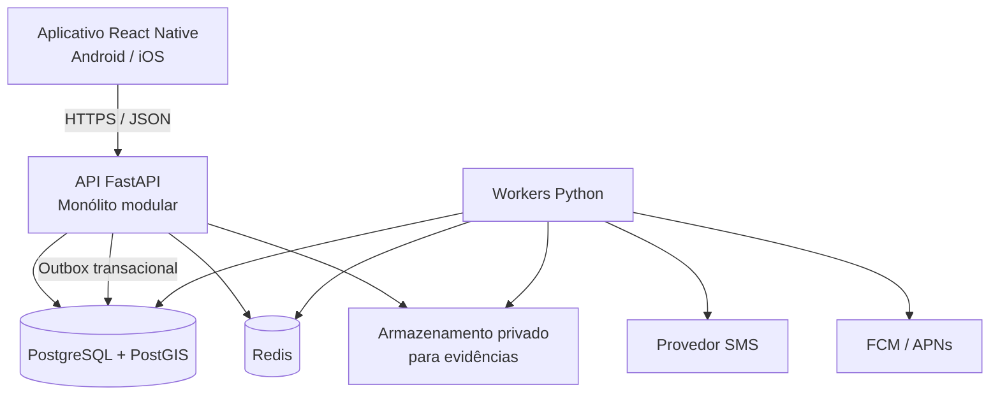
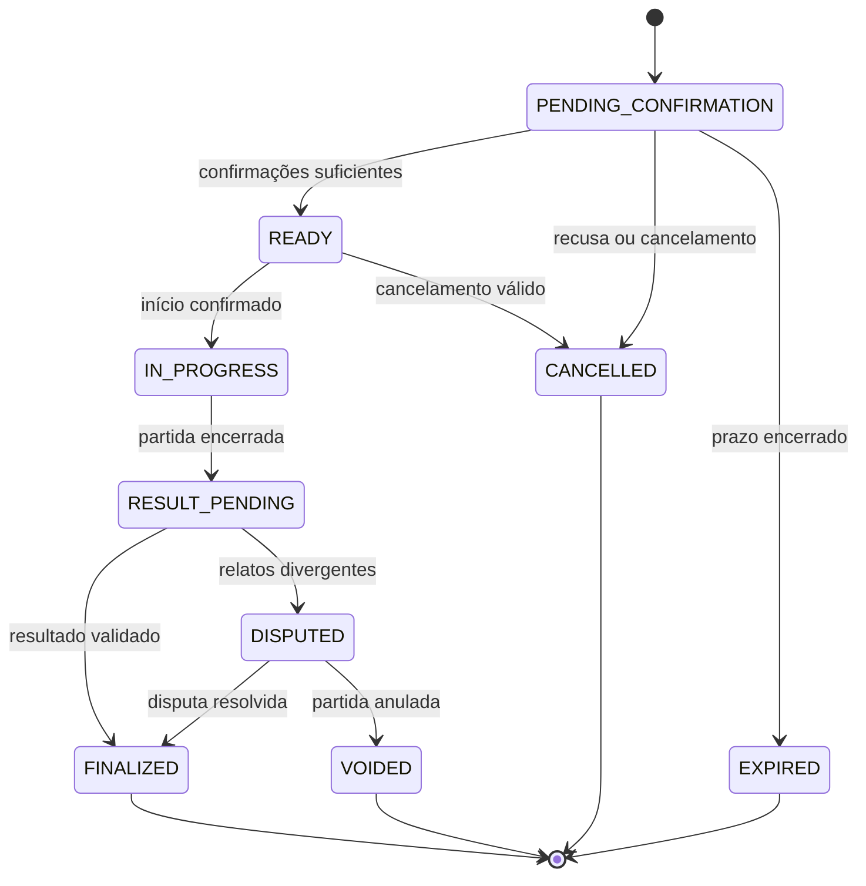

# JOGA — Documentação Técnica

**Versão:** 1.0  
**Status:** especificação-base para reconstrução do projeto  
**Data:** 1º de novembro de 2026  
**Escopo:** aplicativo Android/iOS, API, banco de dados, workers e infraestrutura  
**Repositório do projeto:** https://github.com/kramirodev/Joga

> Este documento descreve a arquitetura-alvo. Ele não afirma que os componentes aqui especificados já estejam implementados. A implementação deve seguir as fases e os critérios de aceite definidos ao final.

---

## 1. Visão do produto

JOGA é uma plataforma mobile de matchmaking esportivo amador. O objetivo é conectar jogadores para partidas presenciais, formar equipes equilibradas e construir uma experiência competitiva confiável por modalidade.

O produto deve permitir que uma pessoa:

1. Crie uma conta usando um número de celular verificado.
2. Proteja o acesso à conta com passkey e mecanismos de sessão seguros.
3. Cadastre modalidades, nível, preferências e disponibilidade.
4. Encontre partidas e locais próximos, por localização atual ou região escolhida manualmente.
5. Entre em filas casuais ou ranqueadas.
6. Receba uma partida e consulte equipe, participantes, horário e local.
7. Confirme presença e participe da validação do resultado.
8. Consulte histórico, classificação e evolução competitiva.

### 1.1 Decisões de produto já tomadas

| Tema | Decisão |
|---|---|
| Plataforma do jogador | Aplicativo Android e iOS. |
| Site público | Não será desenvolvido no MVP. O produto do jogador será exclusivamente mobile. |
| Cadastro | Número de celular obrigatório e verificado por código temporário. |
| Identidade interna | UUID próprio; telefone nunca será a chave primária. |
| Autenticação preferencial | Passkeys, usando os recursos nativos das plataformas. |
| SMS | Usado para verificar o controle inicial do número e em fluxos de recuperação controlados; não será o único fator de segurança. |
| Localização | Em primeiro plano, apenas quando necessária; busca manual será sempre oferecida como alternativa. |
| Rastreamento contínuo | Não será solicitado no MVP. |
| Backend | FastAPI em um monólito modular. |
| Persistência oficial | PostgreSQL com PostGIS. |
| Redis | Cache, limites, presença e distribuição de eventos; nunca será a fonte oficial do estado de uma partida ou do rating. |
| Processamento assíncrono | Workers separados da API. |
| Painel administrativo | Fora do MVP público. Ações administrativas críticas deverão ter ferramentas internas restritas e auditadas. |

### 1.2 Princípios inegociáveis

- Integridade competitiva prevalece sobre velocidade de formação de partidas.
- Toda mudança relevante de estado deve ser validada no servidor.
- O cliente nunca determina MMR, Trust Factor, resultado oficial ou permissões.
- O banco relacional é a fonte da verdade.
- Requisições repetidas não podem criar partidas, relatórios ou alterações de rating duplicadas.
- Dados de localização e telefone devem ser tratados como dados pessoais e minimizados.
- Falhas de SMS, push, Redis ou WebSocket não podem corromper o estado competitivo.
- Segurança deve ser testada continuamente, não adicionada apenas antes do lançamento.

---

## 2. Escopo e exclusões

### 2.1 Incluído no produto

- Aplicativo mobile para Android e iOS.
- API autenticada para o aplicativo.
- Cadastro e gestão de conta por telefone verificado.
- Passkeys e gestão de sessões/dispositivos.
- Perfil de jogador, modalidades e preferências.
- Localização aproximada/atual e busca manual por região.
- Locais esportivos e disponibilidade.
- Filas casuais e ranqueadas.
- Formação e confirmação de partidas.
- Comunicação em tempo real e notificações push.
- Registro e validação de resultados.
- Rating/MMR por modalidade e histórico imutável de alterações.
- Sistema separado de confiança e sinais antifraude.
- Denúncias, disputas e auditoria.

### 2.2 Fora do MVP

- Site público para jogadores.
- Aplicativo desktop.
- Marketplace ou reserva/pagamento de quadras.
- Assinatura Premium com vantagens competitivas.
- Kafka, Kubernetes e arquitetura de microserviços.
- Antifraude baseado em machine learning.
- Torneios, temporadas complexas e premiações.
- Rastreamento contínuo em segundo plano.
- Chat privado completo entre usuários.

Esses itens poderão ser avaliados após o núcleo de partidas, resultados e rating estar estável. Não devem bloquear o primeiro lançamento.

---

## 3. Arquitetura geral

### 3.1 Estilo arquitetural

Adotar um **monólito modular**, com módulos organizados por domínio e processos separados para API e workers. A separação de processos não significa separar o sistema em microserviços: todos compartilham contratos de domínio e o PostgreSQL como fonte de verdade.



### 3.2 Responsabilidade de cada componente

**Aplicativo React Native**
- Interface de jogador, navegação e estado local.
- Integração nativa com localização, passkeys, armazenamento seguro e notificações.
- Validação de experiência do usuário, sem substituir validações do servidor.
- Não armazenar segredos permanentes em código, arquivos de configuração públicos ou AsyncStorage.

**API FastAPI**
- Autenticação e autorização.
- Regras de negócio e validação de transições.
- Operações transacionais no PostgreSQL.
- Emissão de eventos por Outbox.
- Limites, paginação, validação de entrada e contratos de API.

**PostgreSQL + PostGIS**
- Fonte da verdade para contas, filas, partidas, participantes, resultados, rating, disputas e auditoria.
- Constraints, índices e transações para proteger invariantes competitivas.
- Consultas geoespaciais para locais e regiões.

**Redis**
- Cache de dados não autoritativos.
- Rate limiting distribuído, presença temporária e Pub/Sub.
- Dados efêmeros com TTL.
- Não deve ser a única cópia de filas, resultados, MMR ou estado de partidas.

**Workers Python**
- Processamento de filas e formação de partidas.
- Publicação de eventos da Outbox.
- Envio de SMS e push.
- Expiração de reservas/filas e tarefas de reconciliação.
- Processamento de resultado e rating após validação.

### 3.3 Tecnologias recomendadas

| Camada | Tecnologia-base | Observações |
|---|---|---|
| Mobile | React Native + TypeScript | Android e iOS; módulos nativos para passkeys, localização e integridade. |
| API | Python + FastAPI | Monólito modular e contratos OpenAPI. |
| Validação | Pydantic | Schemas de entrada e saída explícitos. |
| ORM | SQLAlchemy 2.x | Sessões e transações explícitas. |
| Migrações | Alembic | Toda mudança de schema versionada. |
| Banco | PostgreSQL + PostGIS | Fonte da verdade e consultas geoespaciais. |
| Cache/eventos | Redis | Apenas funções auxiliares e efêmeras. |
| Testes | Pytest | Unitários, integração, concorrência e segurança. |
| Push | FCM e APNs | Por adaptadores; tokens vinculados a dispositivos. |
| SMS | Provedor intercambiável | Segredos fora do código; limites e monitoramento de custo. |
| CI | GitHub Actions | Lint, tipos, testes, auditorias e build. |

A escolha final de bibliotecas mobile para passkeys deve ser validada com protótipo nativo real em Android e iOS antes de fechar a implementação. Não depender de Expo Go para funcionalidades que exigem integração nativa; usar uma configuração de desenvolvimento que permita módulos nativos. Mesmo sem site público, o projeto precisará de um domínio técnico para associação segura do aplicativo, passkeys e, se adotados, links verificados. O uso e os requisitos serão validados na Fase 1; qualquer compra, registro, DNS ou hospedagem depende de autorização específica e não faz parte da Fase 0. Esse domínio pode servir somente arquivos estáticos de associação e redirecionamentos mínimos, sem oferecer uma interface web para jogadores.

---

## 4. Organização do código

Estrutura sugerida para o backend:

```text
backend/
├── app/
│   ├── main.py
│   ├── core/
│   │   ├── config.py
│   │   ├── security.py
│   │   ├── errors.py
│   │   ├── logging.py
│   │   └── permissions.py
│   ├── infrastructure/
│   │   ├── database/
│   │   ├── redis/
│   │   ├── sms/
│   │   ├── push/
│   │   ├── storage/
│   │   └── telemetry/
│   ├── modules/
│   │   ├── identity/
│   │   ├── users/
│   │   ├── sports/
│   │   ├── availability/
│   │   ├── locations/
│   │   ├── venues/
│   │   ├── matchmaking/
│   │   ├── matches/
│   │   ├── results/
│   │   ├── disputes/
│   │   ├── ratings/
│   │   ├── reputation/
│   │   └── notifications/
│   └── api/
│       └── v1/
├── workers/
│   ├── outbox_dispatcher.py
│   ├── matchmaking_worker.py
│   ├── notification_worker.py
│   └── maintenance_worker.py
├── migrations/
├── tests/
│   ├── unit/
│   ├── integration/
│   ├── concurrency/
│   ├── security/
│   └── contract/
├── scripts/
├── pyproject.toml
└── Dockerfile

mobile/
├── src/
│   ├── app/
│   ├── features/
│   │   ├── authentication/
│   │   ├── profile/
│   │   ├── sports/
│   │   ├── discovery/
│   │   ├── matchmaking/
│   │   ├── matches/
│   │   ├── results/
│   │   └── rankings/
│   ├── shared/
│   ├── services/
│   └── navigation/
├── android/
├── ios/
└── package.json

docs/
├── DOCUMENTACAO_TECNICA.md
├── ADR/
├── API.md
├── SECURITY.md
├── DATA_MODEL.md
└── RUNBOOK.md
```

Cada módulo de domínio deve manter suas regras, schemas, serviços e repositórios próximos. Evitar módulos genéricos gigantes e dependências circulares. Rotas HTTP devem ser finas: recebem a requisição, chamam um caso de uso e convertem o resultado em resposta.

---

## 5. Identidade, cadastro e autenticação

### 5.1 Princípio de identidade

O número de celular é um **identificador de contato verificado**, não uma prova definitiva de identidade civil nem uma garantia de uma pessoa por conta. Números podem ser compartilhados, reciclados, transferidos ou comprometidos por SIM swap.

O sistema deve garantir, no máximo, uma conta ativa associada a um número verificado por vez. Não deve afirmar que isso equivale a uma pessoa física única.

### 5.2 Fluxo de cadastro

1. O aplicativo recebe o número com código internacional e normaliza para E.164.
2. A API aplica limites por IP, dispositivo e número.
3. A API solicita ao provedor o envio de um código temporário.
4. O código é validado no servidor, com validade curta, uso único e limite de tentativas.
5. O backend confirma o telefone e cria a conta com UUID interno.
6. O aplicativo oferece o registro de uma passkey.
7. O usuário conclui perfil e preferências.

**Parâmetros iniciais propostos para OTP** (ajustáveis por risco e custo): código de 6 dígitos, validade de 5 minutos, até 5 tentativas por desafio, intervalo mínimo de 60 segundos entre reenvios e limites agregados por telefone/IP/dispositivo. Esses limites devem ser implementados no servidor e monitorados para impedir abuso e inflação de custos de SMS.

O código nunca deve aparecer em logs. Não armazenar OTP em texto puro: armazenar um hash/HMAC protegido por segredo do servidor, vinculado ao desafio, ao telefone, ao propósito e à expiração.

### 5.3 Proteção do número

- Normalizar e validar o telefone em E.164.
- Guardar o valor cifrado para operações que precisem exibi-lo ou enviá-lo.
- Manter um índice de busca/unicidade por HMAC do número normalizado, com chave secreta fora do banco.
- Não retornar telefone em perfil público nem em respostas de matchmaking.
- Não colocar telefone em logs, analytics ou identificadores de eventos.
- Registrar alterações de telefone em trilha de auditoria.
- Ter procedimento para número reciclado e conta antiga inativa.

A troca de telefone exige autenticação forte na conta atual e verificação do novo número. Se o usuário perdeu o acesso ao número e também à passkey, a recuperação deve usar um fluxo de risco elevado, com análise adicional e período de proteção. Receber um SMS no novo número, isoladamente, não deve ser suficiente para assumir uma conta existente.

### 5.4 Passkeys

Passkeys devem ser o método preferencial de autenticação após o cadastro. O dispositivo cria um par de chaves: a chave privada fica protegida pelo autenticador/plataforma, e o servidor armazena a chave pública e os metadados necessários.

Requisitos:
- Desafio criptográfico gerado pelo backend, aleatório, de uso único e com expiração.
- Verificação no backend da resposta, origem/RP ID esperado, desafio, flags de presença/verificação do usuário e assinatura.
- Registro de mais de uma passkey por usuário, quando suportado.
- Revogação individual de passkeys perdidas ou comprometidas.
- Fluxo de recuperação alternativo que não reduza a segurança a um SMS isolado.
- Não confiar exclusivamente em contadores de assinatura, pois credenciais sincronizadas podem ter comportamento diferente.

Implementações nativas devem usar os mecanismos de plataforma: Credential Manager no Android e Authentication Services no iOS, respeitando a configuração de domínio/RP exigida por cada sistema. A API deve ser independente da plataforma cliente.

**Domínio técnico obrigatório, sem site de produto:** a integração de passkeys no iOS exige domínio associado com o serviço `webcredentials` e arquivo `apple-app-site-association`. No Android, a configuração de credenciais/links pode exigir Digital Asset Links, publicado em `/.well-known/assetlinks.json`, conforme o recurso utilizado. Portanto, “app-only” significa não construir um site público ou frontend web; não significa que seja possível dispensar domínio, DNS e hospedagem HTTPS para os arquivos técnicos de associação. Os requisitos e a escolha do domínio serão validados na Fase 1. Registro, DNS e hospedagem exigem autorização específica e não fazem parte da Fase 0.

### 5.5 Sessões e tokens

- Access token de curta duração, com emissor, audiência, sujeito, sessão, expiração e identificador únicos.
- Refresh token opaco, aleatório e de alta entropia, armazenado no servidor apenas como hash.
- Rotação de refresh token em cada renovação.
- Reutilização de refresh token antigo deve revogar a família da sessão e gerar evento de segurança.
- Logout revoga a sessão no servidor.
- Usuário pode consultar e revogar dispositivos/sessões.
- Refresh token fica em armazenamento seguro do sistema operacional (Keychain/Keystore), nunca em armazenamento simples do aplicativo.
- Chaves de assinatura devem ser gerenciadas fora do código e ter rotação documentada.

### 5.6 Contas e dispositivos

Um usuário pode ter vários dispositivos confiáveis. Dispositivo não é identidade e fingerprint não deve ser usado como prova infalível. Guardar somente sinais necessários para segurança, como identificador de instalação aleatório, plataforma, versão do app, datas de vínculo e estado de integridade quando disponível.

Mecanismos como Play Integrity e App Attest podem adicionar sinais contra automação e adulteração. Eles não substituem autenticação, autorização ou validação de regras no backend.

---

## 6. Localização e privacidade

### 6.1 Política de permissão

- Solicitar localização somente quando o usuário abrir uma funcionalidade que dependa dela.
- Preferir permissão de uso em primeiro plano: `When In Use` no iOS e localização em primeiro plano no Android.
- O aplicativo deve continuar funcional quando o usuário conceder apenas localização aproximada.
- Não solicitar localização permanente/Always ou background no MVP.
- Explicar a finalidade antes de abrir a caixa de permissão do sistema.
- Oferecer seleção manual de cidade, bairro, região ou local esportivo.

### 6.2 Uso dos dados

A localização serve para ordenar e filtrar locais/partidas por proximidade. Ela não deve revelar a posição residencial exata de um jogador a outros participantes.

Modelo preferencial:
- Localização atual enviada quando o usuário realiza uma busca.
- Consulta geoespacial executada pelo backend.
- Persistência apenas da região/preferência necessária, se o usuário optar por salvar.
- Coordenadas temporárias, quando indispensáveis, com retenção curta e finalidade explícita.
- Não manter histórico de deslocamento.
- Não registrar coordenadas em logs ou ferramentas de analytics.
- Em respostas públicas, mostrar distância aproximada ou local de encontro, não coordenadas privadas do usuário.

### 6.3 PostGIS

- Armazenar locais esportivos como `geography(Point, 4326)` quando a consulta for por distância em metros.
- Criar índice espacial GiST.
- Usar `ST_DWithin` para filtrar por raio e `ST_Distance` para ordenação, considerando índices e limites de consulta.
- Validar latitude, longitude e raio no backend.
- Aplicar limites máximos de raio e paginação para evitar consultas dispendiosas.

### 6.4 Privacidade e LGPD

O tratamento deve observar finalidade, necessidade, transparência, segurança e direitos do titular. Antes do lançamento, definir aviso de privacidade, base legal por finalidade, retenção, canal para solicitações, política de exclusão e contratos com provedores de SMS, push, analytics e hospedagem. A documentação técnica não substitui avaliação jurídica ou de privacidade.

---

## 7. Domínio esportivo e matchmaking

### 7.1 Modalidades e perfis

Cada modalidade deve possuir suas próprias regras de composição, tamanho de equipe, duração, formato, faixa de rating e parâmetros de matchmaking. Um rating de futebol não deve ser reutilizado em vôlei, basquete ou outra modalidade.

Preferências do jogador podem incluir:
- Modalidades praticadas.
- Nível autodeclarado inicial.
- Formato de jogo.
- Disponibilidade.
- Raio/local preferido.
- Preferência casual ou ranqueada.

O nível autodeclarado serve como informação inicial e não deve ser confundido com rating competitivo validado.

### 7.2 Entrada em fila

A entrada em fila deve criar um registro persistente no PostgreSQL. O servidor valida:
- Usuário ativo e autenticado.
- Telefone verificado.
- Modalidade e formato válidos.
- Elegibilidade para casual/ranqueada.
- Ausência de outra entrada ativa incompatível.
- Preferências, local/raio e disponibilidade.
- Limites contra spam de entrada/saída.

A operação deve aceitar uma `Idempotency-Key` para impedir entradas duplicadas em retries.

### 7.3 Formação de partidas

O worker deve:
1. Selecionar entradas compatíveis no PostgreSQL.
2. Bloquear as linhas necessárias com `SELECT ... FOR UPDATE SKIP LOCKED`.
3. Revalidar elegibilidade e estado dentro da transação.
4. Escolher participantes e balancear equipes usando dados confiáveis do servidor.
5. Criar partida e participantes.
6. Alterar as entradas para estado associado à partida.
7. Registrar evento na Outbox.
8. Confirmar a transação.

A formação deve ser atômica no banco. Redis pode acelerar descoberta e notificação, mas uma falha no Redis não pode duplicar ou perder uma partida oficial.

### 7.4 Balanceamento

O motor de matchmaking deve considerar, conforme a modalidade:
- Rating por modalidade e formato.
- Incerteza/provisoriedade do rating, quando aplicável.
- Quantidade de jogadores necessária.
- Preferência de local e raio.
- Compatibilidade de horário.
- Tempo de espera.
- Restrições de elegibilidade.

O algoritmo deve ser determinístico para um mesmo conjunto de entradas e versão de parâmetros, quando possível. Registrar a versão do algoritmo e um resumo auditável dos critérios usados na formação, sem expor dados pessoais desnecessários.

### 7.5 Concorrência e integridade

Invariantes obrigatórias:
- Um jogador não participa de duas partidas simultâneas em estados ativos incompatíveis.
- Uma entrada ativa por jogador/modalidade/formato conforme regra definida.
- Uma partida tem tamanho e composição válidos para a modalidade.
- Uma transição inválida é recusada pelo domínio, mesmo que o endpoint seja chamado diretamente.
- Todo processamento de worker é idempotente.
- A mesma entrada não pode ser consumida por dois workers.

Usar constraints e índices únicos parciais no PostgreSQL sempre que possível, além de locks transacionais. Não confiar apenas em verificações feitas antes da transação.

---

## 8. Ciclo de vida da partida

### 8.1 Estados propostos



A transição deve ser implementada em um serviço de domínio central. Não permitir que cada endpoint altere o status livremente.

### 8.2 Confirmação e presença

- A partida formada possui prazo para confirmação.
- Ausência de confirmação pode liberar os demais participantes e expirar a partida conforme política.
- Presença pode ser confirmada por ação no aplicativo e, futuramente, por QR Code no local.
- GPS não é prova isolada de presença, pois pode ser manipulado e pode estar impreciso.
- Penalidades por ausência devem considerar falhas técnicas e permitir contestação.

### 8.3 Resultado

- Resultado é submetido por participantes autorizados, conforme regra da modalidade.
- Em partidas por equipes, uma estratégia inicial é exigir relatórios compatíveis dos representantes dos dois lados.
- Relatos divergentes levam a `DISPUTED`.
- Resultado em disputa não altera MMR.
- Participantes podem anexar evidências, dentro de limites de formato, tamanho e retenção.
- O servidor valida estrutura, autoria, prazo e permissões.
- A decisão final gera evento auditável e não apaga os relatos originais.

A quantidade de confirmações necessária deve ser configurável por modalidade e tamanho de partida. Não usar maioria simples como único mecanismo antifraude em cenários de colusão.

### 8.4 Disputas

A disputa deve registrar motivo, solicitante, participantes envolvidos, relatos, evidências, decisões, responsável pela resolução e timestamps. Administradores não devem editar diretamente resultados ou MMR sem gerar trilha de auditoria. Ações de alto impacto devem exigir segunda aprovação ou processo equivalente.

---

## 9. Rating, ranking e Trust Factor

### 9.1 Rating/MMR

- Rating separado por modalidade e formato competitivo.
- Partidas casuais não alteram rating ranqueado.
- O rating é calculado exclusivamente no backend.
- O cliente pode visualizar rating e histórico, mas nunca enviar o valor desejado.
- Toda alteração gera um registro imutável de histórico.
- Uma partida só pode gerar uma aplicação de rating por versão de cálculo.
- Correções devem gerar eventos compensatórios, sem apagar histórico anterior.
- Registrar versão do algoritmo, parâmetros, rating anterior, variação e rating posterior.

Para a primeira versão, implementar um motor Elo simples e testável por trás de uma interface `RatingEngine`. Não misturar algoritmos na mesma temporada sem versionamento e migração planejada. Avaliar Glicko-2 ou outro método somente após existir volume de partidas e dados suficientes para justificar maior complexidade.

### 9.2 Trust Factor

Trust Factor é separado do rating. Ele representa sinais de confiabilidade operacional, não habilidade esportiva.

Possíveis sinais, sempre sujeitos a política transparente:
- Verificação de telefone.
- Histórico de partidas concluídas.
- Ausências confirmadas e reincidentes.
- Cancelamentos em cima da hora.
- Disputas confirmadas após análise.
- Padrões técnicos de abuso, com revisão humana quando necessário.

Regras:
- Denunciar alguém não reduz automaticamente sua confiança.
- Uma suspeita isolada não deve gerar punição definitiva.
- Usuário deve poder contestar decisões relevantes.
- Cada alteração gera `trust_event` auditável com motivo/categoria.
- Trust Factor não pode ser usado secretamente para alterar MMR.
- Critérios que afetam elegibilidade competitiva precisam ser documentados e versionados.

---

## 10. Modelo de dados inicial

O modelo abaixo é lógico; nomes e normalização final serão definidos nas migrações. IDs internos devem ser UUIDs. Usar `timestamptz` para datas de evento e UTC no backend.

| Entidade | Responsabilidade e campos importantes |
|---|---|
| `users` | UUID, status, display name, created_at, deleted_at. |
| `user_phones` | user_id, telefone cifrado, HMAC de busca, verified_at, status. Índice único para telefone ativo. |
| `phone_challenges` | destino protegido, purpose, hash do código, expires_at, attempts, consumed_at. |
| `passkey_credentials` | user_id, credential_id único, public_key, metadata, created_at, last_used_at, revoked_at. |
| `devices` | user_id, installation_id, platform, app_version, integrity_state, linked_at, revoked_at. |
| `sessions` | user_id, device_id, refresh_token_hash, family_id, expires_at, revoked_at, last_seen_at. |
| `sports` | modalidade, status e regras base. |
| `sport_formats` | esporte, formato, quantidade e parâmetros de composição. |
| `user_sport_profiles` | user_id, sport_id, nível declarado e preferências. |
| `availabilities` | janelas de disponibilidade e timezone. |
| `venues` | local público/esportivo, endereço e geografia. |
| `user_location_preferences` | região preferida ou ponto aproximado salvo com consentimento. |
| `queue_entries` | user_id, sport/format, mode, status, preferências, joined_at, matched_at. |
| `matches` | modalidade, formato, modo, status, venue, horário e versão do algoritmo. |
| `match_participants` | match_id, user_id, team_id, confirmation_status e presença. |
| `teams` | equipes vinculadas à partida. |
| `match_result_reports` | autor, score, payload validado, created_at e estado. |
| `disputes` | partida, motivo, status, decisão e responsáveis. |
| `dispute_evidence` | metadados e referência privada a arquivos. |
| `rating_accounts` | usuário, modalidade, formato, rating atual e estado provisório. |
| `rating_events` | match_id único por aplicação/versão, before/after, delta, algoritmo e timestamp. |
| `trust_events` | categoria, origem, evidência/referência, decisão e contestação. |
| `idempotency_records` | chave, usuário, operação, hash da requisição e resposta/referência. |
| `outbox_events` | tipo, aggregate_id, payload mínimo, created_at, attempts, published_at. |
| `audit_logs` | ator, ação, recurso, motivo, timestamp e contexto seguro. |
| `security_events` | eventos de autenticação, sessão, abuso e risco. |

### 10.1 Constraints críticas

- `user_phones.phone_lookup_hash` único entre números ativos.
- `passkey_credentials.credential_id` único.
- `sessions.refresh_token_hash` único.
- `queue_entries` com índice único parcial para impedir mais de uma entrada ativa incompatível por usuário/modalidade/formato.
- `match_participants` único por `(match_id, user_id)`.
- Constraint ou regra transacional para impedir participação simultânea em partidas incompatíveis.
- `rating_events` único por partida, usuário e versão de aplicação.
- `idempotency_records` único por escopo de usuário/operação/chave.
- Chaves estrangeiras e regras de exclusão explícitas; não apagar histórico competitivo por cascata.

---

## 11. API e contratos

A API será versionada em `/api/v1`. Todas as respostas devem ter schemas explícitos; não retornar modelos ORM diretamente. Datas em ISO 8601/UTC. Erros devem usar formato consistente e não revelar detalhes internos.

### 11.1 Endpoints iniciais propostos

| Método e rota | Finalidade | Autenticação |
|---|---|---|
| `POST /api/v1/auth/phone-challenges` | Solicitar código SMS. | Pública, com rate limit rígido. |
| `POST /api/v1/auth/phone-challenges/{id}/verify` | Validar código e iniciar cadastro/recuperação. | Pública, limitada e vinculada ao desafio. |
| `POST /api/v1/auth/passkeys/registration/options` | Criar desafio de registro. | Sessão válida. |
| `POST /api/v1/auth/passkeys/registration/verify` | Validar e salvar passkey. | Sessão/desafio válido. |
| `POST /api/v1/auth/passkeys/authentication/options` | Criar desafio de autenticação. | Pública, com limites. |
| `POST /api/v1/auth/passkeys/authentication/verify` | Validar passkey e abrir sessão. | Pública, com desafio válido. |
| `POST /api/v1/auth/sessions/refresh` | Renovar sessão com rotação. | Refresh token. |
| `POST /api/v1/auth/sessions/logout` | Revogar sessão atual. | Sessão válida. |
| `GET /api/v1/users/me` | Consultar próprio perfil. | Usuário autenticado. |
| `PATCH /api/v1/users/me` | Alterar campos permitidos do perfil. | Usuário autenticado. |
| `GET /api/v1/sports` | Listar modalidades disponíveis. | Pública ou sessão, conforme política. |
| `GET /api/v1/venues/nearby` | Buscar locais próximos. | Sessão válida ou limite público estrito. |
| `PUT /api/v1/users/me/location-preference` | Salvar região preferida. | Usuário autenticado. |
| `POST /api/v1/queue-entries` | Entrar em uma fila. | Usuário elegível. |
| `GET /api/v1/queue-entries/me` | Consultar fila própria. | Usuário autenticado. |
| `DELETE /api/v1/queue-entries/{id}` | Sair da fila própria. | Dono da entrada. |
| `GET /api/v1/matches/{id}` | Consultar partida autorizada. | Participante ou papel autorizado. |
| `POST /api/v1/matches/{id}/confirmations` | Confirmar/recusar participação. | Participante. |
| `POST /api/v1/matches/{id}/results` | Enviar relatório de resultado. | Participante autorizado. |
| `POST /api/v1/matches/{id}/disputes` | Abrir disputa. | Participante autorizado. |
| `GET /api/v1/users/me/ratings` | Consultar ratings próprios. | Usuário autenticado. |

Os nomes são contratos iniciais, não implementação pronta. OpenAPI deve ser gerado e revisado durante o desenvolvimento.

### 11.2 Autorização

Autenticação responde “quem é o usuário”; autorização responde “o que ele pode fazer neste recurso”. Toda rota que recebe IDs deve validar propriedade, participação ou papel no recurso. UUID difícil de adivinhar não substitui autorização.

Exemplos:
- Um jogador não pode consultar dados privados de outro participante apenas trocando `match_id` ou `user_id`.
- Um usuário só altera o próprio perfil e preferências.
- Apenas participantes da partida podem confirmar ou relatar resultado.
- Uma operação administrativa não pode ser acessada por um usuário comum.
- Campos internos como `rating`, `trust_factor`, `role`, `status` e `verified_at` nunca podem ser alterados por mass assignment do cliente.

---

## 12. Segurança da API e do aplicativo

### 12.1 Controles obrigatórios

- HTTPS/TLS em todas as comunicações externas.
- Segredos em secret manager/variáveis de ambiente protegidas; nunca versionados.
- Credenciais distintas por ambiente e serviço.
- PostgreSQL e Redis em rede privada, sem exposição pública desnecessária.
- Usuários de banco com privilégio mínimo.
- Queries parametrizadas e ORM usado corretamente.
- Validação de entrada, tamanho, tipo, enum, paginação e limites.
- Rate limiting por usuário, IP, dispositivo, telefone e operação sensível.
- Proteção contra enumeração de contas e abuso de fluxos de negócio.
- Logs estruturados sem tokens, OTP, telefone completo, coordenadas precisas ou evidências privadas.
- Respostas de erro sem stack trace ou informação interna.
- Dependências fixadas e verificadas; atualização de segurança recorrente.
- Backups cifrados e testes periódicos de restauração.
- Upload de evidências com allowlist de tipos, limite de tamanho, verificação de conteúdo e armazenamento privado.

### 12.2 WebSocket e realtime

- Autenticar a conexão no handshake com credencial curta e adequada ao canal.
- Validar origem quando aplicável e limitar conexões por usuário/dispositivo/IP.
- Autorizar cada inscrição em canal pelo vínculo real do usuário com partida/recurso.
- Não aceitar UUID de usuário como prova de identidade.
- Revogar ou encerrar conexões quando a sessão for revogada.
- Não manter conexões em memória como único mecanismo de coordenação entre múltiplos processos.
- Usar Redis Pub/Sub ou mecanismo equivalente apenas para distribuir eventos; estado e autorização continuam no PostgreSQL/API.
- Reconectar com backoff e revalidar sessão/permissões.

### 12.3 Segurança de fluxo competitivo

- Proteger entrada/saída de fila contra automação e spam.
- Limitar criação de partidas, relatórios, denúncias e solicitações por janela de tempo.
- Revalidar participantes, estado e permissões dentro da transação.
- Impedir replay por idempotência e nonce/challenge quando aplicável.
- Não aceitar resultado, MMR ou Trust Factor calculado pelo cliente.
- Auditar ações administrativas e mudanças de regra.
- Não permitir que um administrador altere rating diretamente sem evento compensatório e justificativa.

### 12.4 Baseline de segurança

Usar **OWASP ASVS 5.0.0 Level 2** como referência mínima de verificação para o backend e controles reforçados selecionados de Level 3 para autenticação, contas administrativas, resultados, disputas e rating. Usar o **OWASP API Security Top 10** como checklist de desenho e testes. Usar o NIST SP 800-63B-4 como referência técnica para gestão de autenticadores, considerando que sua aplicação normativa original é voltada a sistemas governamentais dos EUA.

Isso não representa certificação formal. A equipe deve transformar os requisitos aplicáveis em testes e evidências rastreáveis.

---

## 13. Consistência, eventos e processamento assíncrono

### 13.1 Outbox transacional

Quando uma transação criar ou alterar uma entidade que exija notificação ou trabalho assíncrono, gravar o evento na tabela `outbox_events` dentro da mesma transação.

Exemplo: criar uma partida e registrar `match.created` deve ocorrer atomicamente. Um dispatcher lê a Outbox, publica o evento e marca o processamento. Se falhar após publicar e antes de marcar, pode publicar novamente; por isso os consumidores precisam ser idempotentes.

### 13.2 Idempotência

Operações críticas devem aceitar chave de idempotência e armazenar:
- Escopo (usuário/operação).
- Chave enviada.
- Hash do corpo da requisição.
- Estado e referência do resultado.
- Data de expiração/retenção.

A mesma chave com corpo diferente deve ser rejeitada. Uma repetição válida deve devolver o resultado original ou estado equivalente, sem repetir o efeito.

### 13.3 Reconciliação

Criar tarefas periódicas para detectar:
- Entradas de fila em estado incompatível com partida.
- Partidas expiradas sem transição final.
- Eventos de Outbox pendentes antigos.
- Sessões expiradas ainda marcadas como ativas.
- Rating sem evento correspondente ou aplicado mais de uma vez.
- Notificações com falhas recorrentes.

Reconciliação corrige apenas estados previstos e auditáveis. Não deve “adivinhar” resultados competitivos.

---

## 14. Observabilidade e operação

### 14.1 Logs, métricas e rastreamento

Implementar logs estruturados com `request_id`, `trace_id`, `user_id` interno quando necessário e identificadores de domínio. Não registrar PII desnecessária.

Métricas prioritárias:
- Taxa de sucesso/falha de cadastro e autenticação.
- Custo e falha de SMS por provedor.
- Sessões revogadas e tentativas suspeitas.
- Tamanho/idade das filas.
- Tempo entre entrada e formação de partida.
- Falhas de confirmação e expiração.
- Partidas disputadas e tempo de resolução.
- Erros e duração de aplicação de rating.
- Atraso da Outbox e falhas de workers.
- Latência e taxa de erro da API.
- Uso de CPU, memória, conexões do banco e Redis.

Alertas devem existir para aumento abrupto de OTP, falhas de autenticação, crescimento da fila de eventos, indisponibilidade do banco, workers parados e alterações incomuns de rating.

### 14.2 Ambientes

- `local`: desenvolvimento com dados fictícios.
- `test`: testes automatizados e integração.
- `staging`: ambiente próximo da produção, sem dados pessoais reais salvo necessidade e proteção específica.
- `production`: segredos e serviços isolados, acesso restrito e backups.

Nunca reutilizar credenciais entre ambientes. Compose local pode expor portas para a máquina de desenvolvimento, mas a configuração de produção deve manter banco e Redis em rede privada. Não usar credenciais padrão de desenvolvimento em produção.

### 14.3 Backup e recuperação

- Backups automáticos e criptografados do PostgreSQL.
- Política de retenção compatível com requisitos legais e operacionais.
- Teste documentado de restauração.
- RPO e RTO definidos antes do lançamento.
- Evidências em armazenamento privado com retenção definida.
- Plano de rotação de segredos e resposta a incidentes.

---

## 15. Estratégia de testes

### 15.1 Testes unitários

- Normalização e validação E.164.
- Expiração/uso único de OTP.
- Verificação de desafios de passkey.
- Regras de autorização.
- Transições da máquina de estados.
- Elegibilidade e compatibilidade de filas.
- Balanceamento de times.
- Cálculo de rating e arredondamentos.
- Regras de Trust Factor.

### 15.2 Testes de integração

Executar com PostgreSQL/PostGIS e Redis reais em containers, não apenas mocks. Testar migrações, constraints, transações, Outbox, workers, adaptadores de SMS/push e upload de evidências.

### 15.3 Testes de concorrência

Cenários obrigatórios:
- Dois workers tentam consumir as mesmas entradas.
- Um usuário envia múltiplas entradas simultâneas.
- Duas requisições tentam cancelar e formar a mesma fila ao mesmo tempo.
- Mesmo resultado é enviado repetidamente.
- Dois processos tentam aplicar rating para a mesma partida.
- Sessão é revogada enquanto existe conexão realtime.

Critério: nenhuma duplicidade competitiva, perda de participante ou aplicação dupla de rating.

### 15.4 Testes de segurança

- BOLA/IDOR em todos os recursos com identificador.
- Escalada de privilégio e mass assignment.
- Brute force e enumeração de telefone.
- Reuso de OTP, desafio expirado e replay de passkey.
- Rotação e reutilização de refresh token.
- Acesso indevido a canais WebSocket.
- Abuso de criação de conta, fila, denúncia e SMS.
- Manipulação de score, MMR, Trust Factor e status pelo cliente.
- Upload malicioso e acesso cruzado a evidências.
- Vazamento de segredos e PII em logs.

### 15.5 Qualidade automatizada

Pipeline inicial recomendado:
- Backend: Ruff, Mypy ou Pyright, Pytest, coverage, Bandit, Semgrep e `pip-audit`.
- Mobile: ESLint, TypeScript, testes unitários e auditoria de dependências.
- Repositório/imagens: secret scanning, Dependabot e Trivy.
- Build e testes de migração em pull requests.
- Bloquear merge quando lint, tipos, testes críticos ou verificações de segredo falharem.

---

## 16. Roadmap de implementação

A sequência normativa, os escopos e os critérios de saída são os definidos em `PLANS.md`. A tabela abaixo resume a mesma sequência para relacionar os domínios técnicos, sem criar fases adicionais ou alterar seus limites.

| Fase | Entrega técnica (resumo) |
|---|---|
| 0. Repositório e governança | Novo repositório JOGA e documentação governados; projeto independente. |
| 1. Prova técnica mobile/nativa | Provas Android/iOS para build, passkeys, localização e integrações críticas. |
| 2. Fundação de engenharia | Estrutura mobile/backend, ambiente local, CI e health checks. |
| 3. Identidade e segurança | Telefone, OTP, passkeys, sessões e recuperação segura. |
| 4. Perfil e descoberta | Perfil esportivo, catálogo, locais e busca manual/GPS. |
| 5. Filas e matchmaking | Filas persistentes, worker e formação idempotente de partidas. |
| 6. Ciclo de partidas | Confirmação, presença, expiração e máquina de estados. |
| 7. Resultados e disputas | Relatos, divergências, evidências e resolução auditável. |
| 8. Sistema competitivo | MMR versionado, ranking e Trust Factor separado. |
| 9. Comunicação em tempo real | WebSocket autorizado, Outbox, push e reconciliação. |
| 10. Hardening e piloto | Segurança, carga, observabilidade, backup/restore e lançamento controlado. |

As dependências e critérios de aceite de cada entrega permanecem definidos exclusivamente em `PLANS.md`.

### 16.1 Ordem de prioridade dentro do MVP

**Obrigatório para primeira versão competitiva:** cadastro seguro, passkey ou alternativa segura de acesso, perfil, modalidades, região/local, fila, formação de partida, confirmação, resultado validado, rating aplicado uma única vez, histórico e auditoria.

**Pode entrar depois do primeiro lançamento:** temporadas, torneios, ranking avançado, QR Code de presença, Trust Factor sofisticado, análise antifraude avançada e painel administrativo completo.

---

## 17. Critérios de aceite para produção

JOGA não deve ser considerado pronto para produção enquanto qualquer item crítico abaixo estiver pendente:

- [ ] Nenhuma API confia em `user_id` fornecido pelo cliente para identificar o usuário autenticado.
- [ ] Telefone não é chave primária e não aparece em respostas públicas ou logs.
- [ ] OTP tem uso único, expiração e limites de tentativas/envio.
- [ ] Passkeys são verificadas integralmente no backend, ou existe alternativa de autenticação aprovada para dispositivos incompatíveis.
- [ ] Refresh token é rotativo, revogável e protegido contra reutilização.
- [ ] Todas as rotas com IDs aplicam autorização no nível do objeto.
- [ ] Redis não é fonte oficial de estado competitivo.
- [ ] Formação de partidas é transacional e testada sob concorrência.
- [ ] Resultado em disputa não altera MMR.
- [ ] Rating é calculado no servidor e aplicado uma única vez.
- [ ] Alterações administrativas são registradas e justificadas.
- [ ] Localização não exige background e existe alternativa manual.
- [ ] Dados sensíveis não aparecem em logs, traces ou analytics.
- [ ] Backups foram restaurados em teste documentado.
- [ ] Testes automatizados cobrem fluxos críticos e cenários negativos.
- [ ] Alertas e runbooks cobrem falhas de autenticação, banco, workers e Outbox.
- [ ] Avisos, retenção e bases legais de tratamento de dados foram revisados para LGPD.

---

## 18. Riscos conhecidos e decisões pendentes

Esta lista atribui cada decisão à fase normativa de `PLANS.md`. Não significa que a decisão já foi tomada. Decisões que alterem arquitetura, segurança, dados ou contratos devem ser registradas em `docs/ADR/` com contexto, opções, decisão, consequências e data.

| Decisão pendente | Fase responsável | Limite/observação |
|---|---|---|
| Expo com development builds ou React Native CLI; versões e módulos nativos | 1 — Prova técnica mobile/nativa | Comparar por protótipos Android/iOS antes de fixar bibliotecas. |
| Biblioteca e fluxo de passkeys, RP ID, origem e associação Apple/Android | 1 — Prova técnica mobile/nativa | Validar nos dois sistemas. O domínio técnico é requisito; sua compra/registro/hospedagem não pertence à Fase 0 e exige autorização própria antes de qualquer ação externa. |
| Permissões de localização aproximada, precisa e negada e integração mobile | 1 — Prova técnica mobile/nativa | Provar o comportamento da plataforma; política de produto continua exigindo alternativa manual e sem rastreamento em segundo plano. |
| SMS sandbox/adaptador simulado para provas e integração real/provedor | 1 para validar adaptador; 3 para escolha e integração do fluxo de identidade | Não gerar custos nem usar credenciais reais sem autorização. |
| Política de números reciclados, recuperação e liberação de número | 3 — Identidade e segurança | SMS isolado não deve permitir assumir uma conta existente. |
| Política de retenção, bases/finalidades e solicitações LGPD para os dados de perfil e localização | 4 — Perfil e descoberta; revisão final em 10 — Hardening e piloto | Definir antes de persistir dados pessoais correspondentes; revisão não substitui avaliação jurídica. |
| Provedor de mapas/geocodificação, licenças, custos e limites | 4 — Perfil e descoberta | Comparar antes de integrar serviço externo. |
| Regras de confirmação de resultado e prazos por modalidade | 7 — Resultados e disputas | Definir antes de aceitar resultados competitivos. |
| Tamanho de grupos, tolerância de rating, espera e raio por modalidade | 5 — Filas e matchmaking | Versionar parâmetros e validar com testes/simulações. |
| Rating inicial, fator K, provisórios, sazonalidade e anulação | 8 — Sistema competitivo | Validar por simulações; manter histórico append-only e correções compensatórias. |
| Infraestrutura de produção, região, gestão de segredos, backup, RPO/RTO e custos | 10 — Hardening e piloto | Basear em estimativa de tráfego e requisitos LGPD; nenhuma implantação nesta decisão documental. |

Os critérios para `local` e `test`, incluindo quando Redis é realmente necessário, pertencem à Fase 2. Esta lista será refinada nas fichas das fases, sem antecipar a implementação.

---

## 19. Projeto anterior como referência conceitual

O projeto anterior está em um repositório independente. JOGA será desenvolvido do zero e não depende de auditoria, preservação operacional, migração, importação ou reutilização de código, arquitetura, banco ou histórico do projeto anterior. Uma consulta conceitual futura é opcional e não altera os contratos nem os critérios desta especificação.

---

## 20. Referências técnicas

As referências abaixo orientam decisões e verificações. Devem ser revisitadas durante a implementação para acompanhar revisões dos padrões e das plataformas.

- **OWASP Application Security Verification Standard (ASVS) 5.0.0:** https://asvs.owasp.org/ — baseline de requisitos técnicos de segurança.
- **OWASP API Security Top 10 (2023):** https://api-security.owasp.org/editions/2023/en/0x00-header/ — riscos de autorização por objeto, autenticação, consumo de recursos e abuso de fluxos de negócio.
- **NIST SP 800-63B-4 (2025):** https://pages.nist.gov/800-63-4/sp800-63b.html — gestão de autenticadores; trata uso de PSTN/SMS como restrito e recomenda considerar troca de SIM, portabilidade e comportamento anormal.
- **W3C Web Authentication Level 3:** https://www.w3.org/TR/webauthn-3/ — especificação de credenciais de chave pública e autenticação WebAuthn.
- **Android — permissões de localização:** https://developer.android.com/develop/sensors-and-location/location/permissions — localização aproximada/precisa e permissões em primeiro plano/segundo plano.
- **Android — Credential Manager:** https://developer.android.com/identity/credential-manager — integração de credenciais e passkeys.
- **Apple — Supporting passkeys:** https://developer.apple.com/documentation/authenticationservices/supporting-passkeys — configuração e uso de passkeys em apps Apple.
- **Apple — Associated Domains:** https://developer.apple.com/documentation/BundleResources/Entitlements/com.apple.developer.associated-domains — vínculo de domínios para `webcredentials` e outros serviços.
- **Android — Credential Manager prerequisites:** https://developer.android.com/identity/credential-manager/prerequisites — pré-requisitos e associações de domínio para credenciais.
- **Android — App Links / Digital Asset Links:** https://developer.android.com/training/app-links/configure-assetlinks — publicação do `assetlinks.json` para associação verificada de aplicativo e domínio.
- **Apple — Core Location authorization:** https://developer.apple.com/documentation/corelocation/requesting-authorization-to-use-location-services — preferência por permissão “When In Use” e solicitação contextual.
- **LGPD — Lei nº 13.709/2018:** https://www2.camara.leg.br/legin/fed/lei/2018/lei-13709-14-agosto-2018-787077-normaatualizada-pl.html — referência legal brasileira para tratamento de dados pessoais.

---

## 21. Início por fase

A próxima fase só começa quando solicitada explicitamente, conforme `PLANS.md`. Para a Fase 0, executar exclusivamente a preparação de repositório e governança definida em `harness/build/phase-00-repositorio-e-governanca.md`. A Fase 1 é a prova técnica mobile/nativa e só deve começar após a Fase 0 ser encerrada e uma nova solicitação ser aprovada.

Não antecipar estrutura de aplicação, Docker, CI funcional, banco, endpoints ou funcionalidades de fases posteriores durante a Fase 0.
