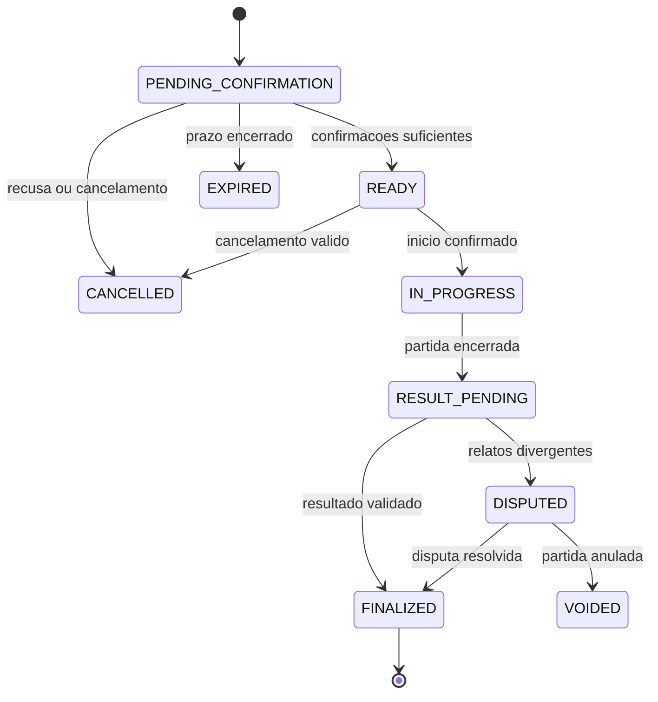
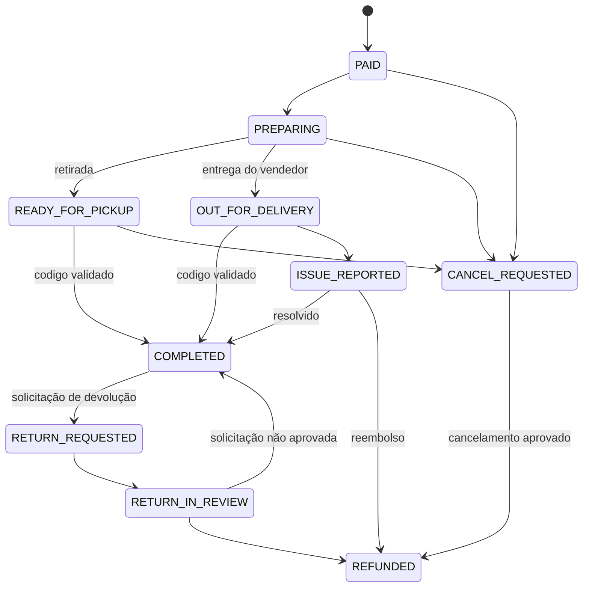

# JOGA — Documentação Técnica

**Versão:** 2.0  
**Status:** especificação técnica-alvo; não representa implementação concluída  
**Data:** 2 de novembro de 2026  
**Escopo:** aplicativo Android/iOS, painel web de gestão, API, PostgreSQL/PostGIS, Redis, workers e integrações comerciais  
**Nome do produto:** JOGA

> Este documento consolida a arquitetura-alvo do JOGA. Ele não afirma que os componentes especificados já estejam implementados. A ordem normativa e os limites de cada fase permanecem definidos em `PLANS.md`. O projeto é independente e não pressupõe migração de código, dados ou infraestrutura de um repositório anterior.

---

## 1. Visão técnica do produto

O JOGA é uma plataforma esportiva e comercial composta por duas experiências de usuário:

1. **Aplicativo mobile do consumidor:** matchmaking, partidas, lobbies, chat, amigos, clãs, descoberta de quadras, reservas e marketplace de produtos.
2. **Painel web de gestão:** ambiente autenticado para lojas, arenas e estabelecimentos administrarem exclusivamente produtos, estoque, pedidos, quadras e reservas originados no JOGA.

As duas experiências compartilham API, identidade, banco de dados e infraestrutura. O painel web não é um ERP e não administra automaticamente vendas presenciais ou operações externas ao JOGA. Não está previsto um site público independente para consumidores no escopo inicial; o Marketplace fica dentro do aplicativo.

O sistema deve manter domínios esportivos, sociais e comerciais separados logicamente dentro de um monólito modular. A integração entre eles ocorre por contratos explícitos e eventos auditáveis, sem permitir que transações comerciais influenciem o resultado competitivo.

## 1.1 Decisões de produto e arquitetura

| Tema | Decisão atual |
|---|---|
| Marca | JOGA; “y” é elemento intencional da identidade verbal |
| Nome de exibição pretendido do app | JOGA y JOGA |
| Painel web | JOGA y GESTÃO, responsivo e autenticado |
| Módulos comerciais | JOGA y LOJA e JOGA y QUADRA |
| Aplicativo do consumidor | Android e iOS |
| Marketplace | Dentro do aplicativo mobile; sem site público de consumidor no escopo inicial |
| Gestão | Site separado para lojistas, proprietários e funcionários |
| Escopo do painel | Somente operações originadas no JOGA; não é ERP geral |
| Esportes iniciais | Futebol 5x5 (10 jogadores no total) e vôlei |
| Duração de partida | Definida por configuração de esporte/formato; não livre por lobby |
| Fila de matchmaking | Uma fila lógica, com filtro de espaço público/privado/tanto faz |
| Horário de lobby | Data e horário específicos; matchmaking escolhe slot comum a partir das disponibilidades |
| Quadras públicas | Descoberta/local de encontro; reserva formal apenas se houver autorização e disponibilidade verificável |
| Quadras privadas | Cadastro, agenda, reserva e pagamento quando habilitados |
| Chat | Por lobby e por clã; sem chat global universal no escopo atual |
| Clãs | Abertos ou fechados, com ranking de troféus por modalidade |
| Lojas | Produtos com estoque alocado ao canal JOGA |
| Entrega | Retirada ou entrega organizada e executada pelo vendedor |
| Logística do JOGA | Sem transportadora própria, cotação, etiqueta ou rastreamento logístico centralizado no escopo atual |
| Confirmação de recebimento | Código de uso único gerado pelo backend e apresentado pelo comprador ao vendedor/entregador |
| Pagamentos | Provedor externo apropriado para marketplace; sem processador ou carteira própria |
| Dados oficiais | PostgreSQL como fonte da verdade |
| Backend | FastAPI em monólito modular |
| Redis | Cache, limites, presença e distribuição efêmera; não fonte oficial |
| Workers | Processos separados para tarefas assíncronas |

## 1.2 Princípios inegociáveis

- Toda mudança relevante de estado é validada no servidor.
- O cliente nunca determina MMR, Trust Factor, troféus, resultado oficial, estoque confirmado, status financeiro ou permissões.
- PostgreSQL é a fonte da verdade para estado esportivo, social e comercial.
- Redis não é fonte oficial de filas, partidas, reservas, pedidos, estoque ou rating.
- Requisições repetidas não podem duplicar reservas, pedidos, pagamentos, movimentações de estoque, mensagens de sistema ou aplicações de rating.
- Dados de telefone e localização são minimizados e protegidos.
- Permissões comerciais devem ser isoladas por organização/estabelecimento.
- Falhas de SMS, push, Redis, WebSocket ou provedor de pagamento não podem corromper o estado oficial.
- O sistema deve registrar eventos financeiros e competitivos de forma auditável.
- O escopo precisa ser entregue por etapas; não construir todo o ecossistema durante a prova técnica inicial.

## 2. Escopo e exclusões

### 2.1 Incluído na arquitetura-alvo

- Aplicativo mobile Android/iOS para consumidores e jogadores.
- Painel web responsivo e autenticado para gerenciadores.
- Identidade central, telefone verificado, passkeys e sessões seguras.
- Perfis, esportes e formatos.
- Preferências de quadra pública/particular/indiferente.
- Disponibilidade e matchmaking com horário concreto de partida.
- Lobbies manuais e lobbies formados pelo matchmaking.
- Chat persistente por lobby e por clã, inicialmente textual.
- Lista de amigos, convites e bloqueios.
- Clãs abertos/fechados e ranking de troféus por modalidade.
- Resultados, disputas, MMR individual e Trust Factor esportivo.
- Cadastro de estabelecimentos, quadras e agenda.
- Reserva/pagamento de quadras privadas.
- Catálogo comercial, variantes e estoque alocado ao canal JOGA.
- Pedidos, pagamentos, comissões, retirada e entrega pelo vendedor.
- Código de confirmação de recebimento.
- Cancelamentos, devoluções e reembolsos com trilha de auditoria.
- Denúncias e disputas comerciais, com comunicação pré-compra (loja/produto) e pós-compra (pedido) vinculadas ao contexto.
- Denúncias de usuários e moderação de chats de lobby e clã, com revisão humana.
- Publicidade patrocinada como módulo posterior, sem impacto competitivo.

### 2.2 Fora do escopo atual

- Site público independente para consumidores.
- App nativo separado para gerenciadores.
- ERP completo ou gestão de vendas presenciais/externas.
- Logística própria, cálculo/cotação de frete, contratação de transportadoras, geração de etiquetas e rastreamento centralizado.
- Integrações genéricas com ERPs e PDVs no primeiro lançamento.
- Carteira custodial ou processador de pagamentos próprio.
- Aluguel de equipamentos com caução, ciclo de devolução e controle de danos.
- Gestão completa de academias/clubes, matrículas, mensalidades, catracas e frequência.
- Marketplace de profissionais individuais.
- Torneios, chaves, fases, inscrições e premiações.
- Chat global universal.
- Upload livre de imagens, vídeos, áudios e arquivos nos chats.
- Kafka, Kubernetes e microserviços como requisito inicial.
- Antifraude completamente automatizado/decisório (a IA é auxiliar e casos sensíveis demandam revisão humana; denúncia não gera punição automática).
- Rastreamento contínuo em segundo plano.

## 3. Arquitetura geral

### 3.1 Estilo arquitetural

Adotar um **monólito modular**, com processos separados para API e workers. A aplicação mobile e o painel web acessam a mesma API. Os módulos compartilham PostgreSQL como fonte da verdade, mas mantêm fronteiras de domínio e regras próprias.


O painel web pode ser desenvolvido em React + TypeScript, mas o framework final deve ser registrado em ADR próprio. A escolha do framework web não precisa bloquear a prova técnica mobile da Fase 1.

### 3.2 Responsabilidades

**Aplicativo React Native**
- Interface de jogador/consumidor.
- Matchmaking, lobbies, chat, clãs, marketplace e reservas.
- Integração nativa com passkeys, localização, armazenamento seguro e push.
- Não contém regras autoritativas de MMR, estoque, preço final, pagamento ou permissão.

**Painel web de gestão**
- Interface autenticada para proprietários e funcionários.
- Cadastro de loja/estabelecimento, produtos, variantes, estoque JOGA, quadras, horários, pedidos e reservas.
- Consulta de comissões, status e relatórios básicos.
- Não administra vendas externas ao JOGA no escopo inicial.
- Não acessa dados de outra organização sem autorização explícita.

**API FastAPI**
- Autenticação, autorização e isolamento multi-tenant.
- Casos de uso e transições de estado.
- Transações de banco, controle de estoque e reserva.
- Integração com provedor de pagamento.
- Verificação de webhooks e códigos de recebimento.
- Outbox, rate limits, paginação, validação e contratos OpenAPI.

**PostgreSQL + PostGIS**
- Fonte da verdade de identidade, organizações, produtos, estoque, pedidos, pagamentos, quadras, reservas, lobbies, mensagens, clãs, partidas, resultados e ratings.
- Constraints, índices e transações para proteger invariantes.
- Consultas geoespaciais de jogadores e locais.

**Redis**
- Cache não autoritativo.
- Rate limiting distribuído, presença, Pub/Sub e dados efêmeros com TTL.
- Nunca será a única cópia de mensagens, lobbies, pedidos, reservas, estoque, partidas ou rating.

**Workers Python**
- Matchmaking e expiração de entradas.
- Processamento da Outbox.
- Notificações e push.
- Reconciliação de pagamentos e operações comerciais.
- Expiração de reservas temporárias de estoque e de horários.
- Processamento de rating e troféus após validação.

## 4. Organização do código

Estrutura sugerida do monorepo:

```text
mobile/
  src/
    app/
    features/
      authentication/
      profile/
      sports/
      matchmaking/
      lobbies/
      chat/
      friends/
      clans/
      matches/
      results/
      rankings/
      venues/
      bookings/
      marketplace/
      orders/
    shared/
    services/
    navigation/
  android/
  ios/

management-web/
  src/
    app/
    features/
      authentication/
      organizations/
      staff/
      stores/
      catalog/
      inventory/
      orders/
      fulfillment/
      venues/
      bookings/
      payments/
      reports/
    shared/

backend/
  app/
    main.py
    core/
      config.py
      security.py
      errors.py
      logging.py
      permissions.py
      tenancy.py
    infrastructure/
      database/
      redis/
      sms/
      push/
      payments/
      storage/
      telemetry/
    modules/
      identity/
      users/
      organizations/
      memberships/
      sports/
      sport_formats/
      availability/
      locations/
      venues/
      bookings/
      matchmaking/
      lobbies/
      chat/
      friends/
      clans/
      matches/
      results/
      disputes/
      ratings/
      reputation/
      moderation/
      marketplace_catalog/
      inventory/
      orders/
      payments/
      merchant_conversations/
      commerce_disputes/
      fulfillment/
      advertising/
      notifications/
    api/
      v1/
  workers/
  migrations/
  tests/
  scripts/
  pyproject.toml
  Dockerfile

docs/
  JOGA_DOCUMENTACAO_CONCEITO_PRODUTO.md
  JOGA_DOCUMENTACAO_TECNICA.md
  ADR/
  API.md
  SECURITY.md
  DATA_MODEL.md
  RUNBOOK.md

infra/
.github/
harness/
AGENTS.md
GOALS.md
PLANS.md
PROMPTS.md
README.md
```

Cada módulo mantém suas regras, schemas, serviços e repositórios próximos. Rotas HTTP devem ser finas. Evitar módulos genéricos gigantes e dependências circulares.

## 5. Identidade, contas e autorização

### 5.1 Identidade central

Uma pessoa poderá possuir uma conta JOGA e assumir diferentes contextos:

- Jogador/consumidor.
- Proprietário de estabelecimento.
- Funcionário/gerenciador de estabelecimento.

Não exigir perfil esportivo para utilizar o painel de gestão. Não criar uma conta separada para cada papel.

O identificador interno será UUID. Número de telefone é contato verificado, não prova de identidade civil nem chave primária.

### 5.2 Organização e isolamento comercial

Modelar organizações/estabelecimentos e seus membros explicitamente:

- `organizations`: entidade comercial.
- `organization_memberships`: vínculo entre usuário e organização.
- `organization_roles` ou permissões equivalentes: proprietário, administrador, operador e permissões específicas.
- `stores` e `venues`: perfis comerciais vinculados à organização, conforme o tipo de negócio.

Toda consulta ou mutação comercial deve validar organização, associação do usuário, papel e recurso específico. UUID difícil de adivinhar não substitui autorização.

Um operador de uma loja só pode ver produtos, estoque, pedidos, pagamentos e dados necessários daquela loja. Um funcionário de uma arena só pode administrar quadras e reservas autorizadas.

### 5.3 Telefone e OTP

O número deve ser normalizado em E.164. Aplicar rate limits por IP, dispositivo, telefone e operação. OTP de uso único, expiração curta, limite de tentativas e armazenamento como hash/HMAC protegido por segredo. Não registrar OTP ou telefone completo em logs.

Parâmetros iniciais sugeridos: seis dígitos, validade de cinco minutos, até cinco tentativas por desafio e intervalo mínimo de 60 segundos para reenvio, sujeitos a teste de abuso e custo.

O número poderá ser reciclado, compartilhado ou comprometido por SIM swap. SMS não deve ser o único método de recuperação de conta.

### 5.4 Passkeys e sessões

Passkeys serão o método preferencial após o cadastro. O backend gera e valida desafios de uso único, origem/RP ID, flags e assinatura. Registrar múltiplas credenciais quando suportado, permitir revogação individual e oferecer recuperação de risco elevado.

O protótipo da Fase 1 deve validar Android e iOS com mecanismos nativos: Credential Manager no Android e Authentication Services no iOS. A estratégia de framework foi decidida em favor do Expo development build com `expo prebuild` (ADR 0009); a biblioteca de passkeys ainda depende de prova em ambas as plataformas.

Access tokens de curta duração; refresh tokens opacos, aleatórios, armazenados no servidor como hash e rotacionados. Reutilização de token antigo revoga a família da sessão. Tokens ficam em Keychain/Keystore no aplicativo e em armazenamento seguro equivalente no navegador.

Para áreas administrativas/comerciais, avaliar controles reforçados, reautenticação para ações financeiras e registro de auditoria.

### 5.5 Domínio técnico

Mesmo sem site público para consumidores, será necessário um domínio técnico protegido para associações de passkeys/aplicativos e arquivos de verificação, conforme os recursos usados. Isso não equivale a construir um site público do JOGA.

## 6. Localização e privacidade

- Solicitar localização somente quando uma funcionalidade precisar dela.
- Priorizar uso em primeiro plano; não solicitar rastreamento contínuo em segundo plano no MVP.
- Oferecer localização aproximada e busca manual por região.
- Não revelar a posição residencial exata de um jogador a outros participantes.
- Não armazenar histórico de deslocamento.
- Consultas geoespaciais devem aplicar raio máximo, paginação e índices GiST.
- Para usuários, coordenadas devem ser processadas com minimização e retenção curta quando persistência não for necessária.
- A localização serve para sugerir região e locais; não prova presença ou resultado competitivo.

Usar PostGIS com `geography(Point, 4326)` quando a consulta envolver distâncias em metros, índice GiST, `ST_DWithin` para filtro e `ST_Distance` para ordenação.

O tratamento deverá observar a LGPD: finalidade, necessidade, transparência, segurança, retenção, direitos do titular e contratos com operadores/provedores. Avisos e bases legais precisam de revisão jurídica antes do lançamento.

## 7. Catálogo esportivo e formatos

### 7.1 Modalidades iniciais

O catálogo inicial inclui:

- Futebol 5x5, total de 10 participantes, duas equipes de cinco.
- Vôlei, com composição exata do formato a ser validada antes da implementação definitiva.

Cada formato terá configuração própria e versionada:

- Quantidade total de participantes.
- Composição das equipes.
- Duração padrão em minutos.
- Regras de confirmação e encerramento.
- Requisitos de local e espaço.
- Elegibilidade casual/ranqueada.

A duração será fixa por esporte/formato. O lobby não poderá escolher uma duração arbitrária. Ao criar o lobby, o backend copia a duração configurada para o registro da partida, preservando o valor histórico mesmo se a configuração mudar futuramente.

### 7.2 Preferências de quadra

Cada usuário poderá definir uma preferência padrão:

- `PUBLIC_ONLY`.
- `PRIVATE_ONLY`.
- `ANY`.

A preferência poderá ser sobrescrita para uma entrada específica na fila. O sistema deve guardar a preferência efetiva usada na formação.

## 8. Matchmaking e agendamento

### 8.1 Uma única fila lógica

Não criar filas independentes por tipo de quadra. O matchmaking opera sobre entradas persistentes e usa a preferência de espaço como restrição de compatibilidade.

A interseção de preferências deve ser respeitada:

- `PUBLIC_ONLY` + `ANY` resulta em pública.
- `PRIVATE_ONLY` + `ANY` resulta em particular.
- `PUBLIC_ONLY` + `PRIVATE_ONLY` é incompatível para um mesmo lobby.
- `ANY` + `ANY` permite ambas.

Se não houver uma categoria de local compatível, não formar o lobby como se houvesse compatibilidade. O sistema poderá aguardar novos participantes ou solicitar ajuste de preferência.

### 8.2 Horário concreto por lobby

O usuário pode informar janelas de disponibilidade. O algoritmo procura um intervalo comum e, ao formar o lobby, seleciona e registra uma data/hora específica.

Todo lobby deve ter:

- `scheduled_start_at` em `timestamptz`.
- `sport_format_id` e versão/configuração aplicada.
- `duration_minutes` copiada da configuração do formato.
- `scheduled_end_at` calculada pelo backend.
- Fuso de apresentação adequado à região do local.

Lobbies manuais exigem data e horário concretos na criação. A duração vem do formato; não é escolhida livremente.

### 8.3 Localização calculada pelo matchmaking

O matchmaking calculará uma região de encontro a partir das localizações aproximadas/autorizadas e preferências dos participantes. Não usar automaticamente o primeiro jogador ou o criador como centro único. O cálculo deve equilibrar deslocamento e privacidade.

### 8.4 Formação transacional

O worker deve:

1. Selecionar entradas compatíveis no PostgreSQL.
2. Bloquear linhas necessárias com `SELECT ... FOR UPDATE SKIP LOCKED` ou estratégia equivalente.
3. Revalidar elegibilidade, horário, preferência de espaço e estado dentro da transação.
4. Selecionar participantes e balancear equipes no servidor.
5. Criar lobby, partida e participantes.
6. Registrar o horário concreto e a duração configurada.
7. Atualizar as entradas da fila.
8. Registrar eventos na Outbox.
9. Confirmar a transação.

Uma falha no Redis não pode duplicar ou perder uma partida oficial.

### 8.5 Invariantes

- Um jogador não participa de partidas simultâneas incompatíveis.
- Uma entrada ativa incompatível não pode ser duplicada.
- Uma partida possui tamanho e formato válidos.
- A preferência de espaço usada na formação fica registrada.
- Todo processamento do worker é idempotente.
- Constraints e locks protegem as invariantes; não depender apenas de verificações anteriores à transação.

## 9. Lobbies, quadras e votação

### 9.1 Tipos de lobby

Separar no modelo:

- `origin`: `MANUAL` ou `MATCHMAKING`.
- `visibility`: `OPEN` ou `CLOSED`.

Lobby manual exige data e horário fixos. Pode ser aberto para descoberta ou fechado por convite.

Lobby do matchmaking é criado pelo sistema após a formação de um grupo compatível. Para os lobbies abertos do matchmaking, não existe proprietário com poder unilateral de escolher ou trocar a quadra.

### 9.2 Votação de troca de quadra

A votação é permitida somente em lobby aberto originado pelo matchmaking. Não habilitar em lobbies fechados ou lobbies criados manualmente.

Regras:

- Qualquer participante elegível pode propor uma alternativa.
- Apenas uma votação pode ficar ativa por lobby.
- Cada participante possui um voto por proposta.
- A proposta precisa respeitar a categoria permitida (`PUBLIC_ONLY`, `PRIVATE_ONLY` ou `ANY`) registrada no lobby.
- A quadra candidata precisa atender ao mesmo horário, duração, modalidade e demais restrições.
- O backend recalcula disponibilidade antes de concluir a alteração.

**Quórum e aprovação iniciais:** pelo menos 50% dos participantes elegíveis devem votar; entre os votos válidos, “Sim” precisa ser estritamente maior que 50%. Empate, maioria “Não” ou falta de quórum rejeitam a proposta. Abstenções não entram na proporção Sim/Não, mas não ajudam a atingir o quórum.

A mudança só é aplicada após a confirmação da disponibilidade e das condições comerciais. Se houver reserva ou pagamento anterior, o sistema deve exigir resolução explícita de cancelamento/reembolso antes de substituir o local. Votação aprovada não cancela reserva paga automaticamente.

### 9.3 Espaços públicos e privados

Locais públicos podem ser cadastrados e recomendados como ponto de encontro, mas não devem ser apresentados como formalmente reserváveis sem autorização e disponibilidade verificável.

Locais privados podem oferecer horários reserváveis. A reserva precisa bloquear o intervalo correspondente em transação, com proteção contra dupla reserva.

## 10. Ciclo de vida da partida e resultados

Estados propostos:



As transições devem ser implementadas em serviço de domínio central. Não permitir alteração livre de status por endpoint. A quantidade e o tipo de confirmações são configuráveis por formato. Denúncia isolada não determina punição; relatos divergentes levam a `DISPUTED`, e resultado disputado não altera MMR até a resolução.

### 10.1 Capitães

Nas partidas formadas pelo matchmaking, cada equipe terá um capitão simbólico, escolhido automaticamente pelo backend.

- O capitão não terá autoridade administrativa sobre os demais jogadores e não poderá decidir unilateralmente o resultado. Sua função é representar a equipe na comunicação e registrar uma confirmação adicional do resultado, que o sistema tratará como informação adicional, não como decisão absoluta.
- A seleção segue esta ordem de prioridade:
  1. Maior Trust Factor esportivo.
  2. Maior número de partidas válidas realizadas.
  3. Maior MMR da modalidade/formato.
  4. Maior idade, em caso de empate nos critérios anteriores.
- A seleção deve ser determinística, registrada na partida e auditável. Os critérios (inicialização do Trust Factor de novos jogadores, empates finais e substituição por ausência) permanecem pendentes de definição (seção 26).
- O conceito define capitão apenas para partidas formadas pelo matchmaking. Lobbies manuais ficam sem capitão até que o produto decida o contrário (seção 26); os endpoints de confirmação não devem exigir capitão nesses casos.

### 10.2 Relato e confirmação do resultado

- Ao final da partida, todos os participantes devem relatar o resultado individualmente, selecionando a equipe vencedora ou empate, quando o formato permitir.
- Os capitães podem registrar a confirmação de suas respectivas equipes.
- Os relatos individuais são visíveis aos demais participantes da partida. A exposição é intencional (responsabilidade social) e deve respeitar autorização: somente participantes da partida podem consultar os relatos e as confirmações; nenhuma consulta externa.
- O prazo de relato será limitado e configurável entre 5 e 10 minutos após o encerramento da partida. Os limites da faixa são validados no servidor; o valor efetivo por formato permanece pendente (seção 26).
- Jogadores que não relatarem dentro do prazo são registrados como relatos anulados. Relatos anulados não contam como favoráveis a nenhum resultado e são apresentados separadamente, sem interpretação automática de concordância ou discordância.

### 10.3 Divergências e validação

- O backend compara os relatos e as confirmações dos capitães. Divergências isoladas não interrompem automaticamente a validação: o resultado majoritário pode ser aceito quando a divergência estiver dentro da tolerância configurável por modalidade e quantidade de participantes. O valor base da tolerância permanece pendente (seção 26) e deve ser validado antes do uso.
- Quando mais de 50% dos relatos válidos divergirem do resultado predominante, a partida entra em `DISPUTED`. Quando a divergência for exatamente de 50%, aplica-se o fluxo de desempate da seção 10.4.
- A disputa é medida de proteção, não mecanismo para anular partidas automaticamente. A anulação é considerada apenas como última alternativa, depois de avaliadas as evidências.

### 10.4 Desempate exato em 50% — segunda votação e análise de confiabilidade

Regra aprovada para o caso de divergência exatamente igual a 50% (conceito §9.4; ADR 0008).

1. **Segunda confirmação.** O backend abre uma nova rodada de confirmação para todos os participantes da partida. Cada jogador pode confirmar ou corrigir a resposta anterior. A segunda rodada tem prazo curto e configurável; o valor efetivo permanece pendente (seção 26).
2. **Histórico preservado.** Nenhum relato é sobrescrito: a primeira votação é mantida integralmente para auditoria, e cada confirmação/correção da segunda rodada é registrada de forma append-only com ator e timestamp.
3. **Análise interna e invisível.** Se a segunda rodada continuar exatamente empatada em 50%, a partida entra em análise interna de confiabilidade, sem exposição de indicadores aos participantes:
   - Avalia cada relato individualmente — não por média simples de Trust Factor do grupo — impedindo que um grupo vença apenas acumulando contas de alta reputação.
   - Sinais avaliados: consistência de votos entre as rodadas; histórico competitivo; coerência em alterações de voto; detecção de padrões de comportamento coordenado ou manipulação.
   - Os relatos dos capitães (selecionados por Trust Factor, seção 10.1) funcionam como sinais relevantes pela confiabilidade de seu histórico, sem peso automático de voto adicional e sem autoridade para determinar o resultado sozinhos.
   - Os indicadores internos e a análise nunca são exibidos aos participantes; servem exclusivamente ao sistema.
4. **Desfechos.** O sistema tenta resolver com base nos indicadores; se as evidências não permitirem conclusão segura, o caso vai para revisão humana. A anulação permanece como último recurso.
5. **MMR congelado.** Durante as duas rodadas e a análise, nenhuma aplicação de rating é permitida: o rating só é aplicado após decisão final validada, via mecanismo idempotente (seção 11.1).

### 10.5 Disputas de partida

Uma partida em `DISPUTED` não gera aplicação de rating.

- O sistema reúne: relatos de cada participante; confirmações dos capitães; histórico de alterações e confirmações; denúncias relacionadas à partida; histórico de confiabilidade relevante dos envolvidos; outras evidências disponíveis e pertinentes.
- A primeira análise pode ser automatizada por regras de consistência e mecanismos de detecção de comportamento suspeito. Casos inconclusivos ou com indícios relevantes de fraude podem ser encaminhados para revisão humana.
- Decisões possíveis: confirmar o resultado predominante; solicitar informações adicionais; corrigir o resultado quando houver evidência suficiente; aplicar medidas de integridade quando houver fraude comprovada; anular a partida somente quando não houver alternativa confiável.
- Toda decisão é registrada com justificativa auditável, ator, timestamp e mecânica append-only; correções posteriores geram eventos compensatórios (seção 11.1).

### 10.6 Integridade do sistema de resultados

- O sistema deve proteger relatos contra manipulação por votos coordenados, contas falsas e denúncias abusivas, com mecanismos próprios de detecção de padrões suspeitos. O balanceamento de MMR não é tratamento suficiente contra fraude.
- Resultados não confirmados ou em disputa não alteram MMR. A plataforma preserva histórico auditável dos relatos originais e das decisões finais.

## 11. Rating, Trust Factor e justiça competitiva

### 11.1 MMR

- Separado por modalidade e formato competitivo.
- Calculado exclusivamente no backend.
- Partidas casuais não alteram MMR ranqueado.
- Uma partida só pode gerar uma aplicação de rating por usuário/versão de cálculo.
- Toda alteração gera evento imutável com valor anterior, delta, valor posterior e versão do algoritmo.
- Correções geram eventos compensatórios, sem apagar histórico.
- Começar com Elo simples por trás de interface `RatingEngine`; avaliar Glicko-2 ou outro método apenas quando houver dados que justifiquem.

### 11.2 Trust Factor esportivo

Trust Factor representa confiabilidade operacional em partidas, não habilidade esportiva nem reputação comercial.

Sinais possíveis: ausências confirmadas e reincidentes, cancelamentos em cima da hora, disputas confirmadas após análise e padrões de abuso. Denúncia isolada não reduz automaticamente o indicador. Decisões relevantes devem permitir contestação e gerar `trust_events` auditáveis.

### 11.3 Separação de sistemas

Compras, anúncios patrocinados, assinatura, gasto em quadras ou pagamento a estabelecimentos nunca alteram MMR, Trust Factor esportivo ou troféus de clã.

## 12. Amigos, chat e clãs

### 12.1 Lista de amigos

Modelar solicitações, vínculos, bloqueios e preferências de notificação. Convites para lobby precisam respeitar bloqueios, privacidade e limites contra spam.

### 12.2 Chat por lobby e por clã

Não haverá chat global universal no escopo atual. Conversas permitidas:

- Chat associado a lobby, acessível somente a participantes autorizados.
- Chat permanente de clã, acessível somente a membros autorizados.

A primeira versão permite texto e referências internas do JOGA (links/objetos de partidas, quadras, produtos e lobbies). Não permitir upload livre de áudio, vídeo, imagem ou arquivo no MVP.

Mensagens devem ser persistidas no PostgreSQL. WebSocket serve à entrega em tempo real, não à persistência. Redis pode distribuir eventos e presença entre processos. Push notifica usuários desconectados.

Controles obrigatórios: autorização por conversa, paginação, limite de tamanho e frequência, bloqueio, denúncia, silenciamento, moderação, prevenção de spam e auditoria de ações administrativas.

### 12.3 Clãs

Clãs possuem estado aberto ou fechado, membros, administradores, convites e limites. Entrada em clã aberto pode ser imediata, desde que haja vaga e regras atendidas. Entrada em clã fechado depende de convite ou aprovação.

O vínculo do jogador ao clã na data de uma partida deve ser registrado para atribuir corretamente os pontos. Mudança de clã não transfere retroativamente troféus conquistados.

### 12.4 Moderação, denúncias de usuários e Trust & Safety

Módulo dedicado (fase 17 do `PLANS.md`). Especificação alvo traduzida do conceito (seções 15.5 e 15.5.1–15.5.5); políticas e parâmetros pendentes de decisão (seção 26). Escopo inicial: chats de lobby e de clã, limitados a texto e referências internas do JOGA; não há moderação de mídia enviada por usuários, pois o MVP não admite upload livre.

#### 12.4.1 Denúncia de perfil no lobby

- Cada participante pode denunciar outro jogador diretamente pelo perfil disponível no lobby.
- Categorias de comportamento incluem: ofensas e insultos; assédio e intimidação; discurso de ódio ou discriminação; atitude antidesportiva; provocação ou comportamento abusivo; spam e mensagens indesejadas; tentativa de fraude ou manipulação de partida; outras condutas inadequadas.
- O denunciante pode selecionar até cinco mensagens específicas como contexto. A IA analisa o contexto dessas mensagens e uma faixa limitada de mensagens próximas, conforme o limite de contexto definido pelo sistema, evitando interpretação isolada. O limite de janela é parâmetro pendente (seção 26).
- O backend deve registrar autor, denunciado, lobby, mensagens selecionadas, contexto autorizado e horário dos eventos.

#### 12.4.2 Moderação automatizada por IA

A IA é camada auxiliar, com níveis de confiança e possibilidade de contestação. Ela pode auxiliar:

- Classificação de denúncias; identificação de ofensas, assédio e discriminação; detecção de spam e mensagens repetitivas; identificação de ameaças e comportamentos potencialmente perigosos; agrupamento de denúncias relacionadas; priorização por gravidade e risco; identificação de possíveis denúncias abusivas ou coordenadas.

- A automação pode aplicar apenas medidas preventivas proporcionais e reversíveis, conforme regras previamente definidas (ocultação temporária de conteúdo, limitação de envio). Suspensões permanentes e decisões graves exigem critérios mais rigorosos e revisão humana. A IA não é autoridade infalível.

#### 12.4.3 Revisão humana e medidas

- No estágio inicial, o próprio responsável pelo JOGA pode atuar como moderador humano. A ferramenta de revisão é interna e separada do painel de lojas (JOGA y GESTÃO); deve apresentar histórico, mensagens relevantes, evidências, classificação automatizada e ações recomendadas.
- Revisão humana é reservada principalmente para casos graves; denúncias com evidências conflitantes; risco à segurança de usuários; recursos contra medidas automatizadas; casos de baixa confiança da IA; possíveis fraudes ou denúncias coordenadas.
- Medidas possíveis: aviso; remoção ou ocultação de mensagens; restrição temporária de envio; restrição de participação em lobbies; suspensão temporária da conta; suspensão permanente em casos graves ou reincidentes. Medidas são proporcionais à gravidade e reincidência, com justificativa e possibilidade de contestação, em registro append-only.
- Denúncia isolada não reduz automaticamente o Trust Factor esportivo; o sistema considera a confiabilidade da denúncia e a existência de evidências antes de aplicar penalidades (seção 11.2).

#### 12.4.4 Privacidade, acesso e retenção

- Acesso a mensagens e evidências de moderação limitado a pessoas e processos autorizados, com auditoria de acessos.
- Armazenar apenas o contexto necessário para analisar a denúncia, com política de retenção a definir (seção 26).
- A automação prioriza o processamento eficiente; conversas não são encaminhadas continuamente para IA/revisão humana sem necessidade.

### 12.5 Troféus de clã

O ranking será separado por modalidade. Não somar futebol e vôlei em um único ranking inicial.

Fórmula-base proposta:

```text
Troféus do clã =
    50% componente de vitórias/resultados competitivos validados
  + 30% componente de contribuição/desempenho dos membros
  + 20% componente de participação competitiva válida
```

Cada componente deverá ser normalizado e versionado. Somente partidas ranqueadas com resultado validado contam. O componente de participação terá limites para não premiar volume artificial. A pontuação será calculada considerando inicialmente os 10 melhores membros elegíveis do clã em cada modalidade.

A elegibilidade deve incluir tempo mínimo de vínculo ao clã e controles contra troca oportunista de clã e partidas combinadas. Os parâmetros exatos de normalização, limite de partidas e permanência mínima serão definidos em ADR após simulações.

Os pesos 50/30/20 são a fórmula-base aceita para prototipação, não devem ser implementados sem simulações e testes de abuso. Temporadas podem ter 30 ou 60 dias; a duração final permanece configurável e pendente de validação.

Troféus de clã são uma classificação coletiva própria, independente do MMR individual. Nenhum ponto pode ser comprado ou concedido por publicidade.

## 13. Organizações, quadras e reservas

### 13.1 Organizações e estabelecimentos

Uma organização pode administrar uma ou mais lojas e/ou espaços esportivos. Cada recurso comercial deve estar vinculado à organização proprietária e ter permissões explícitas.

### 13.2 Agenda de quadras

O estabelecimento define quadras, horários, preços, intervalos, bloqueios e regras. Deve poder registrar reservas feitas externamente para evitar que o JOGA anuncie um horário já indisponível.

A reserva de quadra particular deve controlar conflitos de intervalo, não apenas igualdade de horário de início. O bloqueio do horário e a confirmação do pedido/reserva precisam ocorrer de forma transacional ou por mecanismo de hold com expiração.

Para reservas comerciais, registrar:

- Estabelecimento e quadra.
- Data/hora inicial e final.
- Preço e condições aplicadas no momento da compra.
- Participante/consumidor responsável.
- Estado de pagamento.
- Estado da reserva.
- Política de cancelamento/reembolso.
- Origem da reserva (`JOGA`), para cálculo de comissão.

Não cobrar comissão sobre reservas externas que não tenham sido originadas pelo JOGA, salvo acordo comercial separado e explícito.

## 14. Marketplace, catálogo e estoque

### 14.1 Catálogo

Produtos podem possuir variantes (tamanho, cor, modelo), imagens, descrição, preço e atributos comerciais. A primeira implementação deve limitar campos e categorias ao que for necessário para os produtos suportados.

### 14.2 Estoque comprometido com JOGA

A quantidade anunciada e disponibilizada pelo vendedor no JOGA representa estoque alocado ao canal JOGA. O vendedor não deve vender essas unidades em outro canal sem atualizar o estoque do JOGA ou manter alocação física suficiente.

O produto continua sendo propriedade do vendedor até a transferência decorrente da venda. “Estoque do JOGA” significa estoque reservado comercialmente para cumprir pedidos do JOGA, não transferência automática de propriedade para a plataforma.

Modelo lógico sugerido:

- Quantidade alocada ao canal JOGA.
- Quantidade disponível para compra.
- Quantidade temporariamente reservada em checkouts ativos.
- Quantidade vendida/comprometida em pedidos pagos.
- Movimentações de entrada, ajuste, reserva, liberação, venda e devolução.

Usar uma tabela de movimentações auditáveis e, se houver saldo materializado, mantê-lo consistente por transação. Não sobrescrever quantidade sem registrar a razão.

### 14.3 Checkout e concorrência

- Ao iniciar checkout, reservar temporariamente as unidades por TTL.
- A reserva de estoque deve bloquear a quantidade dentro de transação.
- Pagamento aprovado converte a reserva temporária em venda confirmada.
- Pagamento recusado, cancelado ou expirado libera a quantidade.
- Webhooks repetidos não podem duplicar venda ou movimentação.
- O sistema não deve aceitar estoque negativo.

Como o estoque anunciado é dedicado ao JOGA, não exigir integração com ERP/PDV no MVP. O vendedor deve manter a alocação física e as quantidades publicadas confiáveis.

## 15. Retirada, entrega pelo vendedor e código de recebimento

### 15.1 Modos de cumprimento

- `PICKUP`: comprador retira no local definido.
- `SELLER_DELIVERY`: vendedor organiza e executa a entrega.

Não existe entrega operada pelo JOGA no escopo atual. A plataforma não cota frete, contrata transportadora, paga transportadora, gera etiqueta ou mantém rastreamento logístico centralizado.

No modo `SELLER_DELIVERY`, o vendedor informa preço, região atendida, prazo estimado e condições. Essas informações compõem a oferta e precisam ser claras antes da compra. O vendedor é responsável pela execução da entrega, sem que contratos privados afastem eventuais responsabilidades legais da plataforma.

O vendedor/estabelecimento atualiza os estados operacionais no painel. O JOGA registra eventos, comunica o comprador e disponibiliza o código de confirmação.

### 15.2 Código de confirmação

O backend gera código aleatório, de uso único e vinculado ao pedido. Requisitos:

- Código mostrado somente ao comprador no momento definido pelo fluxo.
- Vendedor/entregador não deve ter acesso antecipado ao código.
- Código armazenado como hash/HMAC, não em texto puro.
- Limite de tentativas e proteção contra adivinhação.
- Expiração e reemissão controladas.
- Uso único e associação ao pedido/entrega correta.
- Evento auditável com ator e timestamp.
- Possibilidade de contestação/atendimento se o comprador não recebeu ou não puder confirmar.

O código comprova que o comprador forneceu uma confirmação de recebimento. Não comprova qualidade, integridade ou conformidade do produto e não elimina direito de arrependimento, garantia, devolução ou reclamação.

### 15.3 Estados de cumprimento sugeridos



A máquina de estados final deve ser revisada com regras de pagamento e legislação. O status comercial não substitui o estado financeiro.

## 16. Pedidos, pagamentos, cancelamentos e devoluções

### 16.1 Provedor de pagamentos

Utilizar provedor externo com recursos adequados a marketplace, cadastro/verificação de vendedores, split quando disponível, webhooks, estornos, chargebacks e relatórios de conciliação.

Não construir processador próprio, armazenar dados completos de cartão ou criar carteira custodial. A disponibilidade real de split, prazo de repasse, responsabilidade por chargeback e regras de reembolso devem ser validadas com o provedor escolhido.

### 16.2 Eventos financeiros

- Confirmar pagamento somente por webhook autenticado ou consulta server-to-server confiável.
- Validar assinatura/autenticidade do webhook.
- Aplicar idempotência por evento/transação.
- Registrar bruto, taxas, comissão, valor do vendedor, estornos e ajustes.
- Manter ledger/registro financeiro interno auditável, sem confundir esse registro com custódia de dinheiro.
- Executar conciliação periódica entre pedidos, pagamentos, reembolsos e repasses.

### 16.3 Vendedor não consegue cumprir

Se o vendedor não consegue cumprir o pedido, o sistema deve permitir cancelamento e reembolso adequado. Quando o cancelamento for devido à impossibilidade de entrega, o consumidor não deve perder o valor pago por produto ou entrega oferecida pelo vendedor.

### 16.4 Devolução e direito do consumidor

O sistema deve permitir solicitação, registro, instruções, acompanhamento, decisão, retorno e reembolso. A operação física de retorno pode ser conduzida pelo vendedor, mas custos e prazos legais devem ser respeitados.

Em compras à distância, o artigo 49 do Código de Defesa do Consumidor prevê direito de arrependimento no prazo legal de sete dias, conforme o caso, com devolução dos valores pagos. O fluxo não pode exigir que o consumidor arque com custo de retorno quando a lei atribuir esse custo ao fornecedor. Defeitos, produto divergente, não entrega e outras hipóteses têm regras próprias.

A plataforma deve passar por revisão jurídica antes do lançamento. Definir papéis e responsabilidades contratuais não elimina automaticamente possíveis responsabilidades legais do marketplace.

### 16.5 Denúncias de transações e antifraude comercial

Módulo dedicado (fase 15 do `PLANS.md`). Tradução técnica do conceito (seções 15.1–15.4). O sistema protege compradores e vendedores tanto na compra quanto após a confirmação do pedido, sem presunção de culpa de qualquer parte e sem decisões irreversíveis automatizadas.

#### 16.5.1 Denúncia de transação

- Aberta por comprador ou vendedor, vinculada automaticamente ao pedido correspondente. Não permitir denúncia por quem não é comprador/vendedor daquele pedido.
- Formulário: tipo de problema; descrição detalhada; até três imagens de evidência com limites de tamanho/formato e controles de segurança (armazenamento privado, allowlist, autorização por papel).
- A IA pode auxiliar na classificação, identificação de inconsistências e priorização de casos. Casos com indícios relevantes de fraude, evidências conflitantes ou consequências financeiras significativas vão para revisão humana.
- Junto da denúncia, registrar referência às mensagens do contexto comercial existentes; mensagens e imagens seguem os limites e a autorização definidos.

#### 16.5.2 Fluxo de decisão de disputa

Análise progressiva, com histórico append-only em cada etapa:

1. Coleta automática de dados do pedido, pagamento, mensagens, códigos de recebimento e evidências.
2. Classificação inicial e identificação de inconsistências por regras e IA.
3. Tentativa de resolução entre comprador e vendedor, quando apropriado, inclusive por propostas de solução (condições, defeitos, alternativas, possíveis soluções).
4. Encaminhamento de casos complexos ou suspeitos para revisão humana.
5. Registro da decisão, justificativa e ações executadas.

- Anulação, cancelamento e reembolso seguem as condições comerciais, o fluxo da seção 16.4 e os eventos autenticados do PSP (seção 16.2); a disposição financeira nunca decorre apenas da classificação da IA.
- O código de confirmação de recebimento é evidência operacional, não prova absoluta de conformidade do produto (seção 15.2).

#### 16.5.3 Proteções antifraude

- Riscos previstos: alegação falsa de não recebimento; registro de entrega inexistente; comprovantes falsos; anúncios de produtos inexistentes ou divergentes; tentativa de reembolso indevido; contas falsas ou múltiplas para manipular avaliações e transações; acordos entre comprador e vendedor para explorar pagamentos/reembolsos.
- O sistema mantém registros auditáveis de pedidos, pagamentos, alterações de status, mensagens, códigos de recebimento e solicitações de suporte, e protege os códigos contra manipulação (seção 15.2/20.5).
- Indicadores permanecem separados: denúncia ou disputa comercial não altera MMR, Trust Factor esportivo nem troféus de clã (seções 11.3 e 12.5). Sinais de confiabilidade comercial são tratados como indicador próprio do estabelecimento/vendedor, sem mistura com o esportivo.

### 16.6 Comunicação entre comprador e vendedor

- Estruturada por contexto: pré-compra vinculada à loja e ao produto (condições, disponibilidade, dúvidas e possibilidades de solução); pós-compra vinculada ao pedido (status, cumprimento, defeitos, alternativas e propostas).
- Histórico preservado e associado à denúncia/disputa quando existente.
- Autorização: comprador do pedido (ou interessado pré-compra autenticado) e membros autorizados da loja daquele contexto; nada de acesso cruzado entre lojas.
- Não permitir uso da conversa para contornar pagamentos ou controles da plataforma (sem troca de dados sensíveis de pagamento, sem redirecionamento fora do JOGA para transações de pedido). Moderação desse canal segue as regras da seção 12.4, adaptadas na fase comercial.
- Controles de tamanho, frequência, idempotência e retenção equivalentes ao chat de lobby. Diferenciação detalhada de papéis para pré-compra é pendência de detalhamento (seção 26).

## 17. Publicidade

Módulo posterior para:

- Produtos patrocinados.
- Lojas em destaque.
- Quadras em destaque.
- Campanhas de marcas.

Anúncios precisam ser identificados. Posições patrocinadas não podem alterar MMR, Trust Factor, formação de equipes ou troféus de clã. Filtros obrigatórios do usuário, como tipo de quadra, distância e disponibilidade, não podem ser ignorados por pagamento.

Registrar impressões, cliques e conversões com minimização de dados e observância da LGPD. Publicidade avançada depende de volume de usuários e deverá ser lançada após validação de audiência.

## 18. Modelo de dados inicial

O modelo abaixo é lógico. A normalização e nomenclatura final serão registradas em `DATA_MODEL.md` e migrações. IDs internos devem ser UUID; datas de evento devem usar `timestamptz` e UTC no backend.

| Entidade | Responsabilidade |
|---|---|
| `users` | Identidade central e estado da conta |
| `user_phones` | Telefone protegido, hash de busca e verificação |
| `phone_challenges` | Desafios OTP e expiração |
| `passkey_credentials` | Credenciais públicas e revogação |
| `devices` | Dispositivos vinculados e sinais mínimos |
| `sessions` | Sessões e refresh token hash |
| `organizations` | Lojas, arenas e organizações comerciais |
| `organization_memberships` | Usuários e papéis em cada organização |
| `stores` | Perfil comercial de loja |
| `venues` | Locais públicos/privados e geografia |
| `venue_spaces` | Quadras/espaços de um estabelecimento |
| `venue_availability` | Horários e bloqueios |
| `bookings` | Reservas originadas no JOGA |
| `sports` | Modalidades |
| `sport_formats` | Composição e duração fixa por formato |
| `user_sport_profiles` | Perfil e preferências esportivas |
| `availabilities` | Janelas de disponibilidade do jogador |
| `queue_entries` | Entradas persistentes da fila |
| `lobbies` | Origem, visibilidade, horário e regras |
| `lobby_participants` | Participantes e estados |
| `lobby_venue_votes` | Propostas, votos, quórum e resultado |
| `friendships` | Solicitações e vínculos |
| `user_blocks` | Bloqueios entre usuários |
| `chat_rooms` | Conversas vinculadas a lobby/clã |
| `chat_memberships` | Autorização por conversa |
| `chat_messages` | Mensagens persistentes e links internos |
| `clans` | Comunidades abertas/fechadas |
| `clan_memberships` | Membros, papéis e datas de vínculo |
| `clan_trophy_events` | Eventos de pontuação coletiva auditáveis |
| `clan_leaderboard_snapshots` | Posições por esporte e temporada |
| `matches` | Partida e estado |
| `match_participants` | Jogadores e equipes |
| `match_result_reports` | Relatos de resultado |
| `disputes` | Disputas e decisões |
| `rating_accounts` | MMR por usuário/modalidade/formato |
| `rating_events` | Histórico imutável de rating |
| `trust_events` | Sinais auditáveis do Trust Factor |
| `moderation_cases` | Casos de moderação consolidados (denúncia, classificação, decisão e recurso) |
| `moderation_actions` | Medidas aplicadas, justificativa, reversibilidade e contestação |
| `moderation_message_refs` | Mensagens selecionadas como contexto de denúncia (até cinco) |
| `commerce_disputes` | Denúncias/disputas comerciais vinculadas a pedidos |
| `commerce_dispute_evidences` | Evidências de denúncia comercial (até três imagens) |
| `commercial_threads` | Conversas pré-compra (loja/produto) e pós-compra (pedido) |
| `products` | Anúncios de produtos |
| `product_variants` | Tamanho/cor/modelo e SKU |
| `inventory_balances` | Saldo alocado ao canal JOGA, se materializado |
| `inventory_movements` | Movimentações auditáveis de estoque |
| `inventory_holds` | Reservas temporárias de checkout |
| `orders` | Pedidos do marketplace |
| `order_items` | Produtos, variantes, preço e quantidade no momento da compra |
| `fulfillments` | Retirada ou entrega pelo vendedor |
| `receipt_codes` | Código de recebimento armazenado como hash e estado |
| `payment_accounts` | Referências do vendedor no provedor de pagamento |
| `payment_transactions` | Transações, taxas, split e referências do provedor |
| `refunds` | Estornos e reembolsos |
| `returns` | Solicitações e eventos de devolução |
| `advertising_campaigns` | Campanhas patrocinadas futuras |
| `idempotency_records` | Idempotência de operações críticas |
| `outbox_events` | Eventos transacionais pendentes |
| `audit_logs` | Ator, ação, recurso, motivo e timestamp |
| `security_events` | Eventos de autenticação e abuso |

### 18.1 Constraints críticas

- Telefone ativo único por hash protegido.
- Credential ID de passkey único.
- Refresh token hash único.
- Membro não pode duplicar vínculo ativo no mesmo clã.
- Mensagem só pode ser lida por membro autorizado da conversa.
- Participante único por lobby/partida.
- Um usuário não participa de partidas simultâneas incompatíveis.
- Apenas uma votação ativa por lobby.
- Um voto por participante/proposta.
- Um hold de estoque não pode ultrapassar saldo disponível.
- Estoque não pode ficar negativo.
- Operações de pagamento e webhook são idempotentes.
- Reserva de quadra não pode sobrepor intervalo bloqueado/reservado.
- Código de recebimento é de uso único e vinculado ao pedido.
- Rating aplicado uma única vez por partida/usuário/versão.
- Desempate em 50%: a segunda rodada nunca sobrescreve o relato original; todo histórico de relato e alteração é append-only.
- Partidas em segunda rodada de desempate ou em análise de confiabilidade não podem gerar aplicação de rating (MMR congelado até decisão final).
- Troféus de clã sempre associados a eventos competitivos válidos e versão do algoritmo.
- Denúncia de perfil só pode ser criada por participante do lobby e referenciar mensagens da própria conversa.
- Denúncia comercial só pode ser criada pelo comprador ou vendedor do pedido e fica vinculada a ele.
- Conversa comercial só é acessível ao comprador/vendedor do contexto autorizado (loja/produto ou pedido).
- Medida de moderação exige ator, justificativa e estado de recurso; medida automatizada é reversível.

## 19. API e contratos

API versionada em `/api/v1`. Schemas explícitos, sem retornar modelos ORM diretamente. Datas em ISO 8601/UTC. Erros em formato consistente e sem detalhes internos.

Famílias iniciais de endpoints (nomes ilustrativos; contratos finais em OpenAPI):

| Família | Exemplos de operações |
|---|---|
| Autenticação | Desafios de telefone, OTP, passkeys, sessões e logout |
| Usuários | Perfil, esportes, disponibilidade e preferências |
| Organizações | Cadastro, membros, papéis e permissões |
| Quadras | Locais próximos, espaços, horários e disponibilidade |
| Reservas | Cotação interna de horário, hold, reserva, cancelamento e histórico |
| Matchmaking | Entrar/sair da fila e consultar estado |
| Lobbies | Criar, listar, entrar, sair, horário e participantes |
| Votação | Propor quadra, votar e consultar resultado |
| Chat | Histórico paginado e envio de mensagens autorizadas |
| Amigos | Solicitação, aceite, remoção, bloqueio e convites |
| Clãs | Descoberta, entrada, aprovação, membros, chat e ranking |
| Partidas | Consultar, confirmar, presença e ciclo de vida |
| Resultados | Relatar, contestar e consultar decisão |
| Ratings | Consultar histórico individual |
| Moderação | Denunciar perfil no lobby, acompanhar denúncia e recurso |
| Moderação interna | Fila de casos, mensagens/evidências, aplicar medida, revisar recurso (staff autorizado) |
| Disputas comerciais | Abrir denúncia de pedido, responder, propor solução e acompanhar decisão |
| Conversa comercial | Pré-compra por loja/produto e pós-compra por pedido, paginada |
| Produtos | Catálogo, variantes e busca |
| Estoque | Alocar, ajustar e consultar estoque do canal JOGA |
| Pedidos | Checkout, histórico, status e cancelamento |
| Cumprimento | Retirada/entrega pelo vendedor, código e confirmação |
| Pagamentos | Webhooks, estado, estorno e conciliação interna |
| Devoluções | Solicitar, analisar, registrar retorno e reembolsar |
| Publicidade | Campanhas e métricas, quando habilitado |

### 19.1 Autorização

Toda rota que recebe IDs deve validar propriedade, participação ou papel no recurso. Exemplos:

- Jogador não consulta lobby/chat privado apenas conhecendo seu UUID.
- Apenas membros consultam chat de clã.
- Apenas participantes consultam o chat de um lobby.
- Gerente só acessa organizações às quais está vinculado.
- Funcionário só executa ações permitidas pelo papel.
- Vendedor só consulta seus pedidos e estoque.
- Somente o comprador autorizado visualiza o código de recebimento.
- Somente ações do servidor e eventos do provedor alteram status financeiro.
- Campos internos como MMR, Trust Factor, troféus, papéis, estoque vendido, pagamento e verificação nunca podem ser alterados por mass assignment do cliente.

## 20. Segurança da API, chat e operações comerciais

### 20.1 Controles obrigatórios

- HTTPS/TLS em todas as comunicações.
- Segredos em secret manager/variáveis protegidas; nunca versionados.
- Credenciais distintas por ambiente.
- PostgreSQL e Redis em rede privada.
- Privilégio mínimo no banco.
- Validação de entrada, limites de tamanho, paginação e rate limiting.
- Proteção contra enumeração, abuso de SMS, spam e automação.
- Logs sem tokens, OTP, telefone completo, códigos de recebimento ou coordenadas precisas.
- Backups criptografados e testes de restauração.
- Uploads privados com allowlist e limites, embora upload em chat não faça parte do MVP.

### 20.2 Multi-tenancy e BOLA

Toda consulta comercial deve filtrar por organização e aplicar autorização por objeto. Testar acesso cruzado entre lojas, arenas, funcionários, pedidos, reservas, catálogo e pagamentos. Não confiar em identificadores enviados pelo cliente.

### 20.3 Chat e WebSocket

- Autenticar conexão no handshake.
- Autorizar cada sala pelo vínculo real do usuário com lobby/clã.
- Revalidar sessão e permissão durante reconexão.
- Limitar conexões, tamanho e frequência de mensagens.
- Proteger contra spam, flooding e conteúdo abusivo.
- Persistir mensagens no PostgreSQL antes de tratá-las como enviadas.
- Usar Redis somente para distribuição/presença.
- Encerrar/restringir conexão quando sessão ou vínculo for revogado.

### 20.4 Estoque, pedidos e pagamentos

- Bloquear/validar saldo de estoque em transação.
- Impedir reserva temporária superior ao saldo.
- Liberar hold expirado de forma idempotente.
- Validar webhook do provedor e impedir replay.
- Não confiar em redirect/retorno do checkout para confirmar pagamento.
- Registrar split, taxas, comissão, estorno e conciliação.
- Não armazenar dados completos de cartão.
- Proteger operações de cancelamento e reembolso por permissão e auditoria.

### 20.5 Código de recebimento

- Código aleatório de entropia adequada, não sequencial.
- Armazenamento apenas como hash/HMAC.
- Código visível somente ao comprador.
- Limite de tentativas e bloqueio temporário contra adivinhação.
- Uso único, expiração e associação ao pedido.
- Ação de confirmação auditável.
- Fluxo alternativo de disputa quando não houver recebimento.
- A confirmação não elimina direito de arrependimento, garantia ou reclamação sobre o produto.

### 20.6 Baseline

Usar OWASP ASVS 5.0.0 Level 2 como baseline e controles reforçados selecionados de Level 3 para autenticação, áreas administrativas, pedidos, pagamentos, estoque e rating. Usar OWASP API Security Top 10 como checklist. Usar NIST SP 800-63B-4 como referência técnica de gestão de autenticadores, sem tratar o JOGA como sistema governamental dos EUA. Isso não equivale a certificação formal.

## 21. Consistência, eventos e reconciliação

### 21.1 Outbox transacional

Alterações que exijam notificação ou processamento assíncrono gravam o evento em `outbox_events` na mesma transação da entidade. O dispatcher pode publicar mais de uma vez em falhas; consumidores devem ser idempotentes.

### 21.2 Idempotência

Operações críticas armazenam escopo, chave, hash do corpo, estado e referência do resultado. A mesma chave com corpo diferente é rejeitada. Repetição válida retorna resultado original ou estado equivalente.

Aplicar em: entrada de fila, criação de lobby, votação, reserva, checkout, pagamento, webhook, movimentação de estoque, código de recebimento, cancelamento, reembolso, resultado e rating.

### 21.3 Reconciliação

Tarefas periódicas devem detectar:

- Holds de estoque expirados ainda ativos.
- Pedidos pagos sem estado de cumprimento coerente.
- Webhooks pendentes/repetidos.
- Diferenças entre pedido, pagamento, estorno e repasse.
- Reservas de quadra expiradas ou conflitantes.
- Códigos de recebimento vencidos ou tentativas suspeitas.
- Lobbies sem transição esperada.
- Votações expiradas sem fechamento.
- Eventos da Outbox antigos.
- Rating/troféus não aplicados ou aplicados em duplicidade.

Reconciliação não deve adivinhar resultado esportivo nem confirmar entrega sem evidência prevista pelo fluxo.

## 22. Observabilidade e operação

Métricas prioritárias:

- Sucesso/falha de cadastro, OTP e passkey.
- Custo e falha de SMS.
- Tamanho e idade das filas.
- Tempo para formar partidas.
- Lobbies criados, abandonados e concluídos.
- Falhas de confirmação e disputas.
- Latência de chat, mensagens rejeitadas e conexões WebSocket.
- Entrada/saída de clãs e abuso de convites.
- Reservas iniciadas, pagas, canceladas e concluídas.
- Conflitos de agenda e tentativas de dupla reserva.
- Estoque disponível, reservado, vendido e ajustado.
- Checkout, aprovação de pagamento, estornos e chargebacks.
- Pedidos sem cumprimento e códigos de recebimento contestados.
- Receita líquida por reserva/venda após custos variáveis.
- Atraso da Outbox, workers e latência da API.

Logs estruturados devem usar request_id/trace_id e IDs internos quando necessários, sem PII desnecessária.

Ambientes: local, test, staging e production, com credenciais separadas. Produção deve manter banco e Redis em rede privada.

Backups automáticos criptografados, retenção definida, RPO/RTO e teste documentado de restauração antes do lançamento.

## 23. Estratégia de testes

### 23.1 Unitários

- OTP, passkeys, sessão e permissões.
- Compatibilidade de preferências de quadra.
- Cálculo de horário e duração do formato.
- Transições de lobby e partida.
- Quórum e maioria da votação.
- Tolerância de divergência, relatos anulados e prazo do relato de resultado (faixa de 5 a 10 minutos).
- Desempate em 50%: segunda rodada, preservação de histórico e regras da análise de confiabilidade individual.
- Denúncia de perfil no lobby: categorias, até cinco mensagens e limites de contexto.
- Medidas de moderação e fluxo de recurso.
- Denúncia comercial com até três imagens, vínculo ao pedido e fluxo de decisão.
- Cálculo de MMR e troféus.
- Regras de clãs e elegibilidade.
- Estoque, hold, expiração e movimentações.
- Código de recebimento.
- Estados de pedido, cancelamento e devolução.

### 23.2 Integração

Executar com PostgreSQL/PostGIS e Redis reais em containers. Testar migrações, transações, Outbox, workers, WebSocket, permissões multi-tenant, PSP sandbox, webhooks e fluxos comerciais.

### 23.3 Concorrência

- Dois workers tentam consumir as mesmas entradas de fila.
- Vários jogadores entram simultaneamente na fila.
- Dois usuários tentam reservar a mesma quadra/horário.
- Dois checkouts tentam comprar as últimas unidades.
- Webhook de pagamento é repetido.
- Hold expira ao mesmo tempo em que pagamento é aprovado.
- Dois participantes tentam abrir votação simultaneamente.
- Participante envia voto repetido.
- Código de recebimento é utilizado simultaneamente ou repetido.
- Denúncia comercial é aberta simultaneamente pelo comprador e pelo vendedor do mesmo pedido.
- Segunda rodada de desempate é aberta simultaneamente por dois participantes; confirmação repetida não duplica histórico.
- Um processo tenta aplicar rating durante a segunda rodada de desempate ou a análise de confiabilidade, antes de decisão final validada.
- Dois processos tentam aplicar MMR/troféus para o mesmo resultado validado.

Critério: nenhuma dupla reserva, estoque negativo, pedido duplicado, confirmação duplicada ou aplicação competitiva dupla.

### 23.4 Segurança

- BOLA/IDOR em recursos esportivos e comerciais.
- Acesso cruzado entre organizações.
- Escalada de privilégio e mass assignment.
- Abuso de OTP, sessões e passkeys.
- Acesso indevido a chats, lobbies e clãs.
- Manipulação de votos, MMR, troféus, estoque, preço e pagamento pelo cliente.
- BOLA/IDOR em denúncias, casos de moderação, relatos de resultado e conversas comerciais.
- Mass assignment em medidas de moderação, classificação de denúncia e status de disputa.
- Denúncia comercial ou abertura de disputa alterando Trust Factor, MMR ou troféus.
- Replay de webhook e código de recebimento.
- Enumeração de pedidos e códigos.
- Spam, flooding e abuso de convites.
- Vazamento de PII/segredos em logs.

### 23.5 Qualidade automatizada

Pipeline recomendado:

- Backend: Ruff, Mypy/Pyright, Pytest, coverage, Bandit, Semgrep e pip-audit.
- Mobile/web: ESLint, TypeScript, testes e auditoria de dependências.
- Repositório/imagens: secret scanning, Dependabot e Trivy.
- Build, testes e migrações em pull requests.
- Bloquear merge quando lint, tipos, testes críticos ou verificações de segredo falharem.

## 24. Roadmap técnico e relação com as fases

`PLANS.md` é a fonte normativa da ordem, escopo e critérios de saída das fases. Este resumo técnico não autoriza avanço automático.

| Fase | Objetivo técnico | Limite principal |
|---|---|---|
| 0. Governança e documentação | Repositório, regras, ADRs, objetivos e planos | Sem implementação de produto |
| 1. Prova técnica mobile | Comparar Expo Development Builds/React Native CLI; testar builds, passkeys, SMS e localização em Android/iOS | Protótipos mínimos; sem aplicativo completo ou backend comercial definitivo |
| 2. Fundação de engenharia | Monorepo, backend, mobile, CI, configuração, banco, Redis, logs e health checks | Sem expandir funcionalidades de negócio antes da fundação |
| 3. Identidade e segurança | OTP, telefone protegido, passkeys, sessões, dispositivos e permissões base | Sem matchmaking até identidade/autorização testadas |
| 4. Perfil, modalidades e locais | Esportes, formatos, durações, disponibilidade, preferências e locais | Incluir apenas futebol 5x5 e vôlei inicialmente |
| 5. Matchmaking e lobbies | Fila única, horário concreto, formação, tipos de lobby e votação aplicável | Sem torneios; concorrência e regras testadas |
| 6. Ciclo de partidas | Confirmações, presença, prazos e máquina de estados | Transições centralizadas e testadas |
| 7. Resultados e disputas | Capitães, relatos com transparência, divergências, disputas e decisões auditáveis | Nenhum resultado em disputa altera MMR |
| 8. Competitivo | MMR versionado, ranking e Trust Factor separados | Nenhum resultado em disputa altera MMR; casual não altera ranqueado |
| 9. Comunidade em tempo real | Chat de lobby, amigos, convites, WebSocket, Outbox e push | Texto e links internos; sem chat global ou mídia livre |
| 10. Hardening e piloto (núcleo esportivo) | Segurança, carga, observabilidade, backup/restore e piloto | Go-live comercial fica na fase 19 |
| 11. Organizações e gestão web | Organizações, papéis, BOLA e painel web (JOGA y GESTÃO) | Framework web com ADR; sem operações de negócio |
| 12. Catálogo e estoque comprometido | Produtos, variantes e movimentações auditáveis do estoque JOGA | Sem pedidos pagos ou logística |
| 13. Pedidos, pagamentos e cumprimento | PSP, webhooks, ledger interno, retirada/entrega pelo vendedor, código de recebimento, devoluções | Sem logística operada pelo JOGA |
| 14. Quadras e reservas | Agenda, disponibilidade e reserva paga de quadras privadas | Espaços públicos não reserváveis sem autorização |
| 15. Integridade comercial | Denúncias de pedidos, evidências, conversas pré/pós-compra, disputas e antifraude | Decisão financeira irreversível nunca automática |
| 16. Clãs e troféus | Clãs, chat de clã, troféus por modalidade e temporadas | Fórmula validada por simulações e controles antiabuso |
| 17. Moderação e Trust & Safety | Denúncias de perfil, análise contextual, medidas e revisão humana | Denúncia isolada não altera Trust Factor; medidas graves exigem revisão humana |
| 18. Publicidade | Campanhas patrocinadas | Publicidade nunca altera competitividade |
| 19. Hardening final e lançamento comercial | Segurança completa, LGPD, revisão jurídica e go-live comercial | Produção somente com critérios atendidos |

A Fase 1 está autorizada como prova técnica. Não iniciar Fase 2 ou qualquer implementação ampla sem cumprir os critérios da Fase 1 e obter a aprovação prevista no processo do projeto.

## 25. Critérios de aceite para produção

O JOGA não deve ser considerado pronto enquanto itens críticos estiverem pendentes:

- Identidade e sessões seguras; telefone não é chave primária.
- Passkeys verificadas integralmente ou alternativa segura aprovada.
- Autorização por objeto e isolamento entre organizações.
- PostgreSQL como fonte da verdade.
- Matchmaking e reservas protegidos contra concorrência.
- Horário e duração fixos por lobby/formato.
- Votação de quadra respeita origem/visibilidade, quórum, maioria e categoria.
- Chat limitado a membros autorizados.
- Estoque não fica negativo e holds são idempotentes.
- Webhooks são autenticados e idempotentes.
- Status de pedido/pagamento não depende de dados enviados pelo cliente.
- Código de recebimento é secreto, de uso único e auditável.
- Cancelamento/devolução respeita direitos do consumidor.
- MMR e troféus são calculados no servidor e têm histórico.
- Publicidade não altera critérios competitivos.
- Relatos de resultado são visíveis apenas aos participantes da partida; relatos anulados são contados e exibidos separadamente.
- O desempate exato em 50% segue o fluxo de segunda confirmação e análise de confiabilidade individual (sem média de grupo), com histórico preservado e MMR congelado até decisão final; indicadores internos nunca são expostos aos participantes.
- Denúncias de usuários e medidas de moderação têm justificativa, recurso e registro auditável; denúncia isolada não reduz Trust Factor.
- Denúncias e disputas comerciais ficam vinculadas ao pedido, com evidências autorizadas e decisão humana em casos sensíveis; nenhuma decisão financeira irreversível decorre apenas de IA.
- Dados sensíveis não aparecem em logs/traces/analytics.
- Backups foram restaurados em teste.
- Testes cobrem concorrência, autorização, pagamentos, estoque, chats e fluxos críticos.
- Avisos, retenção, bases legais e contratos de dados foram revisados para LGPD.

## 26. Riscos e decisões pendentes

Os itens abaixo devem ser definidos antes dos módulos correspondentes:

1. **React Native:** estratégia decidida — Expo development build com `expo prebuild` (ADR 0009). Pendentes: biblioteca de passkeys validada em Android e iOS, build iOS e domínio/RP.
2. **Painel web:** framework, autenticação web e estratégia de deploy.
3. **Esportes:** duração oficial de futebol 5x5 e vôlei; composição definitiva do vôlei; regras específicas por formato.
4. **Matchmaking:** tolerância de MMR, janelas de disponibilidade, raio, cálculo de região de encontro e timeout.
5. **Lobbies:** prazos de confirmação, prazo de votação e comportamento em caso de participantes desconectados.
6. **Quadras:** regras de cancelamento, janela de reserva, pagamentos, reembolsos e bloqueios externos.
7. **Pagamento:** PSP, split disponível, taxas, prazos de repasse, chargebacks, reembolsos e onboarding de vendedores.
8. **Marketplace:** política de alocação física de estoque e ajustes feitos pelo vendedor.
9. **Cumprimento:** prazo para vendedor atualizar status; validade e quantidade de tentativas do código; procedimento alternativo de disputa.
10. **Clãs:** normalização dos componentes 50/30/20, limite de participação, tempo mínimo de vínculo e duração da temporada.
11. **Moderação:** equipe/processo, prazos e política de conteúdo para chat e clãs.
12. **LGPD:** retenção de mensagens, localização, eventos, dados financeiros e contas excluídas.
13. **Infraestrutura:** provedor, região, secrets manager, backup, RPO/RTO e custos.
14. **Marca:** busca de disponibilidade de JOGA e nomes derivados antes de divulgação/registro.
15. **Identificador do aplicativo:** package/bundle ID definitivo (hoje `com.anonymous.joga` é provisório) e nome de exibição (`JOGA y JOGA`).
16. **Capitães:** desempate final, substituição/ausência do capitão e comportamento em lobbies manuais.
17. **Resultados:** tolerância de divergência por modalidade; valor efetivo do prazo de relato (na faixa de 5 a 10 minutos) e prazo da segunda rodada de desempate. O tratamento de divergência exatamente em 50% está definido (seção 10.4; ADR 0008).
18. **Votação de troca de quadra:** definição explícita de abstenções e de o que conta como voto válido para o quórum.
19. **Moderação:** política de conteúdo, limites de contexto das denúncias, ferramenta/provedor de IA, retenção de mensagens e acesso da revisão humana.
20. **Integridade comercial:** participante e forma da conversa pré-compra, prazos de resposta de vendedores e integração detalhada com o PSP nas disputas.

Cada decisão relevante deve ser registrada em ADR com contexto, alternativas, decisão, consequências, status e data.

## 27. Referências técnicas e legais

As referências devem ser revisitadas durante a implementação:

- OWASP ASVS 5.0.0: https://asvs.owasp.org/
- OWASP API Security Top 10 (2023): https://owasp.org/API-Security/editions/2023/en/0x00-header/
- OWASP WebSocket Security Cheat Sheet: https://cheatsheetseries.owasp.org/cheatsheets/WebSocket_Security_Cheat_Sheet.html
- NIST SP 800-63B-4: https://pages.nist.gov/800-63-4/sp800-63b.html
- W3C Web Authentication: https://www.w3.org/TR/webauthn-3/
- Android Credential Manager: https://developer.android.com/identity/credential-manager
- Apple Supporting Passkeys: https://developer.apple.com/documentation/authenticationservices/supporting-passkeys
- Apple Associated Domains: https://developer.apple.com/documentation/BundleResources/Entitlements/com.apple.developer.associated-domains
- Android Digital Asset Links: https://developer.android.com/training/app-links/configure-assetlinks
- Android Location Permissions: https://developer.android.com/develop/sensors-and-location/location/permissions
- Apple Core Location: https://developer.apple.com/documentation/corelocation/requesting-authorization-to-use-location-services
- LGPD — Lei nº 13.709/2018: https://www.planalto.gov.br/ccivil_03/_ato2015-2018/2018/lei/l13709.htm
- Código de Defesa do Consumidor — Lei nº 8.078/1990, especialmente art. 49: https://www.planalto.gov.br/ccivil_03/leis/l8078compilado.htm
- Decreto nº 7.962/2013 — comércio eletrônico: https://www.planalto.gov.br/ccivil_03/_ato2011-2014/2013/decreto/d7962.htm

As referências legais não substituem revisão jurídica específica do modelo de marketplace, dos contratos com vendedores e da operação de pagamento.

## 28. Próxima tarefa técnica autorizada

A próxima entrega autorizada é a **Fase 1: prova técnica mobile**. O trabalho deve validar, com protótipos mínimos e evidências:

- Estratégia React Native: Expo development build com `expo prebuild`, decidida no ADR 0009 após comparar React Native CLI.
- Builds Android e viabilidade de build iOS.
- Passkeys nativas em Android e iOS.
- Integração SMS para OTP.
- Localização em primeiro plano, localização aproximada e alternativa manual.
- Requisitos de domínio/associação de aplicativo.
- Bibliotecas e limitações observadas.

Não construir o aplicativo completo, backend comercial, Marketplace, sistema de estoque, reservas, chat ou clãs durante a Fase 1. Não iniciar automaticamente a Fase 2. Ao concluir, apresentar evidências, riscos, recomendações e ADRs para aprovação.
