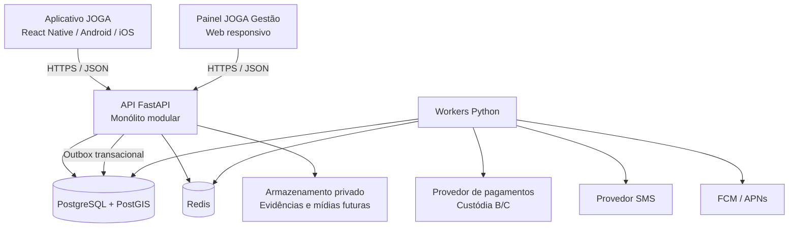
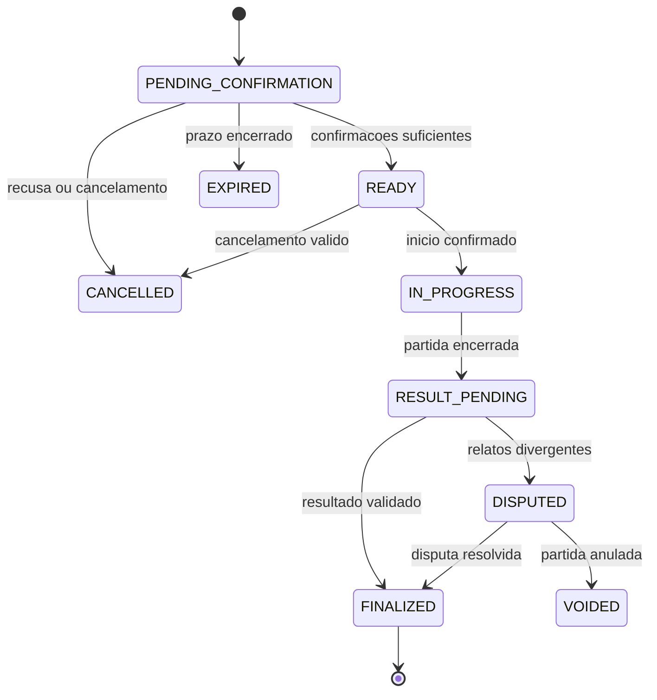
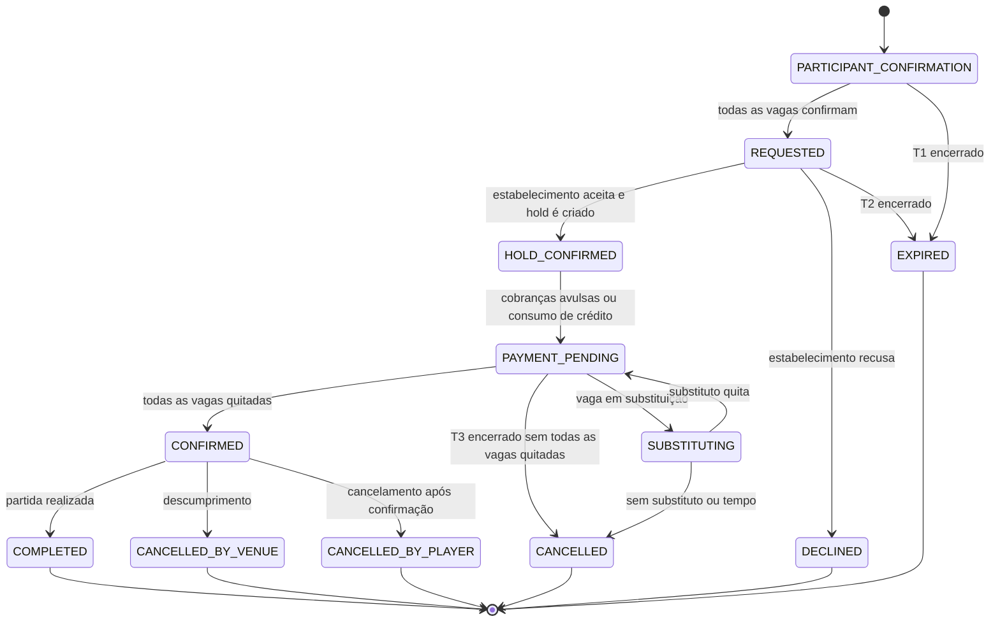

# JOGA — Documentação Técnica

**Versão:** 2.3<br>
**Status:** especificação técnica-alvo; incorpora a ADR 0049 (crédito em reais, ticket de exibição, preço em duas linhas, NFS-e e custódia B→C)<br>
**Data:** 16 de novembro de 2026<br>
**Escopo:** aplicativo Android/iOS, painel web de gestão, API, PostgreSQL/PostGIS, Redis, workers e fluxo financeiro de reservas de quadras<br>
**Nome do produto:** JOGA

> Este documento consolida a arquitetura-alvo do JOGA. Ele não afirma que os componentes especificados já estejam implementados. A ordem normativa e os limites de cada fase permanecem definidos em `PLANS.md`. O projeto é independente e não pressupõe migração de código, dados ou infraestrutura de um repositório anterior.

---

## 1. Visão técnica do produto

O JOGA é uma plataforma esportiva com duas experiências de usuário:

1. **Aplicativo mobile do jogador:** matchmaking, partidas, lobbies, chat, amigos, clãs, descoberta de quadras, reservas e pagamentos individuais.
2. **Painel web de gestão:** ambiente autenticado para estabelecimentos esportivos administrarem quadras, agenda, reservas e informações financeiras originadas no JOGA.

As duas experiências compartilham API, identidade, banco de dados e infraestrutura. O painel web não é um ERP e não administra automaticamente vendas presenciais ou operações externas ao JOGA. Não está previsto um site público independente para consumidores no escopo inicial.

O sistema deve manter domínios esportivos, sociais e financeiros separados logicamente dentro de um monólito modular. A integração entre eles ocorre por contratos explícitos e eventos auditáveis, sem permitir que transações financeiras influenciem o resultado competitivo.

O comércio de produtos está fora do escopo inicial (ADR 0022). A camada comercial é composta por reservas de quadras, parcerias, patrocínios e publicidade contextual.

## 1.1 Decisões de produto e arquitetura

| Tema | Decisão atual |
|---|---|
| Marca | JOGA; “y” é elemento intencional da identidade verbal |
| Nome de exibição pretendido do app | JOGA y JOGA |
| Painel web | JOGA y GESTÃO, responsivo e autenticado |
| Módulo de reservas | JOGA y QUADRA |
| Aplicativo do jogador | Android e iOS |
| Comércio de produtos | Fora do escopo inicial; não especificado nesta versão (ADR 0022) |
| Gestão | Site separado para proprietários, gerentes e funcionários de estabelecimentos |
| Escopo do painel | Somente operações originadas no JOGA; não é ERP geral |
| Esportes iniciais | Futebol 5x5 (10 jogadores no total) e vôlei |
| Duração de partida | Definida por configuração de esporte/formato; não livre por lobby |
| Fila de matchmaking | Uma fila lógica, com filtro de espaço público/privado/tanto faz |
| Horário de lobby | Data e horário específicos; matchmaking escolhe slot comum a partir das disponibilidades |
| Quadras públicas | Descoberta/local de encontro; reserva formal apenas se houver autorização e disponibilidade verificável |
| Quadras privadas | Cadastro, agenda, reserva e pagamento quando habilitados |
| Chat | Por lobby e por clã; sem chat global universal no escopo atual |
| Identidade visual | Sem fotos de pessoas; avatar ilustrado de catálogo fechado; fotos restritas a quadras/estabelecimentos (ADR 0029) |
| Equipamento da partida | Kit por formato com responsáveis; não é critério de capitão, MMR ou elegibilidade (ADR 0030) |
| Clãs | Abertos ou fechados, com ranking de troféus por modalidade |
| Reservas | Solicitação ao estabelecimento, bloqueio temporário e confirmação com todas as vagas quitadas |
| Pagamentos | Crédito pré-pago comprado em reais e exibido em tickets 1:1; no fluxo de reserva avulsa, Pix por participante (ADR 0049) |
| Custódia | Sem carteira própria; o crédito é passivo do JOGA. Protótipo em B (conta separada/passivo) e alvo C (escrow/conta vinculada). Repasse em `starts_at + 2h` (ADR 0040/0049) |
| Cadastro do fornecedor | Validação de CNPJ e chave de repasse antes de abrir reserva paga |
| Interface financeira | Extrato, repasses e contestação por fornecedor; o valor do espaço não é receita do JOGA |
| Dados oficiais | PostgreSQL como fonte da verdade; ledger financeiro em reais (ADR 0049) |
| Backend | FastAPI em monólito modular |
| Redis | Cache, limites, presença e distribuição efêmera; não fonte oficial |
| Workers | Processos separados para tarefas assíncronas |

## 1.2 Princípios inegociáveis

- Toda mudança relevante de estado é validada no servidor.
- O cliente nunca determina MMR, Trust Factor, troféus, resultado oficial, disponibilidade, estado de reserva, status financeiro ou permissões.
- PostgreSQL é a fonte da verdade para estado esportivo, social, de reservas e financeiro.
- Redis não é fonte oficial de filas, partidas, reservas, pagamentos ou rating.
- Requisições repetidas não podem duplicar reservas, pagamentos, estornos, mensagens de sistema ou aplicações de rating.
- Dados de telefone, localização e dados financeiros são minimizados e protegidos.
- Permissões de estabelecimento devem ser isoladas por organização.
- Falhas de SMS, push, Redis, WebSocket ou provedor de pagamento não podem corromper o estado oficial.
- O sistema deve registrar eventos financeiros e competitivos de forma auditável.
- A liberação de valor ao fornecedor só ocorre depois da confirmação e da quitação, em `starts_at + 2h` (ADR 0040).
- Fornecedor sem chave de repasse validada não pode originar reserva paga.
- O ticket é unidade de exibição; a substância jurídica e contábil é o crédito em reais (ADR 0049).

## 2. Escopo e exclusões

### 2.1 Incluído na arquitetura-alvo

- Aplicativo mobile Android/iOS para jogadores.
- Painel web responsivo e autenticado para estabelecimentos.
- Identidade central, telefone verificado, passkeys e sessões seguras.
- Perfis, esportes e formatos.
- Preferências de quadra pública/particular/indiferente.
- Disponibilidade e matchmaking com horário concreto de partida.
- Lobbies manuais e lobbies formados pelo matchmaking.
- Chat persistente por lobby e por clã, inicialmente textual.
- Lista de amigos, convites e bloqueios.
- Clãs abertos/fechados e ranking de troféus por modalidade.
- Resultados, disputas, MMR individual e Trust Factor esportivo.
- Cadastro de estabelecimentos, quadras e agenda.
- Solicitação de reserva, bloqueio temporário e máquina de estados.
- Crédito pré-pago: Pix na compra de pacote ou passe, ticket como unidade de exibição, consumo na confirmação da reserva e devolução em crédito (ADR 0049).
- Onboarding do fornecedor (CNPJ e chave de repasse) e portão de elegibilidade.
- Interface financeira do fornecedor, repasse e conciliação.
- Cancelamentos e reembolsos com trilha de auditoria.
- Denúncias de usuários e moderação de chats de lobby e clã, com revisão humana.
- Publicidade patrocinada como módulo posterior, sem impacto competitivo.

### 2.2 Fora do escopo atual

- Comércio de produtos: catálogo, estoque, pedidos, vendedores, entregas, código de recebimento, avaliações e disputas de produtos.
- Site público independente para consumidores.
- App nativo separado para gerenciadores.
- ERP completo ou gestão de vendas presenciais/externas.
- Logística própria, cálculo/cotação de frete, contratação de transportadoras, geração de etiquetas e rastreamento centralizado.
- Integrações genéricas com ERPs e PDVs no primeiro lançamento.
- Carteira custodial ou processador de pagamentos próprio.
- Aluguel de equipamentos com caução, ciclo de devolução e controle de danos.
- Gestão completa de academias/clubes, matrículas, mensalidades, catracas e frequência.
- Intermediação de profissionais individuais.
- Torneios, chaves, fases, inscrições e premiações.
- Chat global universal.
- Upload livre de imagens, vídeos, áudios e arquivos nos chats.
- Kafka, Kubernetes e microserviços como requisito inicial.
- Antifraude completamente automatizado/decisório (a IA é auxiliar e casos sensíveis demandam revisão humana; denúncia não gera punição automática).
- Rastreamento contínuo em segundo plano.

## 3. Arquitetura geral

### 3.1 Estilo arquitetural

Adotar um **monólito modular**, com processos separados para API e workers. A aplicação mobile e o painel web acessam a mesma API. Os módulos compartilham PostgreSQL como fonte da verdade, mas mantêm fronteiras de domínio e regras próprias.



O painel web pode ser desenvolvido em React + TypeScript, mas o framework final deve ser registrado em ADR próprio. A escolha do framework web não precisa bloquear a prova técnica mobile da Fase 1.

### 3.2 Responsabilidades

**Aplicativo React Native**
- Interface de jogador.
- Matchmaking, lobbies, chat, clãs, descoberta de quadras, reservas e pagamentos.
- Integração nativa com passkeys, localização, armazenamento seguro e push.
- Não contém regras autoritativas de MMR, disponibilidade, preço final, estado de reserva, pagamento ou permissão.

**Painel web de gestão**
- Interface autenticada para proprietários, gerentes e funcionários.
- Cadastro de estabelecimento, quadras, horários, preços, bloqueios, solicitações, reservas e informações financeiras.
- Consulta de liberações, recebíveis, comissões, status e relatórios básicos.
- Não administra vendas externas ao JOGA no escopo inicial.
- Não acessa dados de outra organização sem autorização explícita.

**API FastAPI**
- Autenticação, autorização e isolamento multi-tenant.
- Casos de uso e transições de estado.
- Transações de banco, controle de agenda e reserva.
- Integração com provedor de pagamento e cadastro do fornecedor.
- Verificação de webhooks, eventos financeiros e idempotência.
- Outbox, rate limits, paginação, validação e contratos OpenAPI.

**PostgreSQL + PostGIS**
- Fonte da verdade de identidade, organizações, fornecedores, quadras, agenda, reservas, pagamentos, reembolsos, lobbies, mensagens, clãs, partidas, resultados e ratings.
- Constraints, índices e transações para proteger invariantes.
- Consultas geoespaciais de jogadores e locais.

**Redis**
- Cache não autoritativo.
- Rate limiting distribuído, presença, Pub/Sub e dados efêmeros com TTL.
- Nunca será a única cópia de mensagens, lobbies, reservas, pagamentos, partidas ou rating.

**Workers Python**
- Matchmaking e expiração de entradas.
- Processamento da Outbox.
- Notificações e push.
- Expiração de bloqueios e prazos de reserva.
- Reconciliação de pagamentos, liberações e reembolsos.
- Liberação de repasse em `starts_at + 2h` (ADR 0040), com contestação que suspende a liberação.
- Processamento de rating e troféus após validação.

## 4. Organização do código

Estrutura sugerida do monorepo:

```text
mobile/
  src/
    app/
    features/
      authentication/
      profile/
      sports/
      matchmaking/
      lobbies/
      chat/
      friends/
      clans/
      matches/
      results/
      rankings/
      venues/
      bookings/
      payments/
    shared/
    services/
    navigation/
  android/
  ios/

management-web/
  src/
    app/
    features/
      authentication/
      organizations/
      staff/
      venues/
      availability/
      bookings/
      payments/
      financial/
      reports/
    shared/

backend/
  app/
    main.py
    core/
      config.py
      security.py
      errors.py
      logging.py
      permissions.py
      tenancy.py
    infrastructure/
      database/
      redis/
      sms/
      push/
      payments/
      storage/
      telemetry/
    modules/
      identity/
      users/
      organizations/
      memberships/
      sports/
      sport_formats/
      availability/
      locations/
      venues/
      venue_availability/
      bookings/
      booking_timers/
      payments/
      payouts/
      financial/
      matchmaking/
      lobbies/
      chat/
      friends/
      clans/
      matches/
      results/
      disputes/
      ratings/
      reputation/
      moderation/
      advertising/
      notifications/
    api/
      v1/
  workers/
  migrations/
  tests/
  scripts/
  pyproject.toml
  Dockerfile

docs/
  JOGA_DOCUMENTACAO_CONCEITO_PRODUTO.md
  JOGA_DOCUMENTACAO_TECNICA.md
  ADR/
  API.md
  SECURITY.md
  DATA_MODEL.md
  RUNBOOK.md

infra/
.github/
harness/
AGENTS.md
GOALS.md
PLANS.md
PROMPTS.md
README.md
```

Cada módulo mantém suas regras, schemas, serviços e repositórios próximos. Rotas HTTP devem ser finas. Evitar módulos genéricos gigantes e dependências circulares.

## 5. Identidade, contas e autorização

### 5.1 Identidade central

Uma pessoa poderá possuir uma conta JOGA e assumir diferentes contextos:

- Jogador/consumidor.
- Proprietário de estabelecimento.
- Funcionário/gerenciador de estabelecimento.

Não exigir perfil esportivo para utilizar o painel de gestão. Não criar uma conta separada para cada papel.

O identificador interno será UUID. Número de telefone é contato verificado, não prova de identidade civil nem chave primária.

### 5.2 Organização e isolamento comercial

Modelar organizações/estabelecimentos e seus membros explicitamente:

- `organizations`: entidade comercial.
- `organization_memberships`: vínculo entre usuário e organização.
- `organization_roles` ou permissões equivalentes: proprietário, administrador, operador e permissões específicas.
- `venues`: perfil do estabelecimento esportivo, vinculado à organização.

Toda consulta ou mutação deve validar organização, associação do usuário, papel e recurso específico. UUID difícil de adivinhar não substitui autorização.

Um operador de um estabelecimento só pode ver quadras, agenda, reservas, pagamentos e dados necessários daquela organização. Um funcionário de uma arena só pode administrar quadras e reservas autorizadas.

> **Nota de implementação - CEP do estabelecimento (Fases 1 e 2).** `GET /api/v1/geo/postal-codes/{postal_code}` resolve endereço e coordenadas sugeridas via BrasilAPI CEP v2, com cache persistente de 30 dias e rate limit por usuário. O `POST /organizations/{id}/venues` continua recebendo `latitude`/`longitude` validadas e, desde a Fase 2, aceita `postal_code`, `geocoding_source` e `geocoding_precision`; `geocoded_at` é gravado pelo servidor. Coordenada sem proveniência explícita é `manual`, e ajustar coordenada/CEP sem reenviar proveniência rebaixa para `manual`. A coordenada sugerida tem precisão de logradouro/bairro e o pino ajustável do painel é a autoridade final. Mapa e provedor pago continuam pendentes.

### 5.3 Telefone e OTP

O número deve ser normalizado em E.164. Aplicar rate limits por IP, dispositivo, telefone e operação. OTP de uso único, expiração curta, limite de tentativas e armazenamento como hash/HMAC protegido por segredo. Não registrar OTP ou telefone completo em logs.

Parâmetros iniciais sugeridos: seis dígitos, validade de cinco minutos, até cinco tentativas por desafio e intervalo mínimo de 60 segundos para reenvio, sujeitos a teste de abuso e custo.

O número poderá ser reciclado, compartilhado ou comprometido por SIM swap. SMS não deve ser o único método de recuperação de conta.

### 5.4 Passkeys e sessões

Passkeys serão o método preferencial após o cadastro. O backend gera e valida desafios de uso único, origem/RP ID, flags e assinatura. Registrar múltiplas credenciais quando suportado, permitir revogação individual e oferecer recuperação de risco elevado.

O protótipo da Fase 1 deve validar Android e iOS com mecanismos nativos: Credential Manager no Android e Authentication Services no iOS. A estratégia de framework foi decidida em favor do Expo development build com `expo prebuild` (ADR 0009); a biblioteca de passkeys ainda depende de prova em ambas as plataformas.

Access tokens de curta duração; refresh tokens opacos, aleatórios, armazenados no servidor como hash e rotacionados. Reutilização de token antigo revoga a família da sessão. Tokens ficam em Keychain/Keystore no aplicativo e em armazenamento seguro equivalente no navegador.

Para áreas administrativas/comerciais, avaliar controles reforçados, reautenticação para ações financeiras e registro de auditoria.

### 5.5 Domínio técnico

Mesmo sem site público para consumidores, será necessário um domínio técnico protegido para associações de passkeys/aplicativos e arquivos de verificação, conforme os recursos usados. Isso não equivale a construir um site público do JOGA.

## 6. Localização e privacidade

- Solicitar localização somente quando uma funcionalidade precisar dela.
- Priorizar uso em primeiro plano; não solicitar rastreamento contínuo em segundo plano no MVP.
- Oferecer localização aproximada. **A busca por CEP ou região é benefício do passe** (ADR 0043 §4): o plano gratuito busca apenas pela localização do aparelho.
- A busca por CEP existe para reduzir intenção falsa no motor: sem barreira, o jogador declara intenção em qualquer lugar e o matchmaking tenta formar partidas que não vão acontecer.
- Não revelar a posição residencial exata de um jogador a outros participantes.
- Não armazenar histórico de deslocamento.
- Consultas geoespaciais devem aplicar raio máximo, paginação e índices GiST.
- Para usuários, coordenadas devem ser processadas com minimização e retenção curta quando persistência não for necessária.
- A localização serve para sugerir região e locais; não prova presença ou resultado competitivo.

Usar PostGIS com `geography(Point, 4326)` quando a consulta envolver distâncias em metros, índice GiST, `ST_DWithin` para filtro e `ST_Distance` para ordenação.

O tratamento deverá observar a LGPD: finalidade, necessidade, transparência, segurança, retenção, direitos do titular e contratos com operadores/provedores. Avisos e bases legais precisam de revisão jurídica antes do lançamento.

## 7. Catálogo esportivo e formatos

### 7.1 Modalidades iniciais

O catálogo inicial inclui:

- Futebol 5x5, total de 10 participantes, duas equipes de cinco.
- Vôlei, com composição exata do formato a ser validada antes da implementação definitiva.

Cada formato terá configuração própria e versionada:

- Quantidade total de participantes.
- Composição das equipes.
- Duração padrão em minutos.
- Regras de confirmação e encerramento.
- Requisitos de local e espaço.
- Elegibilidade casual/ranqueada.

A duração será fixa por esporte/formato. O lobby não poderá escolher uma duração arbitrária. Ao criar o lobby, o backend copia a duração configurada para o registro da partida, preservando o valor histórico mesmo se a configuração mudar futuramente.

### 7.2 Preferências de quadra

Cada usuário poderá definir uma preferência padrão:

- `PUBLIC_ONLY`.
- `PRIVATE_ONLY`.
- `ANY`.

A preferência poderá ser sobrescrita para uma entrada específica na fila. O sistema deve guardar a preferência efetiva usada na formação.

### 7.3 Requisitos de equipamento por formato

Cada formato declara requisitos de equipamento versionados (`sport_equipment_requirements`): futebol 5x5 e basquete 3x3 exigem bola; vôlei de praia exige rede e bola; tênis exige bolas e presume raquete individual. O catálogo é do backend, não do cliente.

A partida mantém o estado do kit (`match_equipment`) e as declarações de responsabilidade (`match_equipment_claims`). A declaração é um compromisso registrado, não verificação de posse.

Invariantes:

- o kit não é critério de capitão (seção 10.1), MMR, Trust Factor ou elegibilidade;
- o kit **não bloqueia** lobby, matchmaking, confirmação, pagamento, check-in ou início da partida;
- itens fixos (rede, cesta, trave) são responsabilidade do estabelecimento que declarou aceitar a modalidade; a falta é falha da quadra;
- itens móveis (bola, coletes) são marcação opcional "tenho" do participante ou fornecidos pelo local; não são compromisso obrigatório;
- o mesmo item não pode ter dois responsáveis ativos sem confirmação explícita de troca;
- a cobertura é conferida antes do check-in como checklist/aviso e visível apenas aos participantes;
- partidas ranqueadas priorizam equipamento fornecido pelo local ou pela organização;
- não há evento de confiabilidade por item móvel não levado; a marcação é informativa;
- não há upload de foto de equipamento no MVP.

ADR: 0030.

## 8. Matchmaking e agendamento

### 8.1 Uma única fila lógica

Não criar filas independentes por tipo de quadra. O matchmaking opera sobre entradas persistentes e usa a preferência de espaço como restrição de compatibilidade.

A interseção de preferências deve ser respeitada:

- `PUBLIC_ONLY` + `ANY` resulta em pública.
- `PRIVATE_ONLY` + `ANY` resulta em particular.
- `PUBLIC_ONLY` + `PRIVATE_ONLY` é incompatível para um mesmo lobby.
- `ANY` + `ANY` permite ambas.

Se não houver uma categoria de local compatível, não formar o lobby como se houvesse compatibilidade. O sistema poderá aguardar novos participantes ou solicitar ajuste de preferência.

### 8.2 Horário concreto por lobby

O usuário pode informar janelas de disponibilidade. O algoritmo procura um intervalo comum e, ao formar o lobby, seleciona e registra uma data/hora específica.

Todo lobby deve ter:

- `scheduled_start_at` em `timestamptz`.
- `sport_format_id` e versão/configuração aplicada.
- `duration_minutes` copiada da configuração do formato.
- `scheduled_end_at` calculada pelo backend.
- Fuso de apresentação adequado à região do local.

Lobbies manuais exigem data e horário concretos na criação. A duração vem do formato; não é escolhida livremente.

### 8.3 Localização calculada pelo matchmaking

O matchmaking calculará uma região de encontro a partir das localizações aproximadas/autorizadas e preferências dos participantes. Não usar automaticamente o primeiro jogador ou o criador como centro único. O cálculo deve equilibrar deslocamento e privacidade.

### 8.4 Formação transacional

O worker deve:

1. Selecionar entradas compatíveis no PostgreSQL.
2. Bloquear linhas necessárias com `SELECT ... FOR UPDATE SKIP LOCKED` ou estratégia equivalente.
3. Revalidar elegibilidade, horário, preferência de espaço e estado dentro da transação.
4. Selecionar participantes e balancear equipes no servidor.
5. Criar lobby, partida e participantes.
6. Registrar o horário concreto e a duração configurada.
7. Atualizar as entradas da fila.
8. Registrar eventos na Outbox.
9. Confirmar a transação.

Uma falha no Redis não pode duplicar ou perder uma partida oficial.

### 8.5 Invariantes

- Um jogador não participa de partidas simultâneas incompatíveis.
- Uma entrada ativa incompatível não pode ser duplicada.
- Uma partida possui tamanho e formato válidos.
- A preferência de espaço usada na formação fica registrada.
- Todo processamento do worker é idempotente.
- Constraints e locks protegem as invariantes; não depender apenas de verificações anteriores à transação.

## 9. Lobbies, quadras e votação

### 9.1 Tipos de lobby

Separar no modelo:

- `origin`: `MANUAL` ou `MATCHMAKING`.
- `visibility`: `OPEN` ou `CLOSED`.

Lobby manual exige data e horário fixos. Pode ser aberto para descoberta ou fechado por convite.

Lobby do matchmaking é criado pelo sistema após a formação de um grupo compatível. Para os lobbies abertos do matchmaking, não existe proprietário com poder unilateral de escolher ou trocar a quadra.

### 9.2 Votação de troca de quadra

A votação é permitida somente em lobby aberto originado pelo matchmaking. Não habilitar em lobbies fechados ou lobbies criados manualmente.

Regras:

- Qualquer participante elegível pode propor uma alternativa.
- Apenas uma votação pode ficar ativa por lobby.
- Cada participante possui um voto por proposta.
- A proposta precisa respeitar a categoria permitida (`PUBLIC_ONLY`, `PRIVATE_ONLY` ou `ANY`) registrada no lobby.
- A quadra candidata precisa atender ao mesmo horário, duração, modalidade e demais restrições.
- O backend recalcula disponibilidade antes de concluir a alteração.

**Quórum e aprovação iniciais:** pelo menos 50% dos participantes elegíveis devem votar; entre os votos válidos, “Sim” precisa ser estritamente maior que 50%. Empate, maioria “Não” ou falta de quórum rejeitam a proposta. Abstenções não entram na proporção Sim/Não, mas não ajudam a atingir o quórum.

A mudança só é aplicada após a confirmação da disponibilidade e das condições comerciais. Se houver reserva ou pagamento anterior, o sistema deve exigir resolução explícita de cancelamento/reembolso antes de substituir o local. Votação aprovada não cancela reserva paga automaticamente.

### 9.3 Espaços públicos e privados

Locais públicos podem ser cadastrados e recomendados como ponto de encontro, mas não devem ser apresentados como formalmente reserváveis sem autorização e disponibilidade verificável.

Locais privados podem oferecer horários reserváveis. A reserva precisa bloquear o intervalo correspondente em transação, com proteção contra dupla reserva.

## 10. Ciclo de vida da partida e resultados

Estados propostos:



As transições devem ser implementadas em serviço de domínio central. Não permitir alteração livre de status por endpoint. A quantidade e o tipo de confirmações são configuráveis por formato. Denúncia isolada não determina punição; relatos divergentes levam a `DISPUTED`, e resultado disputado não altera MMR até a resolução.

### 10.1 Capitães

Nas partidas formadas pelo matchmaking, cada equipe terá um capitão simbólico, escolhido automaticamente pelo backend.

- O capitão não terá autoridade administrativa sobre os demais jogadores e não poderá decidir unilateralmente o resultado. Sua função é representar a equipe na comunicação e registrar uma confirmação adicional do resultado, que o sistema tratará como informação adicional, não como decisão absoluta.
- A seleção segue esta ordem de prioridade:
  1. Maior Trust Factor esportivo.
  2. Maior número de partidas válidas realizadas.
  3. Maior MMR da modalidade/formato.
  4. Maior idade, em caso de empate nos critérios anteriores.
- A seleção deve ser determinística, registrada na partida e auditável.
- **Na Fase 7, a seleção é provisória:** maior quantidade de partidas válidas concluídas (`FINALIZED`) e, em empate, UUID. Não usar nível. Registrar `captain_selection_version` e não alterar capitães ou registros históricos retroativamente.
- Na Fase 8, os critérios completos poderão ser aplicados a partidas futuras, incorporando Trust Factor, partidas válidas, MMR e idade quando houver dado confiável.
- O conceito define capitão apenas para partidas formadas pelo matchmaking. Lobbies manuais ficam sem capitão e, portanto, não têm confirmação de capitão na Fase 7.

### 10.2 Relato e confirmação do resultado

- Ao final da partida, todos os participantes devem relatar o resultado individualmente. A votação tem **três resultados possíveis**: `TEAM_1`, `TEAM_2` ou `DRAW`, este último apenas quando o formato permitir.
- Os capitães podem registrar a confirmação de suas respectivas equipes.
- Os relatos individuais são visíveis aos demais participantes da partida. A exposição é intencional (responsabilidade social) e deve respeitar autorização: somente participantes da partida podem consultar os relatos e as confirmações; nenhuma consulta externa.
- O prazo padrão de relato é de **10 minutos** após o encerramento da partida, controlado pelo backend e configurável por formato no futuro. O lobby não altera livremente a janela.
- Os POSTs de relato, confirmação de capitão e evidência têm rate limit por usuário em janela fixa de 60 segundos (`JOGA_RESULTS_RATE_LIMIT_PER_MINUTE`, padrão 30). Excesso retorna `429 rate_limited` com `Retry-After`.
- Jogadores que não relatarem dentro do prazo são registrados como relatos anulados. Votos ausentes ou anulados não entram no denominador do cálculo e não contam como favoráveis a nenhum resultado.
- O denominador é sempre o total de **votos válidos** da rodada, não o total de participantes.

### 10.3 Divergências e validação

- O backend compara os relatos e as confirmações dos capitães.
- **Quórum mínimo:** `ceil(participantes_elegíveis / 2)` votos válidos. Os elegíveis são congelados na abertura da primeira rodada e reutilizados na segunda. Abaixo do quórum, o caso vai para revisão humana e não é finalizado automaticamente.
- **Resultado avaliado:** o outcome com mais votos válidos (maioria simples/plurality), não maioria absoluta. Se houver empate na primeira posição, abre-se a segunda rodada.
- **Não existe parâmetro separado de tolerância de 1–2 votos.** A regra é calculada sobre os votos válidos:
  - divergência abaixo de 50% em relação ao resultado avaliado: resultado pode ser finalizado;
  - divergência exatamente igual a 50%: segunda rodada;
  - divergência acima de 50%: partida em `DISPUTED`.
- Votos ausentes ou anulados não entram no denominador e não são interpretados como concordância ou discordância.
- `DRAW` só é aceito quando o formato permitir: futebol 5x5 permite; vôlei não permite na primeira versão.
- A disputa é medida de proteção, não mecanismo para anular partidas automaticamente. A anulação é considerada apenas como última alternativa, depois de avaliadas as evidências.

### 10.4 Desempate exato em 50% — segunda votação e análise de confiabilidade

Regra aprovada para a segunda rodada: empate na primeira posição ou divergência exatamente igual a 50% (conceito §9.4; ADR 0008).

1. **Segunda confirmação.** O backend abre uma nova rodada de confirmação para todos os participantes elegíveis. Cada jogador pode confirmar ou corrigir a resposta anterior. A segunda rodada tem prazo de **5 minutos**, controlado pelo backend, sem renovação automática. Ela apresenta todas as alternativas permitidas pelo formato (`TEAM_1`, `TEAM_2` e, se permitido, `DRAW`), independentemente da distribuição da primeira rodada.
2. **Histórico preservado.** Nenhum relato é sobrescrito: a primeira votação é mantida integralmente para auditoria, e cada confirmação/correção da segunda rodada é registrada de forma append-only com ator e timestamp.
3. **Análise interna e invisível.** Se a segunda rodada continuar exatamente empatada em 50%, ou não produzir resultado confiável, a partida entra em análise interna de confiabilidade, sem exposição de indicadores aos participantes:
   - Avalia cada relato individualmente — não por média simples de Trust Factor do grupo — impedindo que um grupo vença apenas acumulando contas de alta reputação.
   - Sinais avaliados: consistência de votos entre as rodadas; histórico competitivo; coerência em alterações de voto; detecção de padrões de comportamento coordenado ou manipulação.
   - Os relatos dos capitães (selecionados pelo critério vigente, seção 10.1) funcionam como sinais relevantes pela confiabilidade de seu histórico, sem peso automático de voto adicional e sem autoridade para determinar o resultado sozinhos.
   - Os indicadores internos e a análise nunca são exibidos aos participantes; servem exclusivamente ao sistema.
4. **Desfechos.** O sistema tenta resolver com base nos indicadores; se as evidências não permitirem conclusão segura, o caso vai para revisão humana. A anulação permanece como último recurso.
   - Na segunda rodada: resultado único com divergência abaixo de 50% finaliza; exatamente 50% vai para análise interna; acima de 50% vai para disputa e revisão humana; empate na primeira posição, ausência de resultado único ou falta de quórum vão para revisão humana. Não há terceira rodada.
5. **MMR congelado.** Durante as duas rodadas e a análise, nenhuma aplicação de rating é permitida: o rating só é aplicado após decisão final validada, via mecanismo idempotente (seção 11.1).

### 10.5 Disputas de partida

Uma partida em `DISPUTED` não gera aplicação de rating.

- O sistema reúne: relatos de cada participante; confirmações dos capitães; histórico de alterações e confirmações; denúncias relacionadas à partida; histórico de confiabilidade relevante dos envolvidos; justificativa textual privada; outras evidências disponíveis e pertinentes.
- A evidência da Fase 7 é **apenas textual**, limitada a **2.000 caracteres**, com no máximo uma justificativa por participante por disputa. Acesso restrito e auditável. Não há upload ou armazenamento de arquivos nesta fase; o conteúdo não é exposto publicamente no lobby.
- A retenção provisória está no ADR 0024: evidências por 12 meses após o encerramento da disputa; relatos, confirmações, decisões, revisões e análises por 24 meses; contadores de rate limit por 24 horas. A limpeza é manual e configurável; a política definitiva será revisada na fase de LGPD.
- A primeira análise pode ser automatizada por regras de consistência e mecanismos de detecção de comportamento suspeito. Casos inconclusivos ou com indícios relevantes de fraude podem ser encaminhados para revisão humana.
- Decisões possíveis: confirmar o resultado predominante; solicitar informações adicionais; corrigir o resultado quando houver evidência suficiente; aplicar medidas de integridade quando houver fraude comprovada; anular a partida somente quando não houver alternativa confiável.
- Toda decisão é registrada com justificativa auditável, ator, timestamp e mecânica append-only.
- Enquanto não existir estrutura de staff/admin, a revisão humana pode ser feita por **CLI/script interno auditável**, com `--operator` validado contra lista autorizada, `--reason` obrigatório, ator, timestamp e justificativa. Não criar um sistema completo de administração nesta fase nem endpoint público de moderação.
- Correções posteriores geram eventos compensatórios, sem apagar o histórico.

### 10.6 Integridade do sistema de resultados

- O sistema deve proteger relatos contra manipulação por votos coordenados, contas falsas e denúncias abusivas, com mecanismos próprios de detecção de padrões suspeitos. O balanceamento de MMR não é tratamento suficiente contra fraude.
- Resultados não confirmados ou em disputa não alteram MMR. A plataforma preserva histórico auditável dos relatos originais e das decisões finais.

## 11. Rating, Trust Factor e justiça competitiva

### 11.1 MMR

- Separado por modalidade e formato competitivo.
- Calculado exclusivamente no backend.
- Partidas casuais não alteram MMR ranqueado.
- Uma partida só pode gerar uma aplicação de rating por usuário/versão de cálculo.
- Toda alteração gera evento imutável com valor anterior, delta, valor posterior e versão do algoritmo.
- Correções geram eventos compensatórios, sem apagar histórico.
- **A Fase 8 usa Glicko-2 adaptado para equipes (`glicko2_team_v1`)** por trás de interface `RatingEngine`: rating inicial 1500, RD inicial 350, volatilidade 0.06, RD máximo 350, inatividade em períodos de 7 dias e delta máximo de ±100 por partida. A média de rating e de RD das equipes representa o adversário; cada jogador usa sua própria incerteza.
- O rating bruto permanece oculto no app; a interface mostra divisão, progresso, posição e partidas de colocação.
- Worker dedicado `scripts/apply_ratings.py` aplica o rating após `FINALIZED`, de forma idempotente.

### 11.2 Trust Factor esportivo

Trust Factor representa confiabilidade operacional em partidas, não habilidade esportiva nem reputação comercial.

Sinais possíveis: ausências confirmadas e reincidentes, cancelamentos em cima da hora, disputas confirmadas após análise e padrões de abuso. Denúncia isolada não reduz automaticamente o indicador. Decisões relevantes devem permitir contestação e gerar `trust_events` auditáveis.

Na Fase 8, o Trust Factor começou neutro (`100`) e oculto. A ADR 0041 ativou a aplicação: no-show −30, cancelamento após confirmação −7, cancelamento antes do pagamento −2, recuperação não linear ao concluir partida e restrição temporária da fila ranqueada (7/30 dias). O score não é exposto; apenas a restrição é perceptível. Contestação formal e UI de suporte continuam pendentes.

### 11.3 Separação de sistemas

Compras, anúncios patrocinados, assinatura, gasto em quadras ou pagamento a estabelecimentos nunca alteram MMR, Trust Factor esportivo ou troféus de clã.

### 11.4 Leitura competitiva e ranking

> **Esclarecimento (ADR 0045):** nas estatísticas, "MMR" significa a leitura visível — divisão, progresso e posição. O contrato de `GET /api/v1/ratings/me` não muda: o rating bruto, o `RD` e a volatilidade permanecem ocultos.

- `GET /api/v1/ratings/me?format_id=...`: divisão, progresso, colocação, posição e última atualização; nunca retorna MMR bruto, RD, volatilidade ou Trust Factor.
- `GET /api/v1/rankings?format_id=...&limit=...&offset=...`: top 100 de jogadores já colocados, com nome de exibição, divisão e partidas. Nunca retorna MMR bruto. Jogadores em colocação não entram no ranking público.
- A fila ranqueada usa a política `mmr_v1`, com média de MMR e limite de dispersão interna de 800 pontos por equipe na v1.
- O worker `apply_ratings.py` é separado do worker de partidas e pode ser reexecutado com segurança.

### 11.5 Transparência

- O app mostra divisão, progresso, posição e histórico competitivo, mas não o número bruto do MMR.
- Trust Factor permanece oculto e não influencia MMR, divisão ou ranking na Fase 8.
- A fórmula, os parâmetros e a versão `glicko2_team_v1` são documentados; mudanças futuras exigem nova versão.

### 11.6 Estatísticas e inteligência de rede

- **Fonte:** projeções de partidas, participantes, resultados, `rating_events`, presença, quadras e reservas. Não há coleta nova, rastreamento contínuo, histórico de GPS ou telemetria de evento de jogo.
- **Essencial e livre:** MMR atual (divisão, progresso e posição), partidas, V/E/D, presença, streak e sequência de temporadas.
- **Passe:** evolução da divisão/progresso, histórico por quadra, passaporte, horários e formatos, retrospectiva.
- **Rede (free):** quadras mais usadas e os próprios horários. **Rede (passe):** mapa de calor semanal, densidade competitiva por quadra (onde o jogo é mais forte), ocupação, tendência e horários com mais vaga.
- **Faixas, não números:** densidade competitiva e ocupação usam 3 a 5 rótulos; nunca MMR médio, MMR absoluto ou contagem de pessoas identificáveis.
- **Amostra mínima:** 20 partidas concluídas por célula (quadra × janela móvel de 30 dias), valores iniciais calibráveis; abaixo disso, ocultar ou agrupar.
- **Defasagem:** agregação diária; nunca tempo real.
- **Não é filtro:** o painel não altera matchmaking, não permite selecionar partidas por nível e não expõe adversário antes da partida.
- **Autorização:** o servidor valida titular e plano; nenhum endpoint retorna dados de outro jogador.
- **Contratos propostos:** `GET /api/v1/me/stats/summary`, `GET /api/v1/me/stats/competitive` (evolução da divisão/progresso), `GET /api/v1/me/stats/venues`, `GET /api/v1/me/stats/season` e `GET /api/v1/network/insights`. A implementação pode consolidar rotas, desde que preserve as regras acima.
- **Testes mínimos:** titularidade, gating de plano, amostra mínima, ausência de MMR bruto e de MMR de terceiros, exclusão de partidas em disputa e de resultados não confirmados.

## 12. Amigos, chat e clãs

### 12.1 Lista de amigos

Modelar solicitações, vínculos, bloqueios e preferências de notificação. Convites para lobby precisam respeitar bloqueios, privacidade e limites contra spam.

### 12.2 Chat por lobby e por clã

Não haverá chat global universal no escopo atual. Conversas permitidas:

- Chat associado a lobby, acessível somente a participantes autorizados.
- Chat permanente de clã, acessível somente a membros autorizados.

A primeira versão permite texto e referências internas do JOGA (links/objetos de partidas, quadras e lobbies). Não permitir upload livre de áudio, vídeo, imagem ou arquivo no MVP.

Mensagens devem ser persistidas no PostgreSQL. WebSocket serve à entrega em tempo real, não à persistência. Redis pode distribuir eventos e presença entre processos. Push notifica usuários desconectados.

Controles obrigatórios: autorização por conversa, paginação, limite de tamanho e frequência, bloqueio, denúncia, silenciamento, moderação, prevenção de spam e auditoria de ações administrativas.

Na implementação 9A, o chat por lobby usa `lobby_messages` e a Outbox; o WebSocket entrega eventos apenas no processo atual e o histórico é recuperado por HTTP. Redis/fan-out multi-processo fica para hardening. Tokens de push são registrados por dispositivo, mas o provedor real ainda não está configurado.

### 12.3 Clãs

Clãs possuem estado aberto ou fechado, membros, administradores, convites e limites. Entrada em clã aberto pode ser imediata, desde que haja vaga e regras atendidas. Entrada em clã fechado depende de convite ou aprovação.

O vínculo do jogador ao clã na data de uma partida deve ser registrado para atribuir corretamente os pontos. Mudança de clã não transfere retroativamente troféus conquistados.

### 12.4 Moderação, denúncias de usuários e Trust & Safety

Módulo dedicado (fase 17 do `PLANS.md`). Especificação alvo traduzida do conceito (seções 21.5 e 21.5.1–21.5.5); políticas e parâmetros pendentes de decisão (seção 26). Escopo inicial: chats de lobby e de clã, limitados a texto e referências internas do JOGA; não há moderação de mídia enviada por usuários, pois o MVP não admite upload livre.

#### 12.4.1 Denúncia de perfil no lobby

- Cada participante pode denunciar outro jogador diretamente pelo perfil disponível no lobby.
- Categorias de comportamento incluem: ofensas e insultos; assédio e intimidação; discurso de ódio ou discriminação; atitude antidesportiva; provocação ou comportamento abusivo; spam e mensagens indesejadas; tentativa de fraude ou manipulação de partida; outras condutas inadequadas.
- O denunciante pode selecionar até cinco mensagens específicas como contexto. A IA analisa o contexto dessas mensagens e uma faixa limitada de mensagens próximas, conforme o limite de contexto definido pelo sistema, evitando interpretação isolada. O limite de janela é parâmetro pendente (seção 26).
- O backend deve registrar autor, denunciado, lobby, mensagens selecionadas, contexto autorizado e horário dos eventos.

#### 12.4.2 Moderação automatizada por IA

A IA é camada auxiliar, com níveis de confiança e possibilidade de contestação. Ela pode auxiliar:

- Classificação de denúncias; identificação de ofensas, assédio e discriminação; detecção de spam e mensagens repetitivas; identificação de ameaças e comportamentos potencialmente perigosos; agrupamento de denúncias relacionadas; priorização por gravidade e risco; identificação de possíveis denúncias abusivas ou coordenadas.

- A automação pode aplicar apenas medidas preventivas proporcionais e reversíveis, conforme regras previamente definidas (ocultação temporária de conteúdo, limitação de envio). Suspensões permanentes e decisões graves exigem critérios mais rigorosos e revisão humana. A IA não é autoridade infalível.

#### 12.4.3 Revisão humana e medidas

- No estágio inicial, o próprio responsável pelo JOGA pode atuar como moderador humano. A ferramenta de revisão é interna e separada do painel de gestão (JOGA y GESTÃO); deve apresentar histórico, mensagens relevantes, evidências, classificação automatizada e ações recomendadas.
- Revisão humana é reservada principalmente para casos graves; denúncias com evidências conflitantes; risco à segurança de usuários; recursos contra medidas automatizadas; casos de baixa confiança da IA; possíveis fraudes ou denúncias coordenadas.
- Medidas possíveis: aviso; remoção ou ocultação de mensagens; restrição temporária de envio; restrição de participação em lobbies; suspensão temporária da conta; suspensão permanente em casos graves ou reincidentes. Medidas são proporcionais à gravidade e reincidência, com justificativa e possibilidade de contestação, em registro append-only.
- Denúncia isolada não reduz automaticamente o Trust Factor esportivo; o sistema considera a confiabilidade da denúncia e a existência de evidências antes de aplicar penalidades (seção 11.2).

#### 12.4.4 Privacidade, acesso e retenção

- Acesso a mensagens e evidências de moderação limitado a pessoas e processos autorizados, com auditoria de acessos.
- Armazenar apenas o contexto necessário para analisar a denúncia, com política de retenção a definir (seção 26).
- A automação prioriza o processamento eficiente; conversas não são encaminhadas continuamente para IA/revisão humana sem necessidade.

> **Nota de implementação das Fases 17A/17B/17C.** A primeira fatia usa triagem determinística (`rules_v1`) por categoria, reincidência e quantidade de contexto; não usa IA paga nem envia texto a terceiros. A decisão é humana por CLI e, desde a 17C, por painel web interno separado em `/moderation`. Operadores têm identidade em `moderation_operators` (`ADMIN|MODERATOR`), com bootstrap por `JOGA_MODERATION_ADMIN_USER_IDS`; cada nova denúncia gera notificação persistida `moderation_report`, cada recurso gera `moderation_appeal` para os operadores e a decisão do recurso gera `moderation_appeal_result` para o jogador. Medidas: aviso, restrição ranqueada reversível e suspensão temporária de 1–30 dias; recurso aceito revoga a medida. A 17B acrescenta cooldown de 7 dias após 3 denúncias improcedentes em 30 dias e redação provisória de contexto após 180 dias. O classificador local/open-source e a suspensão permanente continuam pendentes.

> **Nota de contrato mobile da suspensão (17C).** Acesso autenticado comum de uma conta `suspended` responde `401 invalid_token`. O refresh rotaciona a sessão e responde `200` com `user.status = "suspended"`, permitindo que o app preserve a sessão e obtenha access tokens novos durante toda a suspensão. Excepcionalmente, `GET /moderation/actions/me`, `GET /moderation/appeals/me` e `POST /moderation/actions/{action_id}/appeal` aceitam a sessão de conta suspensa, porque o jogador precisa ver o motivo, as datas, o resultado do recurso e contestar a própria medida. A autorização continua restrita às ações/recursos em que o usuário é o alvo; severidade, prioridade e identidade do denunciante não são expostas ao app. O refresh web do painel continua respondendo `401 account_suspended`.

> **Nota de canais de notificação (17C).** Notificações internas de moderação usam `channel = "moderation"` e não aparecem em `GET /me/notifications` nem geram push para o app do jogador. A central do jogador lista apenas `channel = "player"`. O painel consome o canal interno por endpoints dedicados em `/moderation/notifications` (lista, contador, marcar uma e marcar todas), protegidos por `get_moderator`. Resultados de recurso (`moderation_appeal_result`) são do jogador.

### 12.5 Troféus de clã

O ranking será separado por modalidade. Não somar futebol e vôlei em um único ranking inicial.

Fórmula-base proposta:

```text
Troféus do clã =
    50% componente de vitórias/resultados competitivos validados
  + 30% componente de contribuição/desempenho dos membros
  + 20% componente de participação competitiva válida
```

Cada componente deverá ser normalizado e versionado. A ADR 0046 define que partidas finalizadas contam para os troféus, com limites contra volume artificial; se o produto quiser restringir a ranqueadas, isso exige nova decisão registrada. A pontuação será calculada considerando inicialmente os 10 melhores membros elegíveis do clã em cada modalidade.

A elegibilidade deve incluir tempo mínimo de vínculo ao clã e controles contra troca oportunista de clã e partidas combinadas. Os parâmetros exatos de normalização, limite de partidas e permanência mínima serão definidos em ADR após simulações.

Os pesos 50/30/20 são a fórmula-base aceita para prototipação, não devem ser implementados sem simulações e testes de abuso. Temporadas podem ter 30 ou 60 dias; a duração final permanece configurável e pendente de validação.

Troféus de clã são uma classificação coletiva própria, independente do MMR individual. Nenhum ponto pode ser comprado ou concedido por publicidade.

### 12.6 Política de mídia e avatares

Não há fotos de pessoas no produto. Perfil, lobby, chat e clã usam avatar ilustrado gerado a partir de catálogo fechado (`user_avatars`), composto por peças, cores e acessórios versionados; o cliente escolhe apenas combinações válidas e o backend valida.

- sem upload de imagem de pessoa, áudio, vídeo ou arquivo em perfil, lobby ou chat no MVP;
- nome de exibição e `#tag` são texto moderado;
- a identidade visual de clã usa o mesmo catálogo fechado, sem upload de imagem;
- fotos são aceitas apenas para quadras/estabelecimentos, em fluxo autenticado de organização, com revisão, allowlist de tipo, limite de tamanho, armazenamento privado e remoção de pessoas identificáveis;
- documentos de cadastro do fornecedor nunca são públicos;
- a API não aceita URL arbitrária de imagem; mídia de quadra é servida por endpoint autorizado;
- qualquer expansão para foto de pessoa ou upload livre exige ADR e revisão de moderação, privacidade e retenção.

ADR: 0029.

## 13. Organizações, quadras e onboarding do fornecedor

### 13.1 Organizações e estabelecimentos

Uma organização pode administrar um ou mais espaços esportivos. Cada recurso deve estar vinculado à organização proprietária e ter permissões explícitas.

O modelo mínimo:

- `organizations`: entidade comercial.
- `organization_memberships`: vínculo entre usuário e organização.
- `organization_roles`: proprietário, administrador e operador, com permissões por recurso.
- `venues`: perfil do estabelecimento, endereço, geografia, contato e estado operacional.
- `venue_spaces`: quadras ou espaços reserváveis de um estabelecimento.
- `venue_sports`: vínculo entre espaço e modalidade.
- `venue_availability`: horários regulares, preços, duração e exceções.

> **Nota de implementação da Fase 11:** o catálogo de locais descobertos da Fase 4 já usa a tabela `venues` (`kind`, `lat`, `lng`, endereço e estado ativo). Para não quebrar a descoberta nem tratar local público como estabelecimento reservável, o perfil comercial da Fase 11 usa `organization_venues`, vinculado à organização. A ligação/fusão com o catálogo de descoberta e os dados geográficos fica para a Fase 12.
>
> **Nota de implementação da Fase 12A:** `organization_venues.venue_id` é uma FK opcional e única para `venues`, aceita apenas local privado ativo, e pode ser removida. `venue_spaces`, `venue_sports`, `venue_availability`, `venue_blackouts` e `venue_photos` implementam quadras, modalidades, agenda, bloqueios e mídia. Reservas, cobrança e cadastro contratual do fornecedor não fazem parte da 12A.

### 13.2 Agenda e disponibilidade

O estabelecimento define quadras, horários, preços, intervalos, bloqueios e regras. Deve poder registrar reservas feitas externamente para evitar que o JOGA anuncie um horário já indisponível.

A reserva deve controlar conflitos de intervalo, não apenas igualdade de horário de início. O bloqueio e a confirmação precisam ocorrer de forma transacional ou por mecanismo de hold com expiração.

A agenda deve considerar:

- Fuso do estabelecimento.
- Duração definida pelo formato esportivo.
- Intervalo de manutenção entre reservas.
- Feriados, dias fechados e exceções.
- Reservas externas e bloqueios manuais.
- Preço por faixa de horário, quando existir.

O expediente semanal (`venue_business_hours`) pode ser lido, criado, editado e
removido por endpoint próprio. A edição (`PATCH .../business-hours/{id}`) aceita
`weekday`, `opens_at` e `closes_at`, rejeita sobreposição no mesmo dia com
`409 business_hour_conflict` e grava auditoria com antes/depois. **Prazos T2 já
gravados em `booking_timers` não são recalculados** por edição de expediente: o
prazo é congelado quando o T2 começa e a alteração vale apenas para reservas
futuras.

### 13.3 Fornecedor e repasse

O fornecedor que recebe pagamento precisa de cadastro no JOGA, não de recebedor no PSP:

- CNPJ com dígito verificador válido.
- Chave Pix ou conta de titularidade do próprio CNPJ.
- Contrato de intermediação e dados cadastrais.
- Estado de prontidão: `pending`, `active`, `blocked`.
- Referência da chave mascarada no painel.

Regra: **reserva paga só pode ser aberta para fornecedor com chave de repasse validada**. O estado é consultado no backend no momento da abertura da cobrança. Não há KYC de recebedor de marketplace; o modelo C (escrow) e seu KYC contratual pertencem à fase comercial (ADR 0049 §2.8).

### 13.4 Permissões

Toda consulta ou mutação deve validar organização, associação do usuário, papel e recurso específico.

- Um operador de um estabelecimento só vê quadras, agenda, reservas e dados financeiros daquela organização.
- A permissão é por organização; não há, hoje, ACL por quadra. Se o produto exigir que um funcionário administre apenas determinadas quadras, isso deve ser decidido e implementado como escopo próprio.
- Dados bancários e de cadastro do fornecedor têm acesso restrito.
- Ações administrativas e financeiras geram auditoria.

---

## 14. Reservas, bloqueio e temporizadores

### 14.0 Nota de implementação da Fase 13A

A 13A implementa `bookings`, `booking_participants`, `booking_holds`, `booking_timers`, `booking_events` e `booking_payments`. A reserva nasce em `PARTICIPANT_CONFIRMATION` (T1), passa a `REQUESTED` (T2) quando todas as vagas confirmam, e a `PAYMENT_PENDING` (T3) após o aceite e o hold. A 13E implementa T2 em horário comercial, com feriados e fechamentos. A quitação pode ser por crédito (tickets de exibição) ou Pix avulso; a Fase 14B substitui o simulador pelo PSP real.

A **13C** acrescenta a vitrine autenticada em `/api/v1/discovery/bookable-venues`, com quadras ativas, modalidades, faixas de exibição, agenda, fotos aprovadas e próximos horários. A criação de reserva exige `payout_ready`, congela a faixa de exibição e registra a obrigação de repasse na confirmação, inclusive quando a quitação é por crédito. O contrato para o app está em `docs/CONTRATO_RESERVAS_APP.md`; a camada de preço será substituída pela 14E (ADR 0049).

### 14.1 Solicitação e aceite

O fluxo começa com uma solicitação de reserva vinculada a:

- Lobby e participantes.
- Estabelecimento e espaço.
- Data/hora inicial e final.
- Preço e condições aplicadas no momento da solicitação.
- Origem `JOGA`.
- Política de cancelamento/reembolso.

O estabelecimento aceita ou recusa. O aceite é um compromisso condicional de honrar a reserva se todas as vagas forem quitadas dentro do prazo.

### 14.2 Bloqueio temporário

O bloqueio deve ser transacional e vinculado ao intervalo específico:

- Impedir sobreposição com outra reserva ou bloqueio.
- Ter expiração explícita.
- Ser liberado quando o prazo termina, a reserva é recusada ou o lobby é cancelado.
- Não ser prorrogado por substituição de participante.

Em PostgreSQL, a proteção pode usar constraint de exclusão por intervalo (`tstzrange` + GiST/`btree_gist`) ou verificação transacional equivalente. A verificação apenas no cliente não é suficiente.

### 14.3 Três temporizadores independentes

**T1 — confirmação de participação.** Prazo inicial de 1 hora para os jogadores confirmarem que pretendem participar. Controlado pelo backend.

**T2 — resposta do estabelecimento.** Cerca de 30 minutos de funcionamento, com prazo máximo em tempo corrido. O estabelecimento aceita ou recusa e confirma o bloqueio.

**T3 — janela de confirmação e quitação.** 60 minutos, configurável por estabelecimento, com buffer de 5 a 10 minutos para conciliação. No fluxo de crédito, o consumo ocorre na confirmação e não abre cobrança; no fluxo avulso, as cobranças são abertas depois do aceite e do bloqueio.

Os prazos são independentes. O backend é a autoridade; notificação, relógio do dispositivo e conexão não são fonte oficial.

### 14.4 Máquina de estados da reserva



As transições são implementadas em serviço de domínio central. Não permitir alteração livre de status por endpoint. Cada transição registra ator, motivo, timestamp e estado anterior.

### 14.5 Substituição de participantes

A substituição é permitida após o aceite, dentro da janela original de pagamento. Não reinicia o prazo nem prorroga o bloqueio.

Regras:

- Apenas um candidato ocupa uma vaga específica.
- A contribuição do substituto é a mesma da vaga, sem recalcular os demais.
- O histórico de qual participante ocupou cada vaga é preservado.
- Pagamento tardio de participante substituído vai para reembolso.
- Se não houver substituto ou tempo, o lobby é cancelado e os valores pagos são devolvidos.

### 14.6 Cancelamento e reembolso

Se a reserva não se completa por falta de pagamento, indisponibilidade, falha de substituição ou expiração:

1. O lobby é cancelado.
2. O bloqueio é liberado.
3. Nenhuma nova cobrança é emitida.
4. Todos os valores pagos são devolvidos integralmente, incluindo a taxa de serviço.
5. As tarifas não recuperáveis são custo do JOGA (`C_c`), não desconto no reembolso.

O valor principal devolvido não é perda integral. O custo relevante é a tarifa não recuperável, a devolução e o atendimento.

A política consolidada é a **ADR 0039**, que supera a ADR 0038:

- Após `CONFIRMED`, o desfecho financeiro depende do resultado da reserva, não apenas de `CANCELLED_BY_PLAYER`.
- Cancelamento antes do cutoff, com substituto pagante: o substituído é reembolsado e o substituto paga; T3 não reinicia.
- Cancelamento antes do cutoff, sem substituto: lobby cancelado, hold liberado, demais pagantes reembolsados e quem cancelou sem reembolso.
- No-show depois do cutoff: sem reembolso; substituto da fila pode ocupar a vaga já paga, sem nova cobrança.
- Falha da quadra/JOGA: reembolso integral.

A implementação da ADR 0038 foi revertida. As fatias 1–6 da ADR 0039 entregam `lobby_substitutes`, `booking_substitutions`, `booking_refund_exclusions`, T4/T5, cancelamento individual, expiração pelo worker, atribuição com cobrança/reembolso do substituído, vaga paga em no-show, presença T6–T9, coordenadas obrigatórias do estabelecimento, chamada automática da fila e recomendação automática de formação. O substituto paga a vaga no fluxo antes do cutoff; no no-show, ocupa a vaga já paga (`WAIVED`/`covered_by_payment_id`) sem nova cobrança. Presença usa pré-check-in, GPS com geofence e fallback apenas do estabelecimento; não há confirmação por capitão. O repasse à quadra ocorre no horário da partida (ADR 0040). Trust Factor com pesos e UI de presença ainda não existem.

### 14.7 Conclusão e liberação

A reserva passa a `COMPLETED` quando a partida é realizada e confirmada conforme as regras do ciclo de partida.

A liberação ao estabelecimento ocorre 2 h após o início da reserva (`starts_at + 2h`), conforme a ADR 0040, independentemente de a partida acontecer. `JOGA_RELEASE_DELAY_HOURS` tem padrão 2. A janela de contestação é de 72 h (`JOGA_DISPUTE_WINDOW_HOURS`), persistida como snapshot na liberação e na contestação.

### 14.8 Fila de substitutos, presença e desfecho (alvo da ADR 0039)

- Fila `S = (F - M) + 1`, limitada a 4; na prática, muitas vezes +1 para fechar o time par. Casual opcional; ranqueado exige ao menos 1 standby.
- T4 = 25% do tempo restante, piso 30 min, teto 12 h, terminando no cutoff de 6 h antes.
- Fila confirma em T-2h; pré-check-in em T-1h; presença no local em T-30m; substituto fechado em T-15m.
- Presença validada no servidor com geofence e fallback do estabelecimento; não existe confirmação por capitão. GPS não é prova isolada; armazenar resultado e mínimo de dados.
- Formação adaptada: 9 em 5x5 vira 4x4 + rodízio; não conta como 5x5 ranqueado.
- A vaga do ausente pode ser ocupada por substituto sem nova cobrança; exige vínculo explícito entre vaga e pagamento.
- O desfecho da reserva (cumprida, cancelada por falta de substituto, falha da quadra) deve ser um evento único que dispara reembolso, liberação do hold e repasse.
- O repasse de reserva entregue sem partida realizada e o destino do valor não reembolsado continuam pendentes.
- Fatias 1–6 implementadas: fila, chamada automática, cancelamento individual, T4/T5, expiração, exclusão de reembolso, atribuição com cobrança/reembolso, vaga paga em no-show, presença (GPS/estabelecimento), coordenadas obrigatórias e recomendação de formação. Trust Factor com pesos e UI de presença são as próximas fatias.

---

## 15. Pagamentos, crédito, custódia e NFS-e

> **Escopo.** Há dois fluxos: **crédito** (principal) e **reserva avulsa**. No crédito, o jogador compra crédito em reais, exibido em tickets 1:1, e o consome na confirmação; não há split nem cobrança por participante na reserva. Na reserva avulsa, cada participante paga a própria vaga por Pix. A ADR 0049 é a referência de unidade de conta, preço e custódia.

### 15.1 Provedor

No **protótipo e beta fechado**, o PSP é o **Mercado Pago** (ADR 0048), com Pix e custódia no modelo **B** da ADR 0049. A produção-alvo é o modelo **C** (escrow/conta vinculada com titular diferente do JOGA); Inter PJ e Pagar.me ficam para o futuro e não bloqueiam o protótipo.

A 14A usa a **Orders API** (`/v1/orders`) com `X-Idempotency-Key`, webhook `order`, validação de assinatura quando configurada e ledger interno. O adaptador `simulator` cobre CI e desenvolvimento; o adaptador `mercadopago` exige token sandbox e não deve operar dinheiro real até a 14E/14B.

Não construir processador próprio, carteira custodial ou custódia informal.

### 15.2 Modelo de cobrança

**Fluxo de crédito:** uma compra de pacote ou passe gera um `purchase` e uma cobrança Pix; o crédito entra no ledger em reais e é exibido em tickets 1:1. O consumo é idempotente por reserva. Não há uma cobrança por participante na reserva.

`POST /api/v1/me/tickets/purchases` e `POST /api/v1/me/pass/subscriptions` aceitam o cabeçalho opcional `Idempotency-Key` (até 120 caracteres). O replay com o mesmo corpo devolve a resposta original sem abrir uma segunda cobrança; a mesma chave com outro pacote/plano responde `409 idempotency_conflict`. Sem o cabeçalho, a proteção existente continua valendo: uma única compra pendente por jogador/pacote e uma assinatura pendente por jogador.

**Fluxo avulso:** um `order` por reserva, uma cobrança Pix por participante, todas abertas simultaneamente após o bloqueio, com o mesmo prazo. O valor individual é calculado pelo backend e congelado.

O `external_reference` do PSP associa a cobrança à compra ou reserva. O ledger registra a associação; `booking_payments` e `purchase_payments` não são o ledger.

**Etapa 6/6b (sombra de escrita, ADR 0049 §13):** a tabela 2D é a unidade de consumo (`k = tickets_per_seat`); o preço em reais é a autoridade monetária. Os fluxos cobertos lançam no `ledger_*` na mesma transação: compra (`purchase:{id}`), confirmação (`booking:{id}:confirm`, débito `k × 310` ou `psp_clearing`, crédito da quadra e do JOGA; passe usa `pass_revenue` e grátis/admin usam `promo_expense`), devolução (`booking:{id}:refund`), repasse (`release:{id}`), passe (`pass:{id}:sale`, `pass:{id}:month:{n}`). A abertura legada (`opening:{user}`, `Σ remaining × unit_price_cents` contra `opening_equity`) e o reconciliador de tickets e caixa existem em `ledger/opening.py`, `ledger/reconciliation.py` e `scripts/`. O reconciliador confere que toda vaga de passe/grátis/admin tem o lançamento de confirmação.

**Etapa 9 (aposentadoria dos ledgers legados):** o saldo é lido exclusivamente dos lotes + ledger, sem flag nem cache. `ticket_balances` virou **view** sobre `ticket_lots` (`t4e5f6a7b8c9`); o lock de carteira passou a ser a linha de `users`, e não há mais escrita de saldo. A conciliação de tickets reconstrói o saldo por `Σ original_amount` + débitos + devoluções que reabriram lote existente. O extrato do fornecedor e o `booking_ledger` são projeções de `ledger_transactions` + `ledger_entries`; `booking_ledger_entries` foi removido (`u5f6a7b8c9d0`) e `CHARGE_CREATED` deixou de existir. Sem fallback: conta ausente, caixa divergente ou saldo negativo responde `503 balance_unavailable` e registra alerta. O reconciliador (`scripts/reconcile_ledger.py`) tem contador de divergência e exit code diferente de zero.

**Etapa 10 (Fase 15 sobre o ledger em reais):** o extrato por reserva e por repasse carrega `venue_price_cents`, `fee_cents`, `total_cents` e `release_id`; o relatório `financial/commission` separa `venue_price_cents` de `joga_fee_cents`. Recebíveis expõem `receipt_reference` (`simulated:<release_id>`), `dispute_deadline` e o preço congelado. O detalhe da reserva expõe `pricing`, `release`, `dispute` e `fiscal_document` (`pending_manual`). Contestação só em liberação `PENDING` e dentro de `JOGA_DISPUTE_WINDOW_HOURS`; a decisão exige `financial:manage` + `JOGA_REVIEW_OPERATORS` e gera auditoria. `block_for_chargeback` bloqueia/reverte sem tocar saldo. Nenhuma tabela ou migração nova.

### 15.3 Custódia e repasse

**Modelo B (protótipo):** conta separada do caixa operacional, ledger por jogador e reconhecimento como passivo. O risco fiscal é declarado.

**Modelo C (fase comercial):** escrow/conta vinculada com titular diferente do JOGA, com o JOGA como procurador com poderes limitados a instruir o desembolso ao fornecedor definido na reserva. A escolha do fornecedor exige ADR própria.

Não há split: o valor do espaço não é receita do JOGA em nenhum momento; a comissão é a receita da intermediação. O repasse ao fornecedor ocorre em `starts_at + 2h` (ADR 0040), depois da confirmação e da quitação, e é idempotente no ledger em reais. Não existe mais a regra de `N` horas após a partida.

O ledger de dupla entrada é a fonte da verdade. `ticket_ledger` e `payment_events` são registros auxiliares/legados e não podem substituir o ledger principal.

### 15.4 Eventos financeiros

- Confirmar pagamento somente por webhook autenticado ou consulta server-to-server confiável.
- Validar assinatura/autenticidade do webhook e persistir o evento bruto antes do processamento.
- Aplicar idempotência por evento/transação e hash do corpo.
- Registrar bruto, taxas, comissão, valor do fornecedor, estornos e ajustes.
- Manter eventos e ledger append-only.
- Executar conciliação periódica entre compras, reservas, cobranças, reembolsos e repasses.

### 15.5 Reembolsos e MED

- No fluxo de crédito, a devolução normal é em crédito, conforme a ADR 0039; nos 7 dias do CDC, em dinheiro.
- No fluxo avulso, reembolso integral quando a reserva não se completa.
- Reembolso parcial por cobrança deve ser suportado pela 14E; o schema atual só permite um reembolso integral por pagamento.
- Pagamento tardio entra no fluxo de reembolso.
- MED/chargeback pode debitar o fornecedor ou a plataforma; o evento precisa ser registrado e tratado sem tocar o saldo do jogador.
- Estorno sem saldo é evento de cauda, coberto por `p_t·V` e por contrato.

### 15.6 Precificação no backend

A fórmula do conceito §17 continua existindo como cálculo interno de piso e calibração:

```text
TAXA = c·V + C_k + C_c·μ·S + p_t·V
μ = (1 − q)/q
S = 1 + z·√(φ/μ)
```

O que o jogador vê são **duas linhas em reais**: valor do espaço e taxa de intermediação. A taxa é uniforme percentual, com piso configurável. A reserva grava `venue_price_cents`, `fee_cents`, `fee_percent_applied` e `total_cents`, com a versão dos parâmetros. A tabela de conversão tickets ↔ faixa/valor é exibição, não preço jurídico.

O valor é congelado na abertura da cobrança e não muda por recalibração posterior.

### 15.7 Pré-requisitos para abrir pagamento integrado

- Fornecedor com CNPJ e chave de repasse validada.
- Contrato de PSP com tarifas e responsabilidades definidas.
- Ledger em reais e conciliação implementados (14E).
- Capacidade de estorno individual.
- Webhooks autenticados, idempotentes e com hash.
- Interface financeira do fornecedor especificada.
- NFS-e com fluxo definido.
- Revisão jurídica e fiscal da ADR 0049 concluída.

### 15.8 Crédito JOGA: exibição, intermediação e NFS-e

Decisão registrada nas **ADRs 0042 e 0049**. Esta seção fixa o contrato técnico.

**Unidades.** A substância jurídica e contábil é **crédito de consumo expresso em reais**, na razão 1:1, pessoal, intransferível, sem saque, sem revenda e sem transferência entre contas. O **ticket** é a **unidade de exibição**: não é unidade de conta e não tem efeito jurídico, contábil ou fiscal autônomo.

**Exibição.** O saldo em reais **não é exibido como saldo/carteira**. O jogador vê tickets. Antes da confirmação, a interface exibe o valor do espaço, a taxa de intermediação e a tabela de conversão tickets ↔ faixa/valor da quadra. A NFS-e materializa o valor: locação/uso do espaço pelo fornecedor contra o jogador e intermediação pelo JOGA contra o jogador.

**Crédito.** Crédito comprado não expira. A franquia mensal do passe é uma cota de assinatura: não se acumula, não se converte em saldo e tem período mensal. Ingressos gratuitos de nível são promoção e expiram com a temporada.

**Compra e consumo.** A compra do pacote ou passe é evento de caixa e cria passivo. O consumo ocorre na confirmação da reserva e extingue o passivo do jogador ao mesmo tempo em que reconhece a obrigação com o fornecedor. Nenhum dos dois é receita no momento da compra.

**Ledger.** O plano de contas e o ledger de dupla entrada da ADR 0049 §9.2 são a fonte da verdade em centavos. A reserva grava o preço do espaço, a taxa, o percentual aplicado e o total. Não existe “três buckets” como conta separada; o que existe é o plano de contas do ledger.

**Custódia.** O valor do fornecedor é identificado na reserva e repassado em `starts_at + 2h` (ADR 0040). O protótipo opera em B; a fase comercial exige C. Não há split.

**Float.** O crédito carregado é posição de balanço, nunca receita. Rendimento de conta remunerada e crédito não consumido (breakage) não entram como receita.

**PSP.** O `PspAdapter` expõe `create_pix_charge`, `create_subscription` e `create_payout`. Mercado Pago no protótipo; produção em aberto. Pix Automático por API, Payouts em lote e rendimento do float não são requisitos de MVP.

**Matchmaking.** Filtra por intenção (região, janela, formato, nível, distância) e usa o crédito apenas como restrição; a ordenação não usa custo em tickets.

---

## 16. Interface financeira, repasse e conciliação

### 16.1 Conteúdo obrigatório

A interface financeira do fornecedor é obrigatória e deve conter:

- Extrato por reserva e por repasse.
- Agenda de repasses a receber.
- Status de repasse (`PENDING`, `RELEASED`, `FAILED`, `REVERSED`).
- Comprovantes e NFS-e de repasse.
- Dados contratuais do fornecedor.
- Histórico de estornos e ajustes.
- Canal de contestação de valores.
- Relatório de taxas e comissão do JOGA.

A interface atende às obrigações de transparência aplicáveis e não é opcional. O valor do espaço não é receita do JOGA.

### 16.2 Regra de repasse

- Repassar em `starts_at + 2h`, conforme ADR 0040, após a reserva estar confirmada e quitada.
- Respeitar a janela de contestação; contestação aberta suspende o repasse.
- Não existe regra de `N` horas após a partida; a ADR 0040 substituiu esse parâmetro.
- Registrar o repasse no ledger em reais com idempotência.
- Não repassar reserva cancelada, em disputa ou com quitação incompleta.
- Não permitir que o repasse dependa de aprovação manual indefinida.
- Reverter ou bloquear o repasse em caso de reembolso/MED.

### 16.3 Contestação

O estabelecimento pode contestar valores, taxas e estados de liberação. A contestação registra:

- Reserva/cobrança.
- Valor contestado.
- Motivo.
- Evidências.
- Prazo (`venue_releases.dispute_deadline`, snapshot de 72 h).
- Decisão e justificativa.
- Ator e timestamp.

A decisão é auditável e não pode ser apagada. Só a liberação `PENDING` é
contestável; depois de `RELEASED`, `FAILED` ou `REVERSED` a API responde
`409 release_not_contestable`. A decisão exige operador interno autorizado
(`JOGA_REVIEW_OPERATORS`), não o próprio fornecedor.

### 16.4 Conciliação

Tarefas periódicas comparam:

- Cobranças do PSP e `booking_payments`/`purchase_payments`.
- Eventos do PSP e `payment_events`/`psp_webhook_events`.
- Reembolsos e `payment_refunds`.
- Repasses e `venue_releases`.
- Saldo do fornecedor e ledger em reais.
- Reservas confirmadas sem quitação correspondente.
- Cobranças pagas sem compra/reserva correspondente.

Divergências geram alerta e tarefa de investigação. Não corrigir saldo por edição manual silenciosa.

### 16.5 Implementação local da Fase 15 sobre o ledger em reais

O backend da 15 foi refeito sobre o ledger de dupla entrada (Etapa 10), sem
alterar tabelas: `venue_releases` guarda o valor do fornecedor
(`venue_price_cents`) com repasse em `starts_at + 2h`
(`JOGA_RELEASE_DELAY_HOURS`, padrão 2 conforme ADR 0040) e gravação idempotente
de `VENUE_RELEASE`. O extrato por reserva e por repasse é projeção de
`ledger_transactions` + `ledger_entries` e carrega `venue_price_cents`,
`fee_cents`, `total_cents` e `release_id`; `booking_payment_id` é nulo. O
relatório `financial/commission` separa o valor do fornecedor da comissão do
JOGA (`joga_fee_cents`); o valor do espaço nunca é somado como receita.

`financial_disputes` registra contestações do fornecedor. A contestação só é
aceita com liberação `PENDING` e antes do snapshot
`venue_releases.dispute_deadline` (72 h aprovadas em 17/11/2026, copiadas para
`financial_disputes.deadline_at`; não recalcular quando a configuração mudar). A
decisão por endpoint exige `financial:manage` e usuário em
`JOGA_REVIEW_OPERATORS`; grava ator, timestamp, justificativa e auditoria
`financial.dispute_decided`. A CLI continua existindo para operação.
`block_for_chargeback` é o hook de bloqueio/reversão para MED: marca `PENDING`
como `FAILED` e `RELEASED` como `REVERSED`, sem tocar saldo. A política de MED
aprovada em 17/11/2026 prevê bloquear repasse, criar receivable do jogador,
evidência e prazo, sem clawback da quadra; o fluxo real fica na 14B. Reembolso
normal reverte a liberação pela mesma trilha auditável. **Não existe reembolso
parcial**: o rateio é integral por jogador.

A matriz de cancelamento aprovada é: antes do cutoff, devolução integral e sem
repasse; depois do cutoff e no no-show, sem devolução, a quadra recebe integral
e o repasse continua; quadra que cancela devolve tudo e não recebe; contestação
aberta congela o repasse. A substituição segue a ADR 0039.

A API expõe resumo, recebíveis, extrato, comissão, detalhe da reserva e
contestações em `/api/v1/organizations/{org}/financial/...`, sempre escopados
pela organização e pelas capacidades `financial:read`/`financial:manage`. O
comprovante real será `bank:<e2e_id>` + PDF do JOGA em storage privado;
`simulated:<release_id>` só em teste. A NFS-e é a exibição de
`fiscal_documents` (`pending_manual`); a emissão real terá duas notas por
jogador (quadra e JOGA, esta no município do Rio), com provedor, código,
alíquota e retenção em configuração. A 15B ainda precisa consumir os campos
novos no painel. `scripts.reconcile_financials.py` compara pagamentos,
reembolsos, repasses e ledger, sem corrigir saldos; o procedimento oficial para
divergência não está definido. Nenhum split, transferência real, MED real ou
comprovante fiscal real é produzido nesta implementação; isso permanece na 14B,
19A e na fase comercial. A custódia atual é o modelo B com Inter PJ; escrow
(modelo C) e KYC ficam para a fase comercial.

Os três relógios — pagamento (T3), contestação e repasse — continuam distintos.
O repasse está definido em `starts_at + 2h` (ADR 0040); a contestação tem 72 h
persistidas como snapshot. O tratamento de divergência ainda precisa de
procedimento oficial e revisão jurídica antes de dinheiro real.

---

## 17. Publicidade

Módulo posterior para:

- Estabelecimentos e quadras em destaque.
- Campanhas de marcas.
- Conteúdo patrocinado.

Anúncios precisam ser identificados. Posições patrocinadas não podem alterar MMR, Trust Factor, formação de equipes, matchmaking ou troféus de clã. Filtros obrigatórios do usuário, como tipo de quadra, distância e disponibilidade, não podem ser ignorados por pagamento.

Registrar impressões, cliques e conversões com minimização de dados e observância da LGPD. Publicidade avançada depende de volume de usuários e deve ser lançada após validação de audiência.

---

## 18. Modelo de dados (referência; as-built em `DATA_MODEL.md`)

O modelo **as-built** é `docs/DATA_MODEL.md`, gerado a partir das migrations. A tabela abaixo é uma referência lógica e **não é um inventário do schema atual**: nomes como `venue_payment_accounts`, `payment_orders`, `payment_charges`, `payment_ledger_entries`, `payouts`, `refunds`, `chat_rooms`, `chat_memberships`, `lobby_venue_votes`, `match_equipment`, `match_equipment_claims`, `moderation_cases` e `advertising_campaigns` não existem com esses nomes no código. O schema real usa `organizations.payout_*`, `venue_releases`, `payment_refunds`, `lobby_messages`, `clan_messages`, `moderation_reports` e o ledger `ledger_*`. Não usar esta tabela para autogenerate.

Temporada, trilha, XP, passe e catálogo cosmético têm modelo detalhado em `docs/DATA_MODEL.md` e nas migrations (ADR 0043/0045).

| Entidade | Responsabilidade |
|---|---|
| `users` | Identidade central e estado da conta |
| `user_avatars` | Avatar escolhido, peças e versão do catálogo |
| `user_phones` | Telefone protegido, hash de busca e verificação |
| `phone_challenges` | Desafios OTP e expiração |
| `passkey_credentials` | Credenciais públicas e revogação |
| `devices` | Dispositivos vinculados e sinais mínimos |
| `sessions` | Sessões e refresh token hash |
| `organizations` | Estabelecimentos e organizações |
| `organization_memberships` | Usuários e papéis em cada organização |
| `venues` | Estabelecimentos esportivos e geografia |
| `venue_photos` | Fotos de quadra/estabelecimento, revisão e retenção |
| `venue_spaces` | Quadras/espaços de um estabelecimento |
| `venue_sports` | Vínculo entre espaço e modalidade |
| `venue_availability` | Horários, preços, duração e exceções |
| `venue_blackouts` | Bloqueios manuais e reservas externas |
| `venue_payment_accounts` | **Não existe no schema atual**; o repasse usa `organizations.payout_*` |
| `bookings` | Reservas originadas no JOGA |
| `booking_participants` | Participantes, vagas e contribuições |
| `booking_holds` | Bloqueios temporários e expiração |
| `booking_timers` | T1, T2 e T3 independentes por reserva |
| `booking_events` | Histórico append-only de transições e ações |
| `booking_payments` | Cobranças simuladas por participante e versão |
| `payment_refunds` | Reembolsos idempotentes por cobrança |
| `payment_events` | Eventos append-only de cobrança/PSP |
| `psp_webhook_events` | Webhooks brutos e idempotência por provedor |
| `ledger_entries` | Direitos e obrigações financeiras internas |
| `booking_state_transitions` | Histórico auditável de estados |
| `booking_substitutions` | Substituições e vínculo com a vaga |
| `payment_orders` | Pedido de pagamento por reserva |
| `payment_charges` | Cobrança Pix por participante |
| `payment_events` | Eventos do PSP append-only |
| `payment_ledger_entries` | Direitos e obrigações financeiras |
| `payouts` | Liberações ao estabelecimento |
| `refunds` | Estornos e reembolsos |
| `financial_disputes` | Contestações do estabelecimento |
| `sports` | Modalidades |
| `sport_formats` | Composição e duração fixa por formato |
| `sport_equipment_requirements` | Requisitos de equipamento por formato e versão |
| `user_sport_profiles` | Perfil e preferências esportivas |
| `availabilities` | Janelas de disponibilidade do jogador |
| `queue_entries` | Entradas persistentes da fila |
| `lobbies` | Origem, visibilidade, horário e regras |
| `lobby_participants` | Participantes e estados |
| `lobby_venue_votes` | Propostas, votos, quórum e resultado |
| `friendships` | Solicitações e vínculos |
| `user_blocks` | Bloqueios entre usuários |
| `chat_rooms` | Conversas vinculadas a lobby/clã |
| `chat_memberships` | Autorização por conversa |
| `chat_messages` | Mensagens persistentes e links internos |
| `clans` | Comunidades abertas/fechadas |
| `clan_memberships` | Membros, papéis e datas de vínculo |
| `clan_trophy_events` | Eventos de pontuação coletiva auditáveis |
| `clan_leaderboard_snapshots` | Posições por esporte e temporada |
| `matches` | Partida e estado |
| `match_participants` | Jogadores e equipes |
| `match_equipment` | Estado do kit por partida |
| `match_equipment_claims` | Participante responsável por item do kit |
| `match_result_reports` | Relatos de resultado |
| `disputes` | Disputas e decisões |
| `rating_accounts` | MMR por usuário/modalidade/formato |
| `rating_events` | Histórico imutável de rating |
| `trust_events` | Sinais auditáveis do Trust Factor |
| `moderation_cases` | Casos de moderação consolidados |
| `moderation_actions` | Medidas aplicadas, justificativa, reversibilidade e contestação |
| `moderation_message_refs` | Mensagens selecionadas como contexto de denúncia |
| `advertising_campaigns` | Campanhas patrocinadas futuras |
| `idempotency_records` | Idempotência de operações críticas |
| `outbox_events` | Eventos transacionais pendentes |
| `audit_logs` | Ator, ação, recurso, motivo e timestamp |
| `security_events` | Eventos de autenticação e abuso |

### 18.1 Constraints críticas

- Telefone ativo único por hash protegido.
- Credential ID de passkey único.
- Refresh token hash único.
- Membro não pode duplicar vínculo ativo no mesmo clã.
- Mensagem só pode ser lida por membro autorizado da conversa.
- Participante único por lobby/partida.
- Um item de equipamento só pode ter um responsável ativo por partida.
- Avatar só aceita peças e combinações da versão vigente do catálogo.
- Foto de quadra só é pública após revisão e vínculo com organização ativa.
- Um usuário não participa de partidas simultâneas incompatíveis.
- Apenas uma votação ativa por lobby.
- Um voto por participante/proposta.
- Reserva de quadra não pode sobrepor intervalo bloqueado/reservado (constraint de exclusão ou transação equivalente).
- Um único bloqueio ativo por espaço/intervalo.
- Reserva só pode ser confirmada com todas as vagas quitadas — por crédito ou, no fluxo avulso, por Pix.
- Cobrança única por participante/vaga/versão da reserva, no fluxo avulso.
- Evento de pagamento e repasse são idempotentes.
- Repasse existe para reserva `CONFIRMED`/`COMPLETED` 2 h após o início da reserva (ADR 0040).
- Reembolso não pode exceder a cobrança original; reembolso parcial é requisito da 14E.
- Ticket é unidade de exibição; toda obrigação financeira é registrada no ledger em reais.
- Rating aplicado uma única vez por partida/usuário/versão.
- Desempate em 50%: a segunda rodada nunca sobrescreve o relato original.
- Partidas em segunda rodada ou análise de confiabilidade não geram rating.
- Troféus de clã sempre associados a eventos competitivos válidos e versão do algoritmo.
- Denúncia de perfil só pode ser criada por participante do lobby e referenciar mensagens da própria conversa.
- Medida de moderação exige ator, justificativa e estado de recurso; medida automatizada é reversível.

---

## 19. API e contratos

API versionada em `/api/v1`. Schemas explícitos, sem retornar modelos ORM diretamente. Datas em ISO 8601/UTC. Erros em formato consistente e sem detalhes internos.

Na Fase 12A, quadras, modalidades, agenda, bloqueios e fotos ficam sob `/api/v1/organizations/{organization_id}/venues/{venue_id}/...`, sempre escopados pela organização. O upload usa multipart, e a foto é servida por endpoint autenticado com `Cache-Control: no-store`.

Na Fase 14A, a cobrança Pix é criada após o aceite da reserva, no fluxo de pagamento; o webhook público fica em `/api/v1/payments/mercadopago/webhook`, a sincronização em `/api/v1/bookings/{booking_id}/payments/{payment_id}/sync` e a reabertura de cobranças em `/api/v1/organizations/{organization_id}/bookings/{booking_id}/payments/open`.

Na Fase 14C, a organização consulta `/api/v1/organizations/{organization_id}/financial/summary`, o extrato em `/api/v1/organizations/{organization_id}/bookings/{booking_id}/financial` e solicita reembolso em `/api/v1/organizations/{organization_id}/bookings/{booking_id}/refund`.

Famílias iniciais de endpoints (nomes ilustrativos; contratos finais em OpenAPI):

| Família | Exemplos de operações |
|---|---|
| Autenticação | Desafios de telefone, OTP, passkeys, sessões e logout |
| Usuários | Perfil, esportes, disponibilidade e preferências |
| Organizações | Cadastro, membros, papéis e permissões |
| Estabelecimentos | Cadastro, perfil, endereço e estado |
| Quadras | Espaços, modalidades, horários e disponibilidade |
| Fotos de quadra | Enviar, revisar, listar e remover |
| Fornecedor/repasse | Cadastro CNPJ, chave Pix, estado e dados contratuais |
| Reservas | Solicitação, aceite, recusa, bloqueio, confirmação e histórico |
| Temporizadores | T1, T2 e T3; expiração e transições |
| Substituição | Convidar, aceitar e vincular substituto |
| Pagamentos | Compra de crédito, cobranças avulsas, estado, webhooks e conciliação |
| Repasses | Extrato, repasse, comprovantes e contestação |
| Reembolsos | Solicitar, acompanhar e concluir |
| Matchmaking | Entrar/sair da fila e consultar estado |
| Lobbies | Criar, listar, entrar, sair, horário e participantes |
| Equipamento | Catálogo por formato, assumir item, liberar item e confirmar kit |
| Avatares | Catálogo de peças, escolher combinação e atualizar avatar |
| Votação | Propor quadra, votar e consultar resultado |
| Chat | Histórico paginado e envio de mensagens autorizadas |
| Amigos | Solicitação, aceite, remoção, bloqueio e convites |
| Clãs | Descoberta, entrada, aprovação, membros, chat e ranking |
| Partidas | Consultar, confirmar, presença e ciclo de vida |
| Resultados | Relatar, contestar e consultar decisão |
| Ratings | Consultar histórico individual |
| Moderação | Denunciar perfil no lobby, acompanhar denúncia e recurso |
| Moderação interna | Fila de casos, mensagens/evidências, aplicar medida e revisar recurso |
| Publicidade | Campanhas e métricas, quando habilitado |

### 19.1 Autorização

Toda rota que recebe IDs deve validar propriedade, participação ou papel no recurso. Exemplos:

- Jogador não consulta lobby/chat privado apenas conhecendo seu UUID.
- Apenas membros consultam chat de clã.
- Apenas participantes consultam o chat de um lobby.
- Gerente só acessa organizações às quais está vinculado.
- Funcionário só executa ações permitidas pelo papel.
- Estabelecimento só consulta reservas, extrato e recebíveis próprios.
- Somente o participante vê o próprio estado financeiro detalhado.
- Somente ações do servidor e eventos do provedor alteram status financeiro.
- Campos internos como MMR, Trust Factor, troféus, papéis, estado do fornecedor, preço aplicado e pagamento nunca podem ser alterados por mass assignment do cliente.

---

## 20. Segurança da API, chat e operações financeiras

### 20.1 Controles obrigatórios

- HTTPS/TLS em todas as comunicações.
- Segredos em secret manager/variáveis protegidas; nunca versionados.
- Credenciais distintas por ambiente.
- PostgreSQL e Redis em rede privada.
- Privilégio mínimo no banco.
- Validação de entrada, limites de tamanho, paginação e rate limiting.
- Proteção contra enumeração, abuso de SMS, spam e automação.
- Logs sem tokens, OTP, telefone completo, dados bancários ou coordenadas precisas.
- Backups criptografados e testes de restauração.
- Uploads privados com allowlist, limites e armazenamento privado; chat não aceita arquivos no MVP.
- Nenhuma foto de pessoa ou URL arbitrária de imagem é aceita pela API; avatares vêm de catálogo fechado e fotos de quadra passam por revisão.
- Fotos de quadra validam o conteúdo real, reencodam em JPEG, removem EXIF/metadados, limitam bytes/pixels/dimensões e são servidas apenas por endpoint autorizado.
- Na 12A, a revisão inicial é feita por `OWNER`/`ADMIN` da organização, com auditoria; a revisão independente e a denúncia de foto entram na Fase 17.
- Dados do fornecedor e conta bancária com acesso restrito e auditoria.

### 20.2 Multi-tenancy e BOLA

Toda consulta de estabelecimento deve filtrar por organização e aplicar autorização por objeto. Testar acesso cruzado entre estabelecimentos, funcionários, reservas, agenda, pagamentos, recebíveis e contestações. Não confiar em identificadores enviados pelo cliente.

### 20.3 Chat e WebSocket

- Autenticar conexão no handshake.
- Autorizar cada sala pelo vínculo real do usuário com lobby/clã.
- Revalidar sessão e permissão durante reconexão.
- Limitar conexões, tamanho e frequência de mensagens.
- Proteger contra spam, flooding e conteúdo abusivo.
- Persistir mensagens no PostgreSQL antes de tratá-las como enviadas.
- Usar Redis somente para distribuição/presença.
- Encerrar/restringir conexão quando sessão ou vínculo for revogado.

### 20.4 Reservas e pagamentos

- Bloquear/validar intervalo em transação.
- Impedir reserva sobreposta.
- Liberar hold expirado de forma idempotente.
- Validar webhook do provedor e impedir replay.
- Não confiar em redirect/retorno do checkout para confirmar pagamento.
- Registrar o valor do espaço, a taxa, a comissão, o estorno, o repasse e a conciliação no ledger em reais.
- Não armazenar dados completos de cartão.
- Proteger operações de cancelamento, reembolso e repasse por permissão e auditoria.
- Bloquear abertura de cobrança para fornecedor sem chave de repasse validada.
- Não repassar valor antes da confirmação e da quitação; o repasse ocorre em `starts_at + 2h` (ADR 0040).

### 20.5 Baseline

Usar OWASP ASVS 5.0.0 Level 2 como baseline e controles reforçados selecionados de Level 3 para autenticação, áreas administrativas, reservas, pagamentos e rating. Usar OWASP API Security Top 10 como checklist. Usar NIST SP 800-63B-4 como referência técnica de gestão de autenticadores, sem tratar o JOGA como sistema governamental dos EUA. Isso não equivale a certificação formal.

---

## 21. Consistência, eventos e reconciliação

### 21.1 Outbox transacional

Alterações que exijam notificação ou processamento assíncrono gravam o evento em `outbox_events` na mesma transação da entidade. O dispatcher pode publicar mais de uma vez em falhas; consumidores devem ser idempotentes.

### 21.2 Idempotência

Operações críticas armazenam escopo, chave, hash do corpo, estado e referência do resultado. A mesma chave com corpo diferente é rejeitada. Repetição válida retorna resultado original ou estado equivalente.

Aplicar em: entrada de fila, criação de lobby, votação, solicitação de reserva, aceite, bloqueio, cobrança, webhook, liberação, reembolso, resultado e rating.

### 21.3 Reconciliação

Tarefas periódicas devem detectar:

- Holds de reserva expirados ainda ativos.
- Reservas confirmadas sem todas as cobranças pagas.
- Cobranças pagas sem reserva correspondente.
- Webhooks pendentes/repetidos.
- Diferenças entre reserva, cobrança, estorno, liberação e repasse.
- Reservas de quadra expiradas ou conflitantes.
- Liberações pendentes ou duplicadas.
- Eventos de MED e estorno sem saldo abertos.
- Lobbies sem transição esperada.
- Votações expiradas sem fechamento.
- Eventos da Outbox antigos.
- Rating/troféus não aplicados ou aplicados em duplicidade.

Reconciliação não deve adivinhar resultado esportivo nem confirmar pagamento ou liberação sem evidência prevista pelo fluxo.

---

## 22. Observabilidade e operação

Métricas prioritárias:

- Sucesso/falha de cadastro, OTP e passkey.
- Custo e falha de SMS.
- Tamanho e idade das filas.
- Tempo para formar partidas.
- Lobbies criados, abandonados e concluídos.
- Falhas de confirmação e disputas.
- Latência de chat, mensagens rejeitadas e conexões WebSocket.
- Entrada/saída de clãs e abuso de convites.
- Reservas solicitadas, aceitas, bloqueadas, pagas, canceladas e concluídas.
- Conflitos de agenda e tentativas de dupla reserva.
- Cobranças abertas, pagas, expiradas e reembolsadas.
- Webhooks recebidos, repetidos e rejeitados.
- Liberações pendentes, concluídas e revertidas.
- Receita líquida por reserva após custos variáveis.
- Fornecedor pendente, ativo e bloqueado.
- Atraso da Outbox, workers e latência da API.

Logs estruturados devem usar request_id/trace_id e IDs internos quando necessários, sem PII desnecessária.

Ambientes: local, test, staging e production, com credenciais separadas. Produção deve manter banco e Redis em rede privada.

Backups automáticos criptografados, retenção definida, RPO/RTO e teste documentado de restauração antes do lançamento.

---

## 23. Estratégia de testes

### 23.1 Unitários

- OTP, passkeys, sessão e permissões.
- Compatibilidade de preferências de quadra.
- Cálculo de horário e duração do formato.
- Transições de lobby, partida e reserva.
- Quórum e maioria da votação de troca de quadra.
- Resultado com três opções (`TEAM_1`, `TEAM_2`, `DRAW`), quórum `ceil(elegíveis/2)`, elegíveis congelados e denominador de votos válidos.
- Plurality, divergência abaixo/exatamente/acima de 50% e segunda rodada com todas as alternativas permitidas.
- Capitão provisório por partidas `FINALIZED` do mesmo formato e UUID, com versão registrada.
- Evidência textual de até 2.000 caracteres, uma por participante, com acesso restrito e auditoria.
- Denúncia de perfil no lobby: categorias, até cinco mensagens e limites de contexto.
- Medidas de moderação e fluxo de recurso.
- Cálculo de MMR e troféus.
- Regras de clãs e elegibilidade.
- Fórmula de precificação, ponto fixo e elegibilidade.
- Janelas de T1, T2 e T3.
- Regras de substituição e reembolso.
- Estados financeiros individuais e agregados.
- Regra de repasse em `starts_at + 2h` e janela de contestação.

### 23.2 Integração

Executar com PostgreSQL/PostGIS e Redis reais em containers. Testar migrações, transações, Outbox, workers, WebSocket, permissões multi-tenant, PSP sandbox, webhooks, repasse e fluxos de reserva.

### 23.3 Concorrência

- Dois workers tentam consumir as mesmas entradas de fila.
- Vários jogadores entram simultaneamente na fila.
- Dois usuários tentam reservar a mesma quadra/horário.
- Dois estabelecimentos aceitam o mesmo intervalo.
- Webhook de pagamento é repetido.
- Hold expira ao mesmo tempo em que pagamento é aprovado.
- Dois participantes tentam abrir votação simultaneamente.
- Participante envia voto repetido.
- Duas liberações são solicitadas para a mesma reserva.
- Reembolso é solicitado duas vezes para a mesma cobrança.
- Segunda rodada de desempate é aberta simultaneamente por dois participantes.
- Um processo tenta aplicar rating durante a segunda rodada ou análise de confiabilidade.
- Dois processos tentam aplicar MMR/troféus para o mesmo resultado validado.

Critério: nenhuma dupla reserva, cobrança duplicada, liberação duplicada, confirmação duplicada ou aplicação competitiva dupla.

### 23.4 Segurança

- BOLA/IDOR em recursos esportivos, de reserva e financeiros.
- Acesso cruzado entre organizações.
- Escalada de privilégio e mass assignment.
- Abuso de OTP, sessões e passkeys.
- Acesso indevido a chats, lobbies e clãs.
- Manipulação de votos, MMR, troféus, preço, estado de reserva e pagamento pelo cliente.
- BOLA/IDOR em denúncias, casos de moderação e relatos de resultado.
- Mass assignment em medidas de moderação, classificação de denúncia e status de disputa.
- Replay de webhook, cobrança e liberação.
- Enumeração de reservas, cobranças e fornecedores.
- Abertura de cobrança para fornecedor sem chave de repasse validada.
- Spam, flooding e abuso de convites.
- Vazamento de PII, dados bancários ou segredos em logs.

### 23.5 Qualidade automatizada

Pipeline recomendado:

- Backend: Ruff, Mypy/Pyright, Pytest, coverage, Bandit, Semgrep e pip-audit.
- Mobile/web: ESLint, TypeScript, testes e auditoria de dependências.
- Repositório/imagens: secret scanning, Dependabot e Trivy.
- Build, testes e migrações em pull requests.
- Bloquear merge quando lint, tipos, testes críticos ou verificações de segredo falharem.

---

## 24. Roadmap técnico e relação com as fases

`PLANS.md` é a fonte normativa da ordem, escopo e critérios de saída das fases. Este resumo técnico não autoriza avanço automático.

| Fase | Objetivo técnico | Limite principal |
|---|---|---|
| 0. Governança e documentação | Repositório, regras, ADRs, objetivos e planos | Sem implementação de produto |
| 1. Prova técnica mobile | Comparar Expo Development Builds/React Native CLI; testar builds, passkeys, SMS e localização em Android/iOS | Protótipos mínimos; sem aplicativo completo |
| 2. Fundação de engenharia | Monorepo, backend, mobile, CI, configuração, banco, Redis, logs e health checks | Sem expandir funcionalidades de negócio antes da fundação |
| 3. Identidade e segurança | OTP, telefone protegido, passkeys, sessões, dispositivos e permissões base | Sem matchmaking até identidade/autorização testadas |
| 4. Perfil, modalidades e locais | Esportes, formatos, durações, disponibilidade, preferências e locais | Incluir apenas futebol 5x5 e vôlei inicialmente |
| 5. Matchmaking e lobbies | Fila única, horário concreto, formação, tipos de lobby e votação aplicável | Sem torneios; concorrência e regras testadas |
| 6. Ciclo de partidas | Confirmações, presença, prazos e máquina de estados | Transições centralizadas e testadas |
| 7. Resultados e disputas | Capitães, relatos com transparência, divergências, disputas e decisões auditáveis | Nenhum resultado em disputa altera MMR |
| 8. Competitivo | MMR versionado, ranking e Trust Factor separados | Nenhum resultado em disputa altera MMR; casual não altera ranqueado |
| 9. Comunidade em tempo real | Chat de lobby, amigos, convites, WebSocket, Outbox e push | Texto e links internos; sem chat global ou mídia livre |
| 10. Hardening e piloto (núcleo esportivo) | Segurança, carga, observabilidade, backup/restore e piloto | Go-live comercial fica na fase 19 |
| 11. Organizações e painel de gestão | Organizações, papéis, BOLA e painel web (JOGA y GESTÃO) | Framework web com ADR; sem reservas pagas |
| 12. Quadras, agenda e fornecedor | Espaços, agenda, preços, bloqueios, cadastro do fornecedor e chave de repasse | Reserva paga bloqueada sem chave de repasse validada |
| 13. Reservas e temporizadores | Solicitação, aceite, hold, T1/T2/T3, substituição e estados | Sem cobrança antes do aceite e do bloqueio |
| 14. Pagamentos, crédito e reembolsos | Compra de crédito/passe, webhooks, ledger, estorno e conciliação | Sem carteira própria; status só por evento do PSP |
| 14D. Crédito, carteira e temporada | Ticket de exibição, carteira, XP, trilha, catálogo e inteligência de rede | Nenhum item altera competitividade; realinhamento em reais na 14E |
| 14E. Realinhamento ADR 0049 | Ledger em reais, preço em duas linhas, taxa, CPF, NFS-e e migração do crédito | Nenhuma obrigação fora do ledger; dinheiro real bloqueado |
| 14B. Hardening do Mercado Pago | Credenciais reais, reembolso, MED/chargeback, conciliação e métricas | Bloqueada por 14E e pareceres |
| 15. Interface financeira do fornecedor | Extrato, repasses, contestação e conciliação | Sem repasse antes da confirmação/quitação; ledger em reais |
| 16. Clãs e troféus | Clãs, chat de clã, troféus por modalidade e temporadas | Fórmula validada por simulações e controles antiabuso. **Antecipada ao MVP pela ADR 0044, em paralelo às Fases 11–15** |
| 17. Moderação e Trust & Safety | Denúncias de perfil, análise contextual, medidas e revisão humana | Denúncia isolada não altera Trust Factor |
| 18. Publicidade | Campanhas patrocinadas | Bloqueada por 15 e 19A; nunca altera competitividade |
| 19A. Jurídico, fiscal e LGPD | Pareceres, contratos, CPF/NFS-e, custódia e retenção | Bloqueia 18 e 19B |
| 19B. Hardening final e lançamento | Segurança, LGPD, revisão jurídica e go-live | Produção somente com critérios atendidos |

As Fases 0–9 do núcleo esportivo estão implementadas no backend e no mobile, conforme `harness/build-log.md`. A Fase 10 está em hardening local: 10A/10B concluídos; o piloto real depende de celular, provedores, orçamento e LGPD. As Fases 11–17 têm implementação local parcial ou completa, parte ainda na branch de trabalho; a 14D e a 15 precisam ser realinhadas pela 14E (ADR 0049). As Fases 18 e 19 não foram iniciadas.

---

## 25. Critérios de aceite para produção

O JOGA não deve ser considerado pronto enquanto itens críticos estiverem pendentes:

- Identidade e sessões seguras; telefone não é chave primária.
- Passkeys verificadas integralmente ou alternativa segura aprovada.
- Autorização por objeto e isolamento entre organizações.
- PostgreSQL como fonte da verdade.
- Matchmaking, reservas e agenda protegidos contra concorrência.
- Horário e duração fixos por lobby/formato.
- Votação de quadra: quando implementada, respeitar origem/visibilidade, quórum, maioria e categoria.
- Chat limitado a membros autorizados.
- Webhooks são autenticados e idempotentes.
- Status de reserva/pagamento não depende de dados enviados pelo cliente.
- Ledger em reais é a fonte da verdade; preço do espaço, taxa, percentual e total estão persistidos.
- Ticket é unidade de exibição; crédito comprado não expira.
- Fornecedor com chave de repasse validada pode originar reserva paga; o cadastro contratual do modelo C é requisito da fase comercial.
- O repasse ocorre após a reserva confirmada e quitada, em `starts_at + 2h` (ADR 0040).
- Reembolso devolve principal e taxa quando a reserva não se completa; no fluxo de crédito, a devolução normal é em crédito.
- Extrato do fornecedor concilia com o PSP e com o ledger em reais.
- O ticket é unidade de exibição; a obrigação financeira é registrada em reais.
- MMR e troféus são calculados no servidor e têm histórico.
- Publicidade não altera critérios competitivos.
- Relatos de resultado são visíveis apenas aos participantes da partida.
- Resultado é tratado com três opções (`TEAM_1`, `TEAM_2`, `DRAW`), com janela de 10 minutos, quórum `ceil(elegíveis/2)`, elegíveis congelados e votos ausentes/anulados fora do denominador.
- Resultado avaliado é a maioria simples (plurality), com divergência calculada sobre votos válidos.
- Segunda rodada dura 5 minutos e apresenta todas as alternativas permitidas pelo formato; não há terceira rodada.
- Capitão provisório é determinístico, registrado e não retroage; critérios completos entram na Fase 8.
- Evidência de disputa é textual, privada, limitada a 2.000 caracteres e auditável.
- Revisão humana exige operador autorizado e motivo registrado.
- Desempate exato em 50% segue segunda confirmação e análise individual, com MMR congelado.
- Denúncias de usuários e medidas de moderação têm justificativa, recurso e registro auditável.
- Dados sensíveis não aparecem em logs/traces/analytics.
- Backups foram restaurados em teste.
- Testes cobrem concorrência, autorização, reservas, pagamentos e fluxos críticos.
- Avisos, retenção, bases legais e contratos de dados foram revisados para LGPD.

---

## 26. Riscos e decisões pendentes

Os itens abaixo devem ser definidos antes dos módulos correspondentes:

1. **React Native:** Expo development build com `expo prebuild` (ADR 0009). Pendentes: biblioteca de passkeys validada em Android e iOS, build iOS e domínio/RP.
2. **Painel web:** framework, autenticação web e estratégia de deploy.
3. **Esportes:** duração oficial de futebol 5x5 e vôlei; composição definitiva do vôlei; regras específicas por formato.
4. **Matchmaking:** tolerância de MMR, janelas de disponibilidade, raio, cálculo de região de encontro e timeout.
5. **Lobbies:** prazos de confirmação, prazo de votação e comportamento em caso de participantes desconectados.
6. **Quadras:** regras de cancelamento, janela de reserva, bloqueios externos e política de preço.
7. **Pagamento:** PSP, custódia B/C, taxas, prazos de repasse, MED, reembolsos e onboarding de fornecedores.
8. **Fornecedor:** contrato, CNPJ, chave Pix, titularidade e escrow do modelo C.
9. **Repasse:** regra de `starts_at + 2h`, janela de contestação e tratamento de saque autônomo.
10. **Interface financeira:** escopo mínimo, layout, comprovantes, NFS-e e contestação.
11. **Clãs:** normalização dos componentes 50/30/20, limite de participação, tempo mínimo de vínculo e duração da temporada.
12. **Moderação:** equipe/processo, prazos e política de conteúdo para chat e clãs.
13. **LGPD:** retenção de mensagens, localização, eventos, dados financeiros e contas excluídas.
14. **Infraestrutura:** provedor, região, secrets manager, backup, RPO/RTO e custos.
15. **Marca:** busca de disponibilidade de JOGA e nomes derivados antes de divulgação/registro.
16. **Identificador do aplicativo:** package/bundle ID definitivo e nome de exibição.
17. **Capitães:** implementado na Fase 7 — seleção provisória por partidas `FINALIZED` do mesmo formato, concluídas antes da partida atual, com UUID como desempate; seleção na formação com versão `provisional_v1`; confirmação do capitão é registro separado e não conta como voto. Retenção provisória no ADR 0024.
18. **Resultados:** implementado na Fase 7 — prazo de 10 minutos, quórum `ceil(elegíveis/2)`, resultado por maioria simples, três opções, `DRAW` conforme formato, segunda rodada de 5 minutos, análise interna sempre `INCONCLUSIVE`, evidência textual de 2.000 caracteres e rate limiting por usuário. Validado em PostgreSQL local, incluindo concorrência de votos, confirmações, fechamento de rodada e rate limit. Retenção provisória no ADR 0024; pendente configurar operadores autorizados da CLI.
19. **Votação de troca de quadra:** definição explícita de abstenções e voto válido para quórum.
20. **Moderação:** política de conteúdo, limites de contexto, ferramenta/provedor de IA e retenção.
21. **Precificação:** medir `q`, `C_k`, `C_c`, `τ` e `p_t`; definir `c` final e limite de elegibilidade por faixa.
22. **Jurídico:** modelo de intermediação/custódia, contratos com fornecedores, cancelamento, reembolso e retenção de valores.
23. **Avatares e mídia:** catálogo definitivo de peças, limites de combinação, storage de produção, processo de revisão independente, remoção e retenção de fotos de quadra.
24. **Equipamento:** catálogo definitivo por formato, obrigatoriedade em partidas casuais/ranqueadas, consequências de descumprimento e contestação.
25. **Mídia de quadra:** provedor de storage, criptografia, backup, limpeza de arquivos órfãos e política de retenção.
26. **Provisão de fraude dinâmica:** hipótese de `p_t` pela mediana de Trust Factor registrada na ADR 0036; não implementar sem dados de MED/chargeback, score de risco separado, revisão jurídica e teste em modo sombra. O modelo atual mantém `p_t = 0,2%` fixo.

Cada decisão relevante deve ser registrada em ADR com contexto, alternativas, decisão, consequências, status e data.

---

## 27. Referências técnicas e legais

As referências devem ser revisitadas durante a implementação:

- OWASP ASVS 5.0.0: https://asvs.owasp.org/
- OWASP API Security Top 10 (2023): https://owasp.org/API-Security/editions/2023/en/0x00-header/
- OWASP WebSocket Security Cheat Sheet: https://cheatsheetseries.owasp.org/cheatsheets/WebSocket_Security_Cheat_Sheet.html
- NIST SP 800-63B-4: https://pages.nist.gov/800-63-4/sp800-63b.html
- W3C Web Authentication: https://www.w3.org/TR/webauthn-3/
- Android Credential Manager: https://developer.android.com/identity/credential-manager
- Apple Supporting Passkeys: https://developer.apple.com/documentation/authenticationservices/supporting-passkeys
- Apple Associated Domains: https://developer.apple.com/documentation/BundleResources/Entitlements/com.apple.developer.associated-domains
- Android Digital Asset Links: https://developer.android.com/training/app-links/configure-assetlinks
- Android Location Permissions: https://developer.android.com/develop/sensors-and-location/location/permissions
- Apple Core Location: https://developer.apple.com/documentation/corelocation/requesting-authorization-to-use-location-services
- LGPD — Lei nº 13.709/2018: https://www.planalto.gov.br/ccivil_03/_ato2015-2018/2018/lei/l13709.htm
- Código de Defesa do Consumidor — Lei nº 8.078/1990: https://www.planalto.gov.br/ccivil_03/leis/l8078compilado.htm
- Pagar.me — Documentação V5: https://docs.pagar.me/docs/overview-principal
- Pagar.me — Recebedores: https://docs.pagar.me/docs/recebedores
- Pagar.me — Criando uma transferência: https://docs.pagar.me/reference/criando-uma-transferência
- Banco Central — Resolução nº 264/2022 e alterações (interface eletrônica para recebedores): https://www.bcb.gov.br/
- Inter — Tarifas e Pix: https://bancointer.com.br/

As referências legais não substituem revisão jurídica específica do modelo de intermediação, custódia, contratos com fornecedores e operação de pagamento.

---

## 28. Próxima tarefa técnica autorizada

As Fases 0–9 do núcleo esportivo estão implementadas no backend e no mobile, conforme `harness/build-log.md`. A Fase 10 está em hardening local; o piloto real depende de celular, provedores, orçamento e LGPD. As Fases 11–17 têm implementação local parcial ou completa; a 14D e a 15 estão congeladas até a 14E (ADR 0049).

A próxima tarefa autorizada é a **estabilização do repositório** seguida da **Fase 14E — Realinhamento da ADR 0049**, não a Fase 18. Não construir publicidade, dinheiro real, escrow ou NFS-e sem autorização específica e sem os pareceres da ADR 0049. A Fase 15 só deve ser retomada depois da 14E e da 14B.

Ao concluir qualquer fase, apresentar evidências, riscos, recomendações e ADRs para aprovação.
