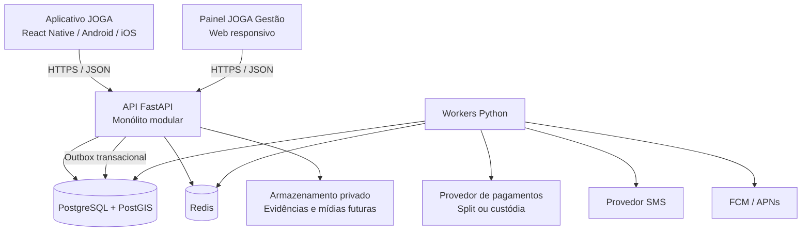
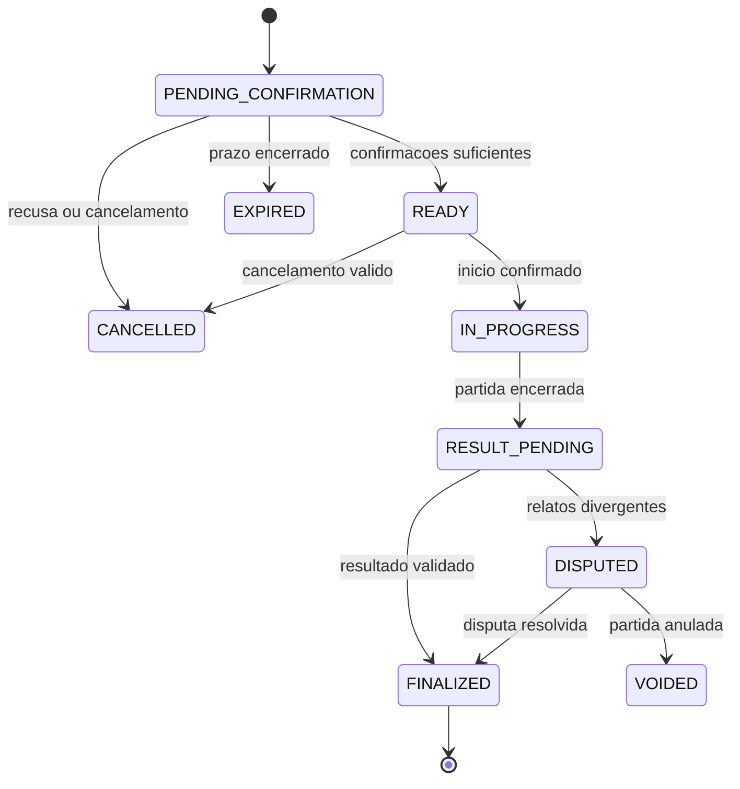
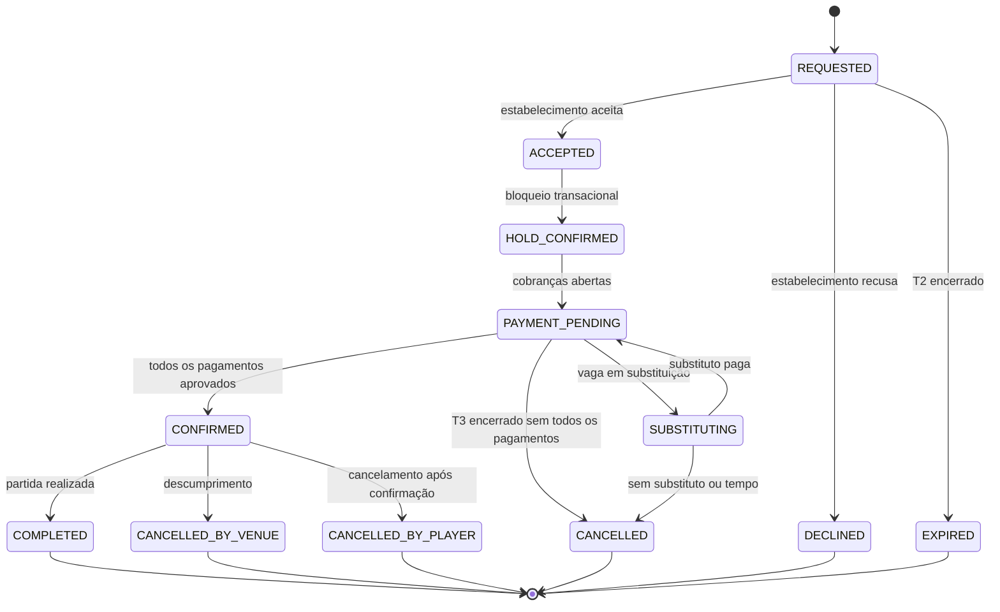

# JOGA — Documentação Técnica

**Versão:** 2.1<br>
**Status:** especificação técnica-alvo; não representa implementação concluída<br>
**Data:** 5 de novembro de 2026<br>
**Escopo:** aplicativo Android/iOS, painel web de gestão, API, PostgreSQL/PostGIS, Redis, workers e fluxo financeiro de reservas de quadras<br>
**Nome do produto:** JOGA

> Este documento consolida a arquitetura-alvo do JOGA. Ele não afirma que os componentes especificados já estejam implementados. A ordem normativa e os limites de cada fase permanecem definidos em `PLANS.md`. O projeto é independente e não pressupõe migração de código, dados ou infraestrutura de um repositório anterior.

---

## 1. Visão técnica do produto

O JOGA é uma plataforma esportiva com duas experiências de usuário:

1. **Aplicativo mobile do jogador:** matchmaking, partidas, lobbies, chat, amigos, clãs, descoberta de quadras, reservas e pagamentos individuais.
2. **Painel web de gestão:** ambiente autenticado para estabelecimentos esportivos administrarem quadras, agenda, reservas e informações financeiras originadas no JOGA.

As duas experiências compartilham API, identidade, banco de dados e infraestrutura. O painel web não é um ERP e não administra automaticamente vendas presenciais ou operações externas ao JOGA. Não está previsto um site público independente para consumidores no escopo inicial.

O sistema deve manter domínios esportivos, sociais e financeiros separados logicamente dentro de um monólito modular. A integração entre eles ocorre por contratos explícitos e eventos auditáveis, sem permitir que transações financeiras influenciem o resultado competitivo.

O comércio de produtos está fora do escopo inicial (ADR 0022). A camada comercial é composta por reservas de quadras, parcerias, patrocínios e publicidade contextual.

## 1.1 Decisões de produto e arquitetura

| Tema | Decisão atual |
|---|---|
| Marca | JOGA; “y” é elemento intencional da identidade verbal |
| Nome de exibição pretendido do app | JOGA y JOGA |
| Painel web | JOGA y GESTÃO, responsivo e autenticado |
| Módulo de reservas | JOGA y QUADRA |
| Aplicativo do jogador | Android e iOS |
| Comércio de produtos | Fora do escopo inicial; não especificado nesta versão (ADR 0022) |
| Gestão | Site separado para proprietários, gerentes e funcionários de estabelecimentos |
| Escopo do painel | Somente operações originadas no JOGA; não é ERP geral |
| Esportes iniciais | Futebol 5x5 (10 jogadores no total) e vôlei |
| Duração de partida | Definida por configuração de esporte/formato; não livre por lobby |
| Fila de matchmaking | Uma fila lógica, com filtro de espaço público/privado/tanto faz |
| Horário de lobby | Data e horário específicos; matchmaking escolhe slot comum a partir das disponibilidades |
| Quadras públicas | Descoberta/local de encontro; reserva formal apenas se houver autorização e disponibilidade verificável |
| Quadras privadas | Cadastro, agenda, reserva e pagamento quando habilitados |
| Chat | Por lobby e por clã; sem chat global universal no escopo atual |
| Clãs | Abertos ou fechados, com ranking de troféus por modalidade |
| Reservas | Solicitação ao estabelecimento, bloqueio temporário e confirmação com pagamentos completos |
| Pagamentos | Pix individual por participante; PSP externo com split ou custódia centralizada |
| Custódia | Sem carteira própria; liberação ao estabelecimento somente após a reserva e a partida |
| KYC do recebedor | Obrigatório antes de abrir reserva paga |
| Interface financeira | Obrigatória para o estabelecimento quando houver split (Res. 264/349) |
| Dados oficiais | PostgreSQL como fonte da verdade |
| Backend | FastAPI em monólito modular |
| Redis | Cache, limites, presença e distribuição efêmera; não fonte oficial |
| Workers | Processos separados para tarefas assíncronas |

## 1.2 Princípios inegociáveis

- Toda mudança relevante de estado é validada no servidor.
- O cliente nunca determina MMR, Trust Factor, troféus, resultado oficial, disponibilidade, estado de reserva, status financeiro ou permissões.
- PostgreSQL é a fonte da verdade para estado esportivo, social, de reservas e financeiro.
- Redis não é fonte oficial de filas, partidas, reservas, pagamentos ou rating.
- Requisições repetidas não podem duplicar reservas, pagamentos, estornos, mensagens de sistema ou aplicações de rating.
- Dados de telefone, localização e dados financeiros são minimizados e protegidos.
- Permissões de estabelecimento devem ser isoladas por organização.
- Falhas de SMS, push, Redis, WebSocket ou provedor de pagamento não podem corromper o estado oficial.
- O sistema deve registrar eventos financeiros e competitivos de forma auditável.
- A liberação de valor ao estabelecimento só ocorre depois da confirmação da reserva e da realização da partida.
- Estabelecimento sem recebedor ativo não pode originar reserva paga.

## 2. Escopo e exclusões

### 2.1 Incluído na arquitetura-alvo

- Aplicativo mobile Android/iOS para jogadores.
- Painel web responsivo e autenticado para estabelecimentos.
- Identidade central, telefone verificado, passkeys e sessões seguras.
- Perfis, esportes e formatos.
- Preferências de quadra pública/particular/indiferente.
- Disponibilidade e matchmaking com horário concreto de partida.
- Lobbies manuais e lobbies formados pelo matchmaking.
- Chat persistente por lobby e por clã, inicialmente textual.
- Lista de amigos, convites e bloqueios.
- Clãs abertos/fechados e ranking de troféus por modalidade.
- Resultados, disputas, MMR individual e Trust Factor esportivo.
- Cadastro de estabelecimentos, quadras e agenda.
- Solicitação de reserva, bloqueio temporário e máquina de estados.
- Pagamento Pix individual, split ou custódia centralizada e reembolsos.
- Onboarding/KYC do recebedor e portão de elegibilidade.
- Interface financeira do estabelecimento, liberação e conciliação.
- Cancelamentos e reembolsos com trilha de auditoria.
- Denúncias de usuários e moderação de chats de lobby e clã, com revisão humana.
- Publicidade patrocinada como módulo posterior, sem impacto competitivo.

### 2.2 Fora do escopo atual

- Comércio de produtos: catálogo, estoque, pedidos, vendedores, entregas, código de recebimento, avaliações e disputas de produtos.
- Site público independente para consumidores.
- App nativo separado para gerenciadores.
- ERP completo ou gestão de vendas presenciais/externas.
- Logística própria, cálculo/cotação de frete, contratação de transportadoras, geração de etiquetas e rastreamento centralizado.
- Integrações genéricas com ERPs e PDVs no primeiro lançamento.
- Carteira custodial ou processador de pagamentos próprio.
- Aluguel de equipamentos com caução, ciclo de devolução e controle de danos.
- Gestão completa de academias/clubes, matrículas, mensalidades, catracas e frequência.
- Intermediação de profissionais individuais.
- Torneios, chaves, fases, inscrições e premiações.
- Chat global universal.
- Upload livre de imagens, vídeos, áudios e arquivos nos chats.
- Kafka, Kubernetes e microserviços como requisito inicial.
- Antifraude completamente automatizado/decisório (a IA é auxiliar e casos sensíveis demandam revisão humana; denúncia não gera punição automática).
- Rastreamento contínuo em segundo plano.

## 3. Arquitetura geral

### 3.1 Estilo arquitetural

Adotar um **monólito modular**, com processos separados para API e workers. A aplicação mobile e o painel web acessam a mesma API. Os módulos compartilham PostgreSQL como fonte da verdade, mas mantêm fronteiras de domínio e regras próprias.



O painel web pode ser desenvolvido em React + TypeScript, mas o framework final deve ser registrado em ADR próprio. A escolha do framework web não precisa bloquear a prova técnica mobile da Fase 1.

### 3.2 Responsabilidades

**Aplicativo React Native**
- Interface de jogador.
- Matchmaking, lobbies, chat, clãs, descoberta de quadras, reservas e pagamentos.
- Integração nativa com passkeys, localização, armazenamento seguro e push.
- Não contém regras autoritativas de MMR, disponibilidade, preço final, estado de reserva, pagamento ou permissão.

**Painel web de gestão**
- Interface autenticada para proprietários, gerentes e funcionários.
- Cadastro de estabelecimento, quadras, horários, preços, bloqueios, solicitações, reservas e informações financeiras.
- Consulta de liberações, recebíveis, comissões, status e relatórios básicos.
- Não administra vendas externas ao JOGA no escopo inicial.
- Não acessa dados de outra organização sem autorização explícita.

**API FastAPI**
- Autenticação, autorização e isolamento multi-tenant.
- Casos de uso e transições de estado.
- Transações de banco, controle de agenda e reserva.
- Integração com provedor de pagamento e KYC do recebedor.
- Verificação de webhooks, eventos financeiros e idempotência.
- Outbox, rate limits, paginação, validação e contratos OpenAPI.

**PostgreSQL + PostGIS**
- Fonte da verdade de identidade, organizações, recebedores, quadras, agenda, reservas, pagamentos, reembolsos, lobbies, mensagens, clãs, partidas, resultados e ratings.
- Constraints, índices e transações para proteger invariantes.
- Consultas geoespaciais de jogadores e locais.

**Redis**
- Cache não autoritativo.
- Rate limiting distribuído, presença, Pub/Sub e dados efêmeros com TTL.
- Nunca será a única cópia de mensagens, lobbies, reservas, pagamentos, partidas ou rating.

**Workers Python**
- Matchmaking e expiração de entradas.
- Processamento da Outbox.
- Notificações e push.
- Expiração de bloqueios e prazos de reserva.
- Reconciliação de pagamentos, liberações e reembolsos.
- Liberação automática após a partida, com janela de disputa.
- Processamento de rating e troféus após validação.

## 4. Organização do código

Estrutura sugerida do monorepo:

```text
mobile/
  src/
    app/
    features/
      authentication/
      profile/
      sports/
      matchmaking/
      lobbies/
      chat/
      friends/
      clans/
      matches/
      results/
      rankings/
      venues/
      bookings/
      payments/
    shared/
    services/
    navigation/
  android/
  ios/

management-web/
  src/
    app/
    features/
      authentication/
      organizations/
      staff/
      venues/
      availability/
      bookings/
      payments/
      financial/
      reports/
    shared/

backend/
  app/
    main.py
    core/
      config.py
      security.py
      errors.py
      logging.py
      permissions.py
      tenancy.py
    infrastructure/
      database/
      redis/
      sms/
      push/
      payments/
      kyc/
      storage/
      telemetry/
    modules/
      identity/
      users/
      organizations/
      memberships/
      sports/
      sport_formats/
      availability/
      locations/
      venues/
      venue_availability/
      bookings/
      booking_timers/
      payments/
      payouts/
      financial/
      matchmaking/
      lobbies/
      chat/
      friends/
      clans/
      matches/
      results/
      disputes/
      ratings/
      reputation/
      moderation/
      advertising/
      notifications/
    api/
      v1/
  workers/
  migrations/
  tests/
  scripts/
  pyproject.toml
  Dockerfile

docs/
  JOGA_DOCUMENTACAO_CONCEITO_PRODUTO.md
  JOGA_DOCUMENTACAO_TECNICA.md
  ADR/
  API.md
  SECURITY.md
  DATA_MODEL.md
  RUNBOOK.md

infra/
.github/
harness/
AGENTS.md
GOALS.md
PLANS.md
PROMPTS.md
README.md
```

Cada módulo mantém suas regras, schemas, serviços e repositórios próximos. Rotas HTTP devem ser finas. Evitar módulos genéricos gigantes e dependências circulares.

## 5. Identidade, contas e autorização

### 5.1 Identidade central

Uma pessoa poderá possuir uma conta JOGA e assumir diferentes contextos:

- Jogador/consumidor.
- Proprietário de estabelecimento.
- Funcionário/gerenciador de estabelecimento.

Não exigir perfil esportivo para utilizar o painel de gestão. Não criar uma conta separada para cada papel.

O identificador interno será UUID. Número de telefone é contato verificado, não prova de identidade civil nem chave primária.

### 5.2 Organização e isolamento comercial

Modelar organizações/estabelecimentos e seus membros explicitamente:

- `organizations`: entidade comercial.
- `organization_memberships`: vínculo entre usuário e organização.
- `organization_roles` ou permissões equivalentes: proprietário, administrador, operador e permissões específicas.
- `venues`: perfil do estabelecimento esportivo, vinculado à organização.

Toda consulta ou mutação deve validar organização, associação do usuário, papel e recurso específico. UUID difícil de adivinhar não substitui autorização.

Um operador de um estabelecimento só pode ver quadras, agenda, reservas, pagamentos e dados necessários daquela organização. Um funcionário de uma arena só pode administrar quadras e reservas autorizadas.

### 5.3 Telefone e OTP

O número deve ser normalizado em E.164. Aplicar rate limits por IP, dispositivo, telefone e operação. OTP de uso único, expiração curta, limite de tentativas e armazenamento como hash/HMAC protegido por segredo. Não registrar OTP ou telefone completo em logs.

Parâmetros iniciais sugeridos: seis dígitos, validade de cinco minutos, até cinco tentativas por desafio e intervalo mínimo de 60 segundos para reenvio, sujeitos a teste de abuso e custo.

O número poderá ser reciclado, compartilhado ou comprometido por SIM swap. SMS não deve ser o único método de recuperação de conta.

### 5.4 Passkeys e sessões

Passkeys serão o método preferencial após o cadastro. O backend gera e valida desafios de uso único, origem/RP ID, flags e assinatura. Registrar múltiplas credenciais quando suportado, permitir revogação individual e oferecer recuperação de risco elevado.

O protótipo da Fase 1 deve validar Android e iOS com mecanismos nativos: Credential Manager no Android e Authentication Services no iOS. A estratégia de framework foi decidida em favor do Expo development build com `expo prebuild` (ADR 0009); a biblioteca de passkeys ainda depende de prova em ambas as plataformas.

Access tokens de curta duração; refresh tokens opacos, aleatórios, armazenados no servidor como hash e rotacionados. Reutilização de token antigo revoga a família da sessão. Tokens ficam em Keychain/Keystore no aplicativo e em armazenamento seguro equivalente no navegador.

Para áreas administrativas/comerciais, avaliar controles reforçados, reautenticação para ações financeiras e registro de auditoria.

### 5.5 Domínio técnico

Mesmo sem site público para consumidores, será necessário um domínio técnico protegido para associações de passkeys/aplicativos e arquivos de verificação, conforme os recursos usados. Isso não equivale a construir um site público do JOGA.

## 6. Localização e privacidade

- Solicitar localização somente quando uma funcionalidade precisar dela.
- Priorizar uso em primeiro plano; não solicitar rastreamento contínuo em segundo plano no MVP.
- Oferecer localização aproximada e busca manual por região.
- Não revelar a posição residencial exata de um jogador a outros participantes.
- Não armazenar histórico de deslocamento.
- Consultas geoespaciais devem aplicar raio máximo, paginação e índices GiST.
- Para usuários, coordenadas devem ser processadas com minimização e retenção curta quando persistência não for necessária.
- A localização serve para sugerir região e locais; não prova presença ou resultado competitivo.

Usar PostGIS com `geography(Point, 4326)` quando a consulta envolver distâncias em metros, índice GiST, `ST_DWithin` para filtro e `ST_Distance` para ordenação.

O tratamento deverá observar a LGPD: finalidade, necessidade, transparência, segurança, retenção, direitos do titular e contratos com operadores/provedores. Avisos e bases legais precisam de revisão jurídica antes do lançamento.

## 7. Catálogo esportivo e formatos

### 7.1 Modalidades iniciais

O catálogo inicial inclui:

- Futebol 5x5, total de 10 participantes, duas equipes de cinco.
- Vôlei, com composição exata do formato a ser validada antes da implementação definitiva.

Cada formato terá configuração própria e versionada:

- Quantidade total de participantes.
- Composição das equipes.
- Duração padrão em minutos.
- Regras de confirmação e encerramento.
- Requisitos de local e espaço.
- Elegibilidade casual/ranqueada.

A duração será fixa por esporte/formato. O lobby não poderá escolher uma duração arbitrária. Ao criar o lobby, o backend copia a duração configurada para o registro da partida, preservando o valor histórico mesmo se a configuração mudar futuramente.

### 7.2 Preferências de quadra

Cada usuário poderá definir uma preferência padrão:

- `PUBLIC_ONLY`.
- `PRIVATE_ONLY`.
- `ANY`.

A preferência poderá ser sobrescrita para uma entrada específica na fila. O sistema deve guardar a preferência efetiva usada na formação.

## 8. Matchmaking e agendamento

### 8.1 Uma única fila lógica

Não criar filas independentes por tipo de quadra. O matchmaking opera sobre entradas persistentes e usa a preferência de espaço como restrição de compatibilidade.

A interseção de preferências deve ser respeitada:

- `PUBLIC_ONLY` + `ANY` resulta em pública.
- `PRIVATE_ONLY` + `ANY` resulta em particular.
- `PUBLIC_ONLY` + `PRIVATE_ONLY` é incompatível para um mesmo lobby.
- `ANY` + `ANY` permite ambas.

Se não houver uma categoria de local compatível, não formar o lobby como se houvesse compatibilidade. O sistema poderá aguardar novos participantes ou solicitar ajuste de preferência.

### 8.2 Horário concreto por lobby

O usuário pode informar janelas de disponibilidade. O algoritmo procura um intervalo comum e, ao formar o lobby, seleciona e registra uma data/hora específica.

Todo lobby deve ter:

- `scheduled_start_at` em `timestamptz`.
- `sport_format_id` e versão/configuração aplicada.
- `duration_minutes` copiada da configuração do formato.
- `scheduled_end_at` calculada pelo backend.
- Fuso de apresentação adequado à região do local.

Lobbies manuais exigem data e horário concretos na criação. A duração vem do formato; não é escolhida livremente.

### 8.3 Localização calculada pelo matchmaking

O matchmaking calculará uma região de encontro a partir das localizações aproximadas/autorizadas e preferências dos participantes. Não usar automaticamente o primeiro jogador ou o criador como centro único. O cálculo deve equilibrar deslocamento e privacidade.

### 8.4 Formação transacional

O worker deve:

1. Selecionar entradas compatíveis no PostgreSQL.
2. Bloquear linhas necessárias com `SELECT ... FOR UPDATE SKIP LOCKED` ou estratégia equivalente.
3. Revalidar elegibilidade, horário, preferência de espaço e estado dentro da transação.
4. Selecionar participantes e balancear equipes no servidor.
5. Criar lobby, partida e participantes.
6. Registrar o horário concreto e a duração configurada.
7. Atualizar as entradas da fila.
8. Registrar eventos na Outbox.
9. Confirmar a transação.

Uma falha no Redis não pode duplicar ou perder uma partida oficial.

### 8.5 Invariantes

- Um jogador não participa de partidas simultâneas incompatíveis.
- Uma entrada ativa incompatível não pode ser duplicada.
- Uma partida possui tamanho e formato válidos.
- A preferência de espaço usada na formação fica registrada.
- Todo processamento do worker é idempotente.
- Constraints e locks protegem as invariantes; não depender apenas de verificações anteriores à transação.

## 9. Lobbies, quadras e votação

### 9.1 Tipos de lobby

Separar no modelo:

- `origin`: `MANUAL` ou `MATCHMAKING`.
- `visibility`: `OPEN` ou `CLOSED`.

Lobby manual exige data e horário fixos. Pode ser aberto para descoberta ou fechado por convite.

Lobby do matchmaking é criado pelo sistema após a formação de um grupo compatível. Para os lobbies abertos do matchmaking, não existe proprietário com poder unilateral de escolher ou trocar a quadra.

### 9.2 Votação de troca de quadra

A votação é permitida somente em lobby aberto originado pelo matchmaking. Não habilitar em lobbies fechados ou lobbies criados manualmente.

Regras:

- Qualquer participante elegível pode propor uma alternativa.
- Apenas uma votação pode ficar ativa por lobby.
- Cada participante possui um voto por proposta.
- A proposta precisa respeitar a categoria permitida (`PUBLIC_ONLY`, `PRIVATE_ONLY` ou `ANY`) registrada no lobby.
- A quadra candidata precisa atender ao mesmo horário, duração, modalidade e demais restrições.
- O backend recalcula disponibilidade antes de concluir a alteração.

**Quórum e aprovação iniciais:** pelo menos 50% dos participantes elegíveis devem votar; entre os votos válidos, “Sim” precisa ser estritamente maior que 50%. Empate, maioria “Não” ou falta de quórum rejeitam a proposta. Abstenções não entram na proporção Sim/Não, mas não ajudam a atingir o quórum.

A mudança só é aplicada após a confirmação da disponibilidade e das condições comerciais. Se houver reserva ou pagamento anterior, o sistema deve exigir resolução explícita de cancelamento/reembolso antes de substituir o local. Votação aprovada não cancela reserva paga automaticamente.

### 9.3 Espaços públicos e privados

Locais públicos podem ser cadastrados e recomendados como ponto de encontro, mas não devem ser apresentados como formalmente reserváveis sem autorização e disponibilidade verificável.

Locais privados podem oferecer horários reserváveis. A reserva precisa bloquear o intervalo correspondente em transação, com proteção contra dupla reserva.

## 10. Ciclo de vida da partida e resultados

Estados propostos:



As transições devem ser implementadas em serviço de domínio central. Não permitir alteração livre de status por endpoint. A quantidade e o tipo de confirmações são configuráveis por formato. Denúncia isolada não determina punição; relatos divergentes levam a `DISPUTED`, e resultado disputado não altera MMR até a resolução.

### 10.1 Capitães

Nas partidas formadas pelo matchmaking, cada equipe terá um capitão simbólico, escolhido automaticamente pelo backend.

- O capitão não terá autoridade administrativa sobre os demais jogadores e não poderá decidir unilateralmente o resultado. Sua função é representar a equipe na comunicação e registrar uma confirmação adicional do resultado, que o sistema tratará como informação adicional, não como decisão absoluta.
- A seleção segue esta ordem de prioridade:
  1. Maior Trust Factor esportivo.
  2. Maior número de partidas válidas realizadas.
  3. Maior MMR da modalidade/formato.
  4. Maior idade, em caso de empate nos critérios anteriores.
- A seleção deve ser determinística, registrada na partida e auditável. Os critérios (inicialização do Trust Factor de novos jogadores, empates finais e substituição por ausência) permanecem pendentes de definição (seção 26).
- O conceito define capitão apenas para partidas formadas pelo matchmaking. Lobbies manuais ficam sem capitão até que o produto decida o contrário (seção 26); os endpoints de confirmação não devem exigir capitão nesses casos.

### 10.2 Relato e confirmação do resultado

- Ao final da partida, todos os participantes devem relatar o resultado individualmente, selecionando a equipe vencedora ou empate, quando o formato permitir.
- Os capitães podem registrar a confirmação de suas respectivas equipes.
- Os relatos individuais são visíveis aos demais participantes da partida. A exposição é intencional (responsabilidade social) e deve respeitar autorização: somente participantes da partida podem consultar os relatos e as confirmações; nenhuma consulta externa.
- O prazo de relato será limitado e configurável entre 5 e 10 minutos após o encerramento da partida. Os limites da faixa são validados no servidor; o valor efetivo por formato permanece pendente (seção 26).
- Jogadores que não relatarem dentro do prazo são registrados como relatos anulados. Relatos anulados não contam como favoráveis a nenhum resultado e são apresentados separadamente, sem interpretação automática de concordância ou discordância.

### 10.3 Divergências e validação

- O backend compara os relatos e as confirmações dos capitães. Divergências isoladas não interrompem automaticamente a validação: o resultado majoritário pode ser aceito quando a divergência estiver dentro da tolerância configurável por modalidade e quantidade de participantes. O valor base da tolerância permanece pendente (seção 26) e deve ser validado antes do uso.
- Quando mais de 50% dos relatos válidos divergirem do resultado predominante, a partida entra em `DISPUTED`. Quando a divergência for exatamente de 50%, aplica-se o fluxo de desempate da seção 10.4.
- A disputa é medida de proteção, não mecanismo para anular partidas automaticamente. A anulação é considerada apenas como última alternativa, depois de avaliadas as evidências.

### 10.4 Desempate exato em 50% — segunda votação e análise de confiabilidade

Regra aprovada para o caso de divergência exatamente igual a 50% (conceito §9.4; ADR 0008).

1. **Segunda confirmação.** O backend abre uma nova rodada de confirmação para todos os participantes da partida. Cada jogador pode confirmar ou corrigir a resposta anterior. A segunda rodada tem prazo curto e configurável; o valor efetivo permanece pendente (seção 26).
2. **Histórico preservado.** Nenhum relato é sobrescrito: a primeira votação é mantida integralmente para auditoria, e cada confirmação/correção da segunda rodada é registrada de forma append-only com ator e timestamp.
3. **Análise interna e invisível.** Se a segunda rodada continuar exatamente empatada em 50%, a partida entra em análise interna de confiabilidade, sem exposição de indicadores aos participantes:
   - Avalia cada relato individualmente — não por média simples de Trust Factor do grupo — impedindo que um grupo vença apenas acumulando contas de alta reputação.
   - Sinais avaliados: consistência de votos entre as rodadas; histórico competitivo; coerência em alterações de voto; detecção de padrões de comportamento coordenado ou manipulação.
   - Os relatos dos capitães (selecionados por Trust Factor, seção 10.1) funcionam como sinais relevantes pela confiabilidade de seu histórico, sem peso automático de voto adicional e sem autoridade para determinar o resultado sozinhos.
   - Os indicadores internos e a análise nunca são exibidos aos participantes; servem exclusivamente ao sistema.
4. **Desfechos.** O sistema tenta resolver com base nos indicadores; se as evidências não permitirem conclusão segura, o caso vai para revisão humana. A anulação permanece como último recurso.
5. **MMR congelado.** Durante as duas rodadas e a análise, nenhuma aplicação de rating é permitida: o rating só é aplicado após decisão final validada, via mecanismo idempotente (seção 11.1).

### 10.5 Disputas de partida

Uma partida em `DISPUTED` não gera aplicação de rating.

- O sistema reúne: relatos de cada participante; confirmações dos capitães; histórico de alterações e confirmações; denúncias relacionadas à partida; histórico de confiabilidade relevante dos envolvidos; outras evidências disponíveis e pertinentes.
- A primeira análise pode ser automatizada por regras de consistência e mecanismos de detecção de comportamento suspeito. Casos inconclusivos ou com indícios relevantes de fraude podem ser encaminhados para revisão humana.
- Decisões possíveis: confirmar o resultado predominante; solicitar informações adicionais; corrigir o resultado quando houver evidência suficiente; aplicar medidas de integridade quando houver fraude comprovada; anular a partida somente quando não houver alternativa confiável.
- Toda decisão é registrada com justificativa auditável, ator, timestamp e mecânica append-only; correções posteriores geram eventos compensatórios (seção 11.1).

### 10.6 Integridade do sistema de resultados

- O sistema deve proteger relatos contra manipulação por votos coordenados, contas falsas e denúncias abusivas, com mecanismos próprios de detecção de padrões suspeitos. O balanceamento de MMR não é tratamento suficiente contra fraude.
- Resultados não confirmados ou em disputa não alteram MMR. A plataforma preserva histórico auditável dos relatos originais e das decisões finais.

## 11. Rating, Trust Factor e justiça competitiva

### 11.1 MMR

- Separado por modalidade e formato competitivo.
- Calculado exclusivamente no backend.
- Partidas casuais não alteram MMR ranqueado.
- Uma partida só pode gerar uma aplicação de rating por usuário/versão de cálculo.
- Toda alteração gera evento imutável com valor anterior, delta, valor posterior e versão do algoritmo.
- Correções geram eventos compensatórios, sem apagar histórico.
- Começar com Elo simples por trás de interface `RatingEngine`; avaliar Glicko-2 ou outro método apenas quando houver dados que justifiquem.

### 11.2 Trust Factor esportivo

Trust Factor representa confiabilidade operacional em partidas, não habilidade esportiva nem reputação comercial.

Sinais possíveis: ausências confirmadas e reincidentes, cancelamentos em cima da hora, disputas confirmadas após análise e padrões de abuso. Denúncia isolada não reduz automaticamente o indicador. Decisões relevantes devem permitir contestação e gerar `trust_events` auditáveis.

### 11.3 Separação de sistemas

Compras, anúncios patrocinados, assinatura, gasto em quadras ou pagamento a estabelecimentos nunca alteram MMR, Trust Factor esportivo ou troféus de clã.

## 12. Amigos, chat e clãs

### 12.1 Lista de amigos

Modelar solicitações, vínculos, bloqueios e preferências de notificação. Convites para lobby precisam respeitar bloqueios, privacidade e limites contra spam.

### 12.2 Chat por lobby e por clã

Não haverá chat global universal no escopo atual. Conversas permitidas:

- Chat associado a lobby, acessível somente a participantes autorizados.
- Chat permanente de clã, acessível somente a membros autorizados.

A primeira versão permite texto e referências internas do JOGA (links/objetos de partidas, quadras e lobbies). Não permitir upload livre de áudio, vídeo, imagem ou arquivo no MVP.

Mensagens devem ser persistidas no PostgreSQL. WebSocket serve à entrega em tempo real, não à persistência. Redis pode distribuir eventos e presença entre processos. Push notifica usuários desconectados.

Controles obrigatórios: autorização por conversa, paginação, limite de tamanho e frequência, bloqueio, denúncia, silenciamento, moderação, prevenção de spam e auditoria de ações administrativas.

### 12.3 Clãs

Clãs possuem estado aberto ou fechado, membros, administradores, convites e limites. Entrada em clã aberto pode ser imediata, desde que haja vaga e regras atendidas. Entrada em clã fechado depende de convite ou aprovação.

O vínculo do jogador ao clã na data de uma partida deve ser registrado para atribuir corretamente os pontos. Mudança de clã não transfere retroativamente troféus conquistados.

### 12.4 Moderação, denúncias de usuários e Trust & Safety

Módulo dedicado (fase 17 do `PLANS.md`). Especificação alvo traduzida do conceito (seções 21.5 e 21.5.1–21.5.5); políticas e parâmetros pendentes de decisão (seção 26). Escopo inicial: chats de lobby e de clã, limitados a texto e referências internas do JOGA; não há moderação de mídia enviada por usuários, pois o MVP não admite upload livre.

#### 12.4.1 Denúncia de perfil no lobby

- Cada participante pode denunciar outro jogador diretamente pelo perfil disponível no lobby.
- Categorias de comportamento incluem: ofensas e insultos; assédio e intimidação; discurso de ódio ou discriminação; atitude antidesportiva; provocação ou comportamento abusivo; spam e mensagens indesejadas; tentativa de fraude ou manipulação de partida; outras condutas inadequadas.
- O denunciante pode selecionar até cinco mensagens específicas como contexto. A IA analisa o contexto dessas mensagens e uma faixa limitada de mensagens próximas, conforme o limite de contexto definido pelo sistema, evitando interpretação isolada. O limite de janela é parâmetro pendente (seção 26).
- O backend deve registrar autor, denunciado, lobby, mensagens selecionadas, contexto autorizado e horário dos eventos.

#### 12.4.2 Moderação automatizada por IA

A IA é camada auxiliar, com níveis de confiança e possibilidade de contestação. Ela pode auxiliar:

- Classificação de denúncias; identificação de ofensas, assédio e discriminação; detecção de spam e mensagens repetitivas; identificação de ameaças e comportamentos potencialmente perigosos; agrupamento de denúncias relacionadas; priorização por gravidade e risco; identificação de possíveis denúncias abusivas ou coordenadas.

- A automação pode aplicar apenas medidas preventivas proporcionais e reversíveis, conforme regras previamente definidas (ocultação temporária de conteúdo, limitação de envio). Suspensões permanentes e decisões graves exigem critérios mais rigorosos e revisão humana. A IA não é autoridade infalível.

#### 12.4.3 Revisão humana e medidas

- No estágio inicial, o próprio responsável pelo JOGA pode atuar como moderador humano. A ferramenta de revisão é interna e separada do painel de gestão (JOGA y GESTÃO); deve apresentar histórico, mensagens relevantes, evidências, classificação automatizada e ações recomendadas.
- Revisão humana é reservada principalmente para casos graves; denúncias com evidências conflitantes; risco à segurança de usuários; recursos contra medidas automatizadas; casos de baixa confiança da IA; possíveis fraudes ou denúncias coordenadas.
- Medidas possíveis: aviso; remoção ou ocultação de mensagens; restrição temporária de envio; restrição de participação em lobbies; suspensão temporária da conta; suspensão permanente em casos graves ou reincidentes. Medidas são proporcionais à gravidade e reincidência, com justificativa e possibilidade de contestação, em registro append-only.
- Denúncia isolada não reduz automaticamente o Trust Factor esportivo; o sistema considera a confiabilidade da denúncia e a existência de evidências antes de aplicar penalidades (seção 11.2).

#### 12.4.4 Privacidade, acesso e retenção

- Acesso a mensagens e evidências de moderação limitado a pessoas e processos autorizados, com auditoria de acessos.
- Armazenar apenas o contexto necessário para analisar a denúncia, com política de retenção a definir (seção 26).
- A automação prioriza o processamento eficiente; conversas não são encaminhadas continuamente para IA/revisão humana sem necessidade.

### 12.5 Troféus de clã

O ranking será separado por modalidade. Não somar futebol e vôlei em um único ranking inicial.

Fórmula-base proposta:

```text
Troféus do clã =
    50% componente de vitórias/resultados competitivos validados
  + 30% componente de contribuição/desempenho dos membros
  + 20% componente de participação competitiva válida
```

Cada componente deverá ser normalizado e versionado. Somente partidas ranqueadas com resultado validado contam. O componente de participação terá limites para não premiar volume artificial. A pontuação será calculada considerando inicialmente os 10 melhores membros elegíveis do clã em cada modalidade.

A elegibilidade deve incluir tempo mínimo de vínculo ao clã e controles contra troca oportunista de clã e partidas combinadas. Os parâmetros exatos de normalização, limite de partidas e permanência mínima serão definidos em ADR após simulações.

Os pesos 50/30/20 são a fórmula-base aceita para prototipação, não devem ser implementados sem simulações e testes de abuso. Temporadas podem ter 30 ou 60 dias; a duração final permanece configurável e pendente de validação.

Troféus de clã são uma classificação coletiva própria, independente do MMR individual. Nenhum ponto pode ser comprado ou concedido por publicidade.

## 13. Organizações, quadras e onboarding do recebedor

### 13.1 Organizações e estabelecimentos

Uma organização pode administrar um ou mais espaços esportivos. Cada recurso deve estar vinculado à organização proprietária e ter permissões explícitas.

O modelo mínimo:

- `organizations`: entidade comercial.
- `organization_memberships`: vínculo entre usuário e organização.
- `organization_roles`: proprietário, administrador e operador, com permissões por recurso.
- `venues`: perfil do estabelecimento, endereço, geografia, contato e estado operacional.
- `venue_spaces`: quadras ou espaços reserváveis de um estabelecimento.
- `venue_sports`: vínculo entre espaço e modalidade.
- `venue_availability`: horários regulares, preços, duração e exceções.

### 13.2 Agenda e disponibilidade

O estabelecimento define quadras, horários, preços, intervalos, bloqueios e regras. Deve poder registrar reservas feitas externamente para evitar que o JOGA anuncie um horário já indisponível.

A reserva deve controlar conflitos de intervalo, não apenas igualdade de horário de início. O bloqueio e a confirmação precisam ocorrer de forma transacional ou por mecanismo de hold com expiração.

A agenda deve considerar:

- Fuso do estabelecimento.
- Duração definida pelo formato esportivo.
- Intervalo de manutenção entre reservas.
- Feriados, dias fechados e exceções.
- Reservas externas e bloqueios manuais.
- Preço por faixa de horário, quando existir.

### 13.3 Recebedor e KYC

Cada estabelecimento que recebe pagamento precisa de um recebedor no PSP:

- Dados cadastrais de CPF/CNPJ.
- Conta bancária na mesma titularidade.
- Validação de identidade e, conforme o PSP, prova de vida.
- Estado de credenciamento: `PENDING`, `ACTIVE`, `REJECTED`, `SUSPENDED`.
- Referência do recebedor no PSP.

Regra: **reserva paga só pode ser aberta para recebedor `ACTIVE`**. O estado é consultado no backend e registrado no momento da abertura da cobrança. KYC pendente não é contornado por promessa comercial.

### 13.4 Permissões

Toda consulta ou mutação deve validar organização, associação do usuário, papel e recurso específico.

- Um operador de um estabelecimento só vê quadras, agenda, reservas e dados financeiros daquela organização.
- Um funcionário de arena só administra quadras e reservas autorizadas.
- Dados bancários e de KYC têm acesso restrito.
- Ações administrativas e financeiras geram auditoria.

---

## 14. Reservas, bloqueio e temporizadores

### 14.1 Solicitação e aceite

O fluxo começa com uma solicitação de reserva vinculada a:

- Lobby e participantes.
- Estabelecimento e espaço.
- Data/hora inicial e final.
- Preço e condições aplicadas no momento da solicitação.
- Origem `JOGA`.
- Política de cancelamento/reembolso.

O estabelecimento aceita ou recusa. O aceite é um compromisso condicional de honrar a reserva se todos pagarem dentro do prazo.

### 14.2 Bloqueio temporário

O bloqueio deve ser transacional e vinculado ao intervalo específico:

- Impedir sobreposição com outra reserva ou bloqueio.
- Ter expiração explícita.
- Ser liberado quando o prazo termina, a reserva é recusada ou o lobby é cancelado.
- Não ser prorrogado por substituição de participante.

Em PostgreSQL, a proteção pode usar constraint de exclusão por intervalo (`tstzrange` + GiST/`btree_gist`) ou verificação transacional equivalente. A verificação apenas no cliente não é suficiente.

### 14.3 Três temporizadores independentes

**T1 — confirmação de participação.** Prazo inicial de 1 hora para os jogadores confirmarem que pretendem participar. Controlado pelo backend.

**T2 — resposta do estabelecimento.** Cerca de 30 minutos de funcionamento, com prazo máximo em tempo corrido. O estabelecimento aceita ou recusa e confirma o bloqueio.

**T3 — bloqueio e pagamento.** 60 minutos, configurável por estabelecimento, com buffer de 5 a 10 minutos para conciliação. As cobranças são abertas depois do aceite e do bloqueio.

Os prazos são independentes. O backend é a autoridade; notificação, relógio do dispositivo e conexão não são fonte oficial.

### 14.4 Máquina de estados da reserva



As transições são implementadas em serviço de domínio central. Não permitir alteração livre de status por endpoint. Cada transição registra ator, motivo, timestamp e estado anterior.

### 14.5 Substituição de participantes

A substituição é permitida após o aceite, dentro da janela original de pagamento. Não reinicia o prazo nem prorroga o bloqueio.

Regras:

- Apenas um candidato ocupa uma vaga específica.
- A contribuição do substituto é a mesma da vaga, sem recalcular os demais.
- O histórico de qual participante ocupou cada vaga é preservado.
- Pagamento tardio de participante substituído vai para reembolso.
- Se não houver substituto ou tempo, o lobby é cancelado e os valores pagos são devolvidos.

### 14.6 Cancelamento e reembolso

Se a reserva não se completa por falta de pagamento, indisponibilidade, falha de substituição ou expiração:

1. O lobby é cancelado.
2. O bloqueio é liberado.
3. Nenhuma nova cobrança é emitida.
4. Todos os valores pagos são devolvidos integralmente, incluindo a taxa de serviço.
5. As tarifas não recuperáveis são custo do JOGA (`C_c`), não desconto no reembolso.

O valor principal devolvido não é perda integral. O custo relevante é a tarifa não recuperável, a devolução e o atendimento.

### 14.7 Conclusão e liberação

A reserva passa a `COMPLETED` quando a partida é realizada e confirmada conforme as regras do ciclo de partida.

A liberação ao estabelecimento só ocorre depois de `COMPLETED`, dentro da janela de disputa. A liberação automática após `N` horas existe para impedir que a quadra fique refém de confirmação de jogador. `N` permanece pendente.

---

## 15. Pagamentos Pix, split e custódia

### 15.1 Provedor

Utilizar provedor externo com recursos adequados a:

- várias cobranças Pix no mesmo pedido;
- split por cobrança;
- saldo por recebedor;
- transferência/liberação controlada;
- estorno individual;
- webhooks autenticados;
- conciliação.

O Pagar.me Flex é a primeira opção, condicionada a contrato e às respostas do ADR 0021. O Inter é a alternativa centralizada.

Não construir processador próprio, carteira custodial ou custódia informal.

### 15.2 Modelo de cobrança

- Um `order` por reserva.
- Uma cobrança Pix por participante.
- Cada cobrança vinculada a reserva, lobby, participante e vaga.
- Todas as cobranças abertas simultaneamente após o bloqueio.
- Mesmo prazo para todas.
- Valor individual calculado pelo backend e congelado na abertura.

O `order_id` do PSP é a referência externa da reserva. O ledger interno mantém a associação entre cobranças, participantes e reserva.

### 15.3 Split e custódia

**Split (Pagar.me Flex).** Cada estabelecimento é um recebedor. A cobrança é dividida entre a parte do estabelecimento e a taxa do JOGA. O saldo fica no recebedor até a liberação. `transfer_enabled=false` desativa a transferência automática; o JOGA usa `POST /transfers` com `Idempotency-Key` para liberar. Se o recebedor puder sacar por conta própria, a retenção deixa de ser técnica e passa a ser contratual; o risco sobe e `p_t` deve refletir isso.

**Custódia centralizada (Inter).** O valor fica na conta do JOGA. A quadra não saca sozinha. O repasse é feito depois da confirmação. Exige revisão jurídica e segregação contábil.

Em ambos os casos, o backend mantém um ledger financeiro interno auditável. O ledger não é custódia; é registro de direitos e obrigações.

### 15.4 Eventos financeiros

- Confirmar pagamento somente por webhook autenticado ou consulta server-to-server confiável.
- Validar assinatura/autenticidade do webhook.
- Aplicar idempotência por evento/transação.
- Registrar bruto, taxas, comissão, valor do estabelecimento, estornos e ajustes.
- Manter `payment_events` append-only.
- Executar conciliação periódica entre reservas, cobranças, reembolsos e liberações.

### 15.5 Reembolsos e MED

- Reembolso integral quando a reserva não se completa.
- Reembolso individual por cobrança.
- Pagamento tardio entra no fluxo de reembolso.
- Estorno Pix com split deve ser validado no PSP: quem absorve a devolução e as tarifas.
- MED pode debitar o recebedor ou a plataforma; o evento precisa ser registrado e tratado.
- Estorno sem saldo é evento de cauda, coberto por `p_t·V` e por contrato.

### 15.6 Precificação no backend

A taxa aplicada é calculada pela fórmula do documento conceitual §17:

```text
TAXA = c·V + C_k + C_c·μ·S + p_t·V
μ = (1 − q)/q
S = 1 + z·√(φ/μ)
```

O cálculo é resolvido como ponto fixo porque as tarifas percentuais incidem sobre `V + TAXA`. Os parâmetros aplicados ficam registrados por reserva, com versão da fórmula e data de calibração. Se a taxa resultante ultrapassar o limite de elegibilidade da faixa (conceito §17.7), a reserva paga não é oferecida.

O valor é congelado na abertura da cobrança e não muda por recalibração posterior.

### 15.7 Pré-requisitos para abrir pagamento integrado

- Recebedor ativo (KYC).
- Contrato de PSP com tarifas e responsabilidades definidas.
- Capacidade de várias cobranças no mesmo pedido.
- Capacidade de split ou custódia centralizada aprovada.
- Estorno individual testado.
- Webhooks autenticados e idempotentes.
- Interface financeira do recebedor especificada.
- Revisão jurídica do modelo.

---

## 16. Interface financeira, liberação e conciliação

### 16.1 Conteúdo obrigatório

Quando houver split, o estabelecimento precisa de uma interface financeira com:

- Extrato por reserva e por cobrança.
- Agenda de recebíveis.
- Status de liberação (`PENDING`, `RELEASED`, `FAILED`, `REVERSED`).
- Comprovantes e notas de repasse.
- Dados contratuais do recebedor.
- Histórico de estornos e ajustes.
- Canal de contestação de valores.
- Relatório de taxas e comissão do JOGA.

A interface atende às obrigações de transparência aplicáveis a facilitadores de pagamento (Res. 264/349) e não é opcional.

### 16.2 Regra de liberação

- Liberar somente após `COMPLETED`.
- Respeitar a janela de disputa.
- Liberar automaticamente após `N` horas da partida.
- Registrar a liberação no ledger com idempotência.
- Não liberar reserva cancelada, em disputa ou com pagamento incompleto.
- Não permitir que a liberação dependa de aprovação manual indefinida.

### 16.3 Contestação

O estabelecimento pode contestar valores, taxas e estados de liberação. A contestação registra:

- Reserva/cobrança.
- Valor contestado.
- Motivo.
- Evidências.
- Decisão e justificativa.
- Ator e timestamp.

A decisão é auditável e não pode ser apagada.

### 16.4 Conciliação

Tarefas periódicas comparam:

- Cobranças do PSP e `payment_charges`.
- Eventos do PSP e `payment_events`.
- Reembolsos e `refunds`.
- Liberações e `payouts`.
- Saldo do recebedor e ledger interno.
- Reservas confirmadas sem cobrança correspondente.
- Cobranças pagas sem reserva correspondente.

Divergências geram alerta e tarefa de investigação. Não corrigir saldo por edição manual silenciosa.

---

## 17. Publicidade

Módulo posterior para:

- Estabelecimentos e quadras em destaque.
- Campanhas de marcas.
- Conteúdo patrocinado.

Anúncios precisam ser identificados. Posições patrocinadas não podem alterar MMR, Trust Factor, formação de equipes, matchmaking ou troféus de clã. Filtros obrigatórios do usuário, como tipo de quadra, distância e disponibilidade, não podem ser ignorados por pagamento.

Registrar impressões, cliques e conversões com minimização de dados e observância da LGPD. Publicidade avançada depende de volume de usuários e deve ser lançada após validação de audiência.

---

## 18. Modelo de dados inicial

O modelo abaixo é lógico. A normalização e nomenclatura final serão registradas em `DATA_MODEL.md` e migrações. IDs internos devem ser UUID; datas de evento devem usar `timestamptz` e UTC no backend.

| Entidade | Responsabilidade |
|---|---|
| `users` | Identidade central e estado da conta |
| `user_phones` | Telefone protegido, hash de busca e verificação |
| `phone_challenges` | Desafios OTP e expiração |
| `passkey_credentials` | Credenciais públicas e revogação |
| `devices` | Dispositivos vinculados e sinais mínimos |
| `sessions` | Sessões e refresh token hash |
| `organizations` | Estabelecimentos e organizações |
| `organization_memberships` | Usuários e papéis em cada organização |
| `venues` | Estabelecimentos esportivos e geografia |
| `venue_spaces` | Quadras/espaços de um estabelecimento |
| `venue_sports` | Vínculo entre espaço e modalidade |
| `venue_availability` | Horários, preços, duração e exceções |
| `venue_blackouts` | Bloqueios manuais e reservas externas |
| `venue_payment_accounts` | Referência do recebedor, KYC e estado |
| `bookings` | Reservas originadas no JOGA |
| `booking_participants` | Participantes, vagas e contribuições |
| `booking_holds` | Bloqueios temporários e expiração |
| `booking_state_transitions` | Histórico auditável de estados |
| `booking_substitutions` | Substituições e vínculo com a vaga |
| `payment_orders` | Pedido de pagamento por reserva |
| `payment_charges` | Cobrança Pix por participante |
| `payment_events` | Eventos do PSP append-only |
| `payment_ledger_entries` | Direitos e obrigações financeiras |
| `payouts` | Liberações ao estabelecimento |
| `refunds` | Estornos e reembolsos |
| `financial_disputes` | Contestações do estabelecimento |
| `sports` | Modalidades |
| `sport_formats` | Composição e duração fixa por formato |
| `user_sport_profiles` | Perfil e preferências esportivas |
| `availabilities` | Janelas de disponibilidade do jogador |
| `queue_entries` | Entradas persistentes da fila |
| `lobbies` | Origem, visibilidade, horário e regras |
| `lobby_participants` | Participantes e estados |
| `lobby_venue_votes` | Propostas, votos, quórum e resultado |
| `friendships` | Solicitações e vínculos |
| `user_blocks` | Bloqueios entre usuários |
| `chat_rooms` | Conversas vinculadas a lobby/clã |
| `chat_memberships` | Autorização por conversa |
| `chat_messages` | Mensagens persistentes e links internos |
| `clans` | Comunidades abertas/fechadas |
| `clan_memberships` | Membros, papéis e datas de vínculo |
| `clan_trophy_events` | Eventos de pontuação coletiva auditáveis |
| `clan_leaderboard_snapshots` | Posições por esporte e temporada |
| `matches` | Partida e estado |
| `match_participants` | Jogadores e equipes |
| `match_result_reports` | Relatos de resultado |
| `disputes` | Disputas e decisões |
| `rating_accounts` | MMR por usuário/modalidade/formato |
| `rating_events` | Histórico imutável de rating |
| `trust_events` | Sinais auditáveis do Trust Factor |
| `moderation_cases` | Casos de moderação consolidados |
| `moderation_actions` | Medidas aplicadas, justificativa, reversibilidade e contestação |
| `moderation_message_refs` | Mensagens selecionadas como contexto de denúncia |
| `advertising_campaigns` | Campanhas patrocinadas futuras |
| `idempotency_records` | Idempotência de operações críticas |
| `outbox_events` | Eventos transacionais pendentes |
| `audit_logs` | Ator, ação, recurso, motivo e timestamp |
| `security_events` | Eventos de autenticação e abuso |

### 18.1 Constraints críticas

- Telefone ativo único por hash protegido.
- Credential ID de passkey único.
- Refresh token hash único.
- Membro não pode duplicar vínculo ativo no mesmo clã.
- Mensagem só pode ser lida por membro autorizado da conversa.
- Participante único por lobby/partida.
- Um usuário não participa de partidas simultâneas incompatíveis.
- Apenas uma votação ativa por lobby.
- Um voto por participante/proposta.
- Reserva de quadra não pode sobrepor intervalo bloqueado/reservado.
- Um único bloqueio ativo por espaço/intervalo.
- Reserva só pode ser confirmada com todas as cobranças pagas.
- Cobrança única por participante/vaga/versão da reserva.
- Evento de pagamento e liberação são idempotentes.
- Liberação só existe para reserva `COMPLETED` e dentro da política.
- Reembolso não pode exceder a cobrança original.
- Rating aplicado uma única vez por partida/usuário/versão.
- Desempate em 50%: a segunda rodada nunca sobrescreve o relato original.
- Partidas em segunda rodada ou análise de confiabilidade não geram rating.
- Troféus de clã sempre associados a eventos competitivos válidos e versão do algoritmo.
- Denúncia de perfil só pode ser criada por participante do lobby e referenciar mensagens da própria conversa.
- Medida de moderação exige ator, justificativa e estado de recurso; medida automatizada é reversível.

---

## 19. API e contratos

API versionada em `/api/v1`. Schemas explícitos, sem retornar modelos ORM diretamente. Datas em ISO 8601/UTC. Erros em formato consistente e sem detalhes internos.

Famílias iniciais de endpoints (nomes ilustrativos; contratos finais em OpenAPI):

| Família | Exemplos de operações |
|---|---|
| Autenticação | Desafios de telefone, OTP, passkeys, sessões e logout |
| Usuários | Perfil, esportes, disponibilidade e preferências |
| Organizações | Cadastro, membros, papéis e permissões |
| Estabelecimentos | Cadastro, perfil, endereço e estado |
| Quadras | Espaços, modalidades, horários e disponibilidade |
| KYC/recebedor | Onboarding, estado e dados contratuais |
| Reservas | Solicitação, aceite, recusa, bloqueio, confirmação e histórico |
| Temporizadores | T1, T2 e T3; expiração e transições |
| Substituição | Convidar, aceitar e vincular substituto |
| Pagamentos | Cobranças, estado, webhooks e conciliação interna |
| Liberações | Recebíveis, liberação, comprovantes e contestação |
| Reembolsos | Solicitar, acompanhar e concluir |
| Matchmaking | Entrar/sair da fila e consultar estado |
| Lobbies | Criar, listar, entrar, sair, horário e participantes |
| Votação | Propor quadra, votar e consultar resultado |
| Chat | Histórico paginado e envio de mensagens autorizadas |
| Amigos | Solicitação, aceite, remoção, bloqueio e convites |
| Clãs | Descoberta, entrada, aprovação, membros, chat e ranking |
| Partidas | Consultar, confirmar, presença e ciclo de vida |
| Resultados | Relatar, contestar e consultar decisão |
| Ratings | Consultar histórico individual |
| Moderação | Denunciar perfil no lobby, acompanhar denúncia e recurso |
| Moderação interna | Fila de casos, mensagens/evidências, aplicar medida e revisar recurso |
| Publicidade | Campanhas e métricas, quando habilitado |

### 19.1 Autorização

Toda rota que recebe IDs deve validar propriedade, participação ou papel no recurso. Exemplos:

- Jogador não consulta lobby/chat privado apenas conhecendo seu UUID.
- Apenas membros consultam chat de clã.
- Apenas participantes consultam o chat de um lobby.
- Gerente só acessa organizações às quais está vinculado.
- Funcionário só executa ações permitidas pelo papel.
- Estabelecimento só consulta reservas, extrato e recebíveis próprios.
- Somente o participante vê o próprio estado financeiro detalhado.
- Somente ações do servidor e eventos do provedor alteram status financeiro.
- Campos internos como MMR, Trust Factor, troféus, papéis, estado de KYC, preço aplicado e pagamento nunca podem ser alterados por mass assignment do cliente.

---

## 20. Segurança da API, chat e operações financeiras

### 20.1 Controles obrigatórios

- HTTPS/TLS em todas as comunicações.
- Segredos em secret manager/variáveis protegidas; nunca versionados.
- Credenciais distintas por ambiente.
- PostgreSQL e Redis em rede privada.
- Privilégio mínimo no banco.
- Validação de entrada, limites de tamanho, paginação e rate limiting.
- Proteção contra enumeração, abuso de SMS, spam e automação.
- Logs sem tokens, OTP, telefone completo, dados bancários ou coordenadas precisas.
- Backups criptografados e testes de restauração.
- Uploads privados com allowlist e limites, embora upload em chat não faça parte do MVP.
- Dados de KYC e conta bancária com acesso restrito e auditoria.

### 20.2 Multi-tenancy e BOLA

Toda consulta de estabelecimento deve filtrar por organização e aplicar autorização por objeto. Testar acesso cruzado entre estabelecimentos, funcionários, reservas, agenda, pagamentos, recebíveis e contestações. Não confiar em identificadores enviados pelo cliente.

### 20.3 Chat e WebSocket

- Autenticar conexão no handshake.
- Autorizar cada sala pelo vínculo real do usuário com lobby/clã.
- Revalidar sessão e permissão durante reconexão.
- Limitar conexões, tamanho e frequência de mensagens.
- Proteger contra spam, flooding e conteúdo abusivo.
- Persistir mensagens no PostgreSQL antes de tratá-las como enviadas.
- Usar Redis somente para distribuição/presença.
- Encerrar/restringir conexão quando sessão ou vínculo for revogado.

### 20.4 Reservas e pagamentos

- Bloquear/validar intervalo em transação.
- Impedir reserva sobreposta.
- Liberar hold expirado de forma idempotente.
- Validar webhook do provedor e impedir replay.
- Não confiar em redirect/retorno do checkout para confirmar pagamento.
- Registrar split, taxas, comissão, estorno, liberação e conciliação.
- Não armazenar dados completos de cartão.
- Proteger operações de cancelamento, reembolso e liberação por permissão e auditoria.
- Bloquear abertura de cobrança para recebedor sem KYC ativo.
- Não liberar valor antes da confirmação da reserva e da realização da partida.

### 20.5 Baseline

Usar OWASP ASVS 5.0.0 Level 2 como baseline e controles reforçados selecionados de Level 3 para autenticação, áreas administrativas, reservas, pagamentos e rating. Usar OWASP API Security Top 10 como checklist. Usar NIST SP 800-63B-4 como referência técnica de gestão de autenticadores, sem tratar o JOGA como sistema governamental dos EUA. Isso não equivale a certificação formal.

---

## 21. Consistência, eventos e reconciliação

### 21.1 Outbox transacional

Alterações que exijam notificação ou processamento assíncrono gravam o evento em `outbox_events` na mesma transação da entidade. O dispatcher pode publicar mais de uma vez em falhas; consumidores devem ser idempotentes.

### 21.2 Idempotência

Operações críticas armazenam escopo, chave, hash do corpo, estado e referência do resultado. A mesma chave com corpo diferente é rejeitada. Repetição válida retorna resultado original ou estado equivalente.

Aplicar em: entrada de fila, criação de lobby, votação, solicitação de reserva, aceite, bloqueio, cobrança, webhook, liberação, reembolso, resultado e rating.

### 21.3 Reconciliação

Tarefas periódicas devem detectar:

- Holds de reserva expirados ainda ativos.
- Reservas confirmadas sem todas as cobranças pagas.
- Cobranças pagas sem reserva correspondente.
- Webhooks pendentes/repetidos.
- Diferenças entre reserva, cobrança, estorno, liberação e repasse.
- Reservas de quadra expiradas ou conflitantes.
- Liberações pendentes ou duplicadas.
- Eventos de MED e estorno sem saldo abertos.
- Lobbies sem transição esperada.
- Votações expiradas sem fechamento.
- Eventos da Outbox antigos.
- Rating/troféus não aplicados ou aplicados em duplicidade.

Reconciliação não deve adivinhar resultado esportivo nem confirmar pagamento ou liberação sem evidência prevista pelo fluxo.

---

## 22. Observabilidade e operação

Métricas prioritárias:

- Sucesso/falha de cadastro, OTP e passkey.
- Custo e falha de SMS.
- Tamanho e idade das filas.
- Tempo para formar partidas.
- Lobbies criados, abandonados e concluídos.
- Falhas de confirmação e disputas.
- Latência de chat, mensagens rejeitadas e conexões WebSocket.
- Entrada/saída de clãs e abuso de convites.
- Reservas solicitadas, aceitas, bloqueadas, pagas, canceladas e concluídas.
- Conflitos de agenda e tentativas de dupla reserva.
- Cobranças abertas, pagas, expiradas e reembolsadas.
- Webhooks recebidos, repetidos e rejeitados.
- Liberações pendentes, concluídas e revertidas.
- Receita líquida por reserva após custos variáveis.
- KYC pendente, aprovado e rejeitado.
- Atraso da Outbox, workers e latência da API.

Logs estruturados devem usar request_id/trace_id e IDs internos quando necessários, sem PII desnecessária.

Ambientes: local, test, staging e production, com credenciais separadas. Produção deve manter banco e Redis em rede privada.

Backups automáticos criptografados, retenção definida, RPO/RTO e teste documentado de restauração antes do lançamento.

---

## 23. Estratégia de testes

### 23.1 Unitários

- OTP, passkeys, sessão e permissões.
- Compatibilidade de preferências de quadra.
- Cálculo de horário e duração do formato.
- Transições de lobby, partida e reserva.
- Quórum e maioria da votação.
- Tolerância de divergência, relatos anulados e prazo do relato de resultado.
- Desempate em 50%: segunda rodada, preservação de histórico e análise de confiabilidade individual.
- Denúncia de perfil no lobby: categorias, até cinco mensagens e limites de contexto.
- Medidas de moderação e fluxo de recurso.
- Cálculo de MMR e troféus.
- Regras de clãs e elegibilidade.
- Fórmula de precificação, ponto fixo e elegibilidade.
- Janelas de T1, T2 e T3.
- Regras de substituição e reembolso.
- Estados financeiros individuais e agregados.
- Regra de liberação após a partida e janela de disputa.

### 23.2 Integração

Executar com PostgreSQL/PostGIS e Redis reais em containers. Testar migrações, transações, Outbox, workers, WebSocket, permissões multi-tenant, PSP sandbox, webhooks, split, liberação e fluxos de reserva.

### 23.3 Concorrência

- Dois workers tentam consumir as mesmas entradas de fila.
- Vários jogadores entram simultaneamente na fila.
- Dois usuários tentam reservar a mesma quadra/horário.
- Dois estabelecimentos aceitam o mesmo intervalo.
- Webhook de pagamento é repetido.
- Hold expira ao mesmo tempo em que pagamento é aprovado.
- Dois participantes tentam abrir votação simultaneamente.
- Participante envia voto repetido.
- Duas liberações são solicitadas para a mesma reserva.
- Reembolso é solicitado duas vezes para a mesma cobrança.
- Segunda rodada de desempate é aberta simultaneamente por dois participantes.
- Um processo tenta aplicar rating durante a segunda rodada ou análise de confiabilidade.
- Dois processos tentam aplicar MMR/troféus para o mesmo resultado validado.

Critério: nenhuma dupla reserva, cobrança duplicada, liberação duplicada, confirmação duplicada ou aplicação competitiva dupla.

### 23.4 Segurança

- BOLA/IDOR em recursos esportivos, de reserva e financeiros.
- Acesso cruzado entre organizações.
- Escalada de privilégio e mass assignment.
- Abuso de OTP, sessões e passkeys.
- Acesso indevido a chats, lobbies e clãs.
- Manipulação de votos, MMR, troféus, preço, estado de reserva e pagamento pelo cliente.
- BOLA/IDOR em denúncias, casos de moderação e relatos de resultado.
- Mass assignment em medidas de moderação, classificação de denúncia e status de disputa.
- Replay de webhook, cobrança e liberação.
- Enumeração de reservas, cobranças e recebedores.
- Abertura de cobrança para recebedor sem KYC.
- Spam, flooding e abuso de convites.
- Vazamento de PII, dados bancários ou segredos em logs.

### 23.5 Qualidade automatizada

Pipeline recomendado:

- Backend: Ruff, Mypy/Pyright, Pytest, coverage, Bandit, Semgrep e pip-audit.
- Mobile/web: ESLint, TypeScript, testes e auditoria de dependências.
- Repositório/imagens: secret scanning, Dependabot e Trivy.
- Build, testes e migrações em pull requests.
- Bloquear merge quando lint, tipos, testes críticos ou verificações de segredo falharem.

---

## 24. Roadmap técnico e relação com as fases

`PLANS.md` é a fonte normativa da ordem, escopo e critérios de saída das fases. Este resumo técnico não autoriza avanço automático.

| Fase | Objetivo técnico | Limite principal |
|---|---|---|
| 0. Governança e documentação | Repositório, regras, ADRs, objetivos e planos | Sem implementação de produto |
| 1. Prova técnica mobile | Comparar Expo Development Builds/React Native CLI; testar builds, passkeys, SMS e localização em Android/iOS | Protótipos mínimos; sem aplicativo completo |
| 2. Fundação de engenharia | Monorepo, backend, mobile, CI, configuração, banco, Redis, logs e health checks | Sem expandir funcionalidades de negócio antes da fundação |
| 3. Identidade e segurança | OTP, telefone protegido, passkeys, sessões, dispositivos e permissões base | Sem matchmaking até identidade/autorização testadas |
| 4. Perfil, modalidades e locais | Esportes, formatos, durações, disponibilidade, preferências e locais | Incluir apenas futebol 5x5 e vôlei inicialmente |
| 5. Matchmaking e lobbies | Fila única, horário concreto, formação, tipos de lobby e votação aplicável | Sem torneios; concorrência e regras testadas |
| 6. Ciclo de partidas | Confirmações, presença, prazos e máquina de estados | Transições centralizadas e testadas |
| 7. Resultados e disputas | Capitães, relatos com transparência, divergências, disputas e decisões auditáveis | Nenhum resultado em disputa altera MMR |
| 8. Competitivo | MMR versionado, ranking e Trust Factor separados | Nenhum resultado em disputa altera MMR; casual não altera ranqueado |
| 9. Comunidade em tempo real | Chat de lobby, amigos, convites, WebSocket, Outbox e push | Texto e links internos; sem chat global ou mídia livre |
| 10. Hardening e piloto (núcleo esportivo) | Segurança, carga, observabilidade, backup/restore e piloto | Go-live comercial fica na fase 19 |
| 11. Organizações e painel de gestão | Organizações, papéis, BOLA e painel web (JOGA y GESTÃO) | Framework web com ADR; sem reservas pagas |
| 12. Quadras, agenda e KYC | Espaços, agenda, preços, bloqueios e onboarding do recebedor | Reserva paga bloqueada sem recebedor ativo |
| 13. Reservas e temporizadores | Solicitação, aceite, hold, T1/T2/T3, substituição e estados | Sem cobrança antes do aceite e do bloqueio |
| 14. Pagamentos Pix e reembolsos | Cobranças individuais, split/custódia, webhooks, ledger e reembolsos | Sem carteira própria; status só por evento do PSP |
| 15. Interface financeira e conciliação | Extrato, recebíveis, liberação, contestação e conciliação | Sem liberação antes da partida; Res. 264/349 |
| 16. Clãs e troféus | Clãs, chat de clã, troféus por modalidade e temporadas | Fórmula validada por simulações e controles antiabuso |
| 17. Moderação e Trust & Safety | Denúncias de perfil, análise contextual, medidas e revisão humana | Denúncia isolada não altera Trust Factor |
| 18. Publicidade | Campanhas patrocinadas | Publicidade nunca altera competitividade |
| 19. Hardening final e lançamento comercial | Segurança completa, LGPD, revisão jurídica e go-live comercial | Produção somente com critérios atendidos |

As Fases 0–6 estão implementadas no backend conforme `harness/build-log.md`. A Fase 7 é a próxima do núcleo esportivo, mas não deve ser iniciada sem pedido explícito. Nenhuma fase comercial (11+) está implementada.

---

## 25. Critérios de aceite para produção

O JOGA não deve ser considerado pronto enquanto itens críticos estiverem pendentes:

- Identidade e sessões seguras; telefone não é chave primária.
- Passkeys verificadas integralmente ou alternativa segura aprovada.
- Autorização por objeto e isolamento entre organizações.
- PostgreSQL como fonte da verdade.
- Matchmaking, reservas e agenda protegidos contra concorrência.
- Horário e duração fixos por lobby/formato.
- Votação de quadra respeita origem/visibilidade, quórum, maioria e categoria.
- Chat limitado a membros autorizados.
- Webhooks são autenticados e idempotentes.
- Status de reserva/pagamento não depende de dados enviados pelo cliente.
- Recebedor sem KYC ativo não origina reserva paga.
- Liberação só ocorre após a reserva confirmada e a partida realizada.
- Reembolso devolve principal e taxa quando a reserva não se completa.
- Extrato do estabelecimento concilia com o PSP.
- MMR e troféus são calculados no servidor e têm histórico.
- Publicidade não altera critérios competitivos.
- Relatos de resultado são visíveis apenas aos participantes da partida.
- Desempate exato em 50% segue segunda confirmação e análise individual, com MMR congelado.
- Denúncias de usuários e medidas de moderação têm justificativa, recurso e registro auditável.
- Dados sensíveis não aparecem em logs/traces/analytics.
- Backups foram restaurados em teste.
- Testes cobrem concorrência, autorização, reservas, pagamentos e fluxos críticos.
- Avisos, retenção, bases legais e contratos de dados foram revisados para LGPD.

---

## 26. Riscos e decisões pendentes

Os itens abaixo devem ser definidos antes dos módulos correspondentes:

1. **React Native:** Expo development build com `expo prebuild` (ADR 0009). Pendentes: biblioteca de passkeys validada em Android e iOS, build iOS e domínio/RP.
2. **Painel web:** framework, autenticação web e estratégia de deploy.
3. **Esportes:** duração oficial de futebol 5x5 e vôlei; composição definitiva do vôlei; regras específicas por formato.
4. **Matchmaking:** tolerância de MMR, janelas de disponibilidade, raio, cálculo de região de encontro e timeout.
5. **Lobbies:** prazos de confirmação, prazo de votação e comportamento em caso de participantes desconectados.
6. **Quadras:** regras de cancelamento, janela de reserva, bloqueios externos e política de preço.
7. **Pagamento:** PSP, split, custódia, taxas, prazos de liberação, MED, reembolsos e onboarding de recebedores.
8. **KYC:** documentação exigida, prazos, tratamento de rejeição e reavaliação.
9. **Liberação:** valor de `N`, janela de disputa e tratamento de saque autônomo pelo estabelecimento.
10. **Interface financeira:** escopo mínimo da Res. 264/349, layout, comprovantes e contestação.
11. **Clãs:** normalização dos componentes 50/30/20, limite de participação, tempo mínimo de vínculo e duração da temporada.
12. **Moderação:** equipe/processo, prazos e política de conteúdo para chat e clãs.
13. **LGPD:** retenção de mensagens, localização, eventos, dados financeiros e contas excluídas.
14. **Infraestrutura:** provedor, região, secrets manager, backup, RPO/RTO e custos.
15. **Marca:** busca de disponibilidade de JOGA e nomes derivados antes de divulgação/registro.
16. **Identificador do aplicativo:** package/bundle ID definitivo e nome de exibição.
17. **Capitães:** desempate final, substituição/ausência do capitão e comportamento em lobbies manuais.
18. **Resultados:** tolerância de divergência por modalidade e prazos de relato.
19. **Votação de troca de quadra:** definição explícita de abstenções e voto válido para quórum.
20. **Moderação:** política de conteúdo, limites de contexto, ferramenta/provedor de IA e retenção.
21. **Precificação:** medir `q`, `C_k`, `C_c`, `τ` e `p_t`; definir `c` final e limite de elegibilidade por faixa.
22. **Jurídico:** modelo de split/custódia, contratos com estabelecimentos, cancelamento, reembolso e retenção de valores.

Cada decisão relevante deve ser registrada em ADR com contexto, alternativas, decisão, consequências, status e data.

---

## 27. Referências técnicas e legais

As referências devem ser revisitadas durante a implementação:

- OWASP ASVS 5.0.0: https://asvs.owasp.org/
- OWASP API Security Top 10 (2023): https://owasp.org/API-Security/editions/2023/en/0x00-header/
- OWASP WebSocket Security Cheat Sheet: https://cheatsheetseries.owasp.org/cheatsheets/WebSocket_Security_Cheat_Sheet.html
- NIST SP 800-63B-4: https://pages.nist.gov/800-63-4/sp800-63b.html
- W3C Web Authentication: https://www.w3.org/TR/webauthn-3/
- Android Credential Manager: https://developer.android.com/identity/credential-manager
- Apple Supporting Passkeys: https://developer.apple.com/documentation/authenticationservices/supporting-passkeys
- Apple Associated Domains: https://developer.apple.com/documentation/BundleResources/Entitlements/com.apple.developer.associated-domains
- Android Digital Asset Links: https://developer.android.com/training/app-links/configure-assetlinks
- Android Location Permissions: https://developer.android.com/develop/sensors-and-location/location/permissions
- Apple Core Location: https://developer.apple.com/documentation/corelocation/requesting-authorization-to-use-location-services
- LGPD — Lei nº 13.709/2018: https://www.planalto.gov.br/ccivil_03/_ato2015-2018/2018/lei/l13709.htm
- Código de Defesa do Consumidor — Lei nº 8.078/1990: https://www.planalto.gov.br/ccivil_03/leis/l8078compilado.htm
- Pagar.me — Documentação V5: https://docs.pagar.me/docs/overview-principal
- Pagar.me — Recebedores: https://docs.pagar.me/docs/recebedores
- Pagar.me — Criando uma transferência: https://docs.pagar.me/reference/criando-uma-transferência
- Banco Central — Resolução nº 264/2022 e alterações (interface eletrônica para recebedores): https://www.bcb.gov.br/
- Inter — Tarifas e Pix: https://bancointer.com.br/

As referências legais não substituem revisão jurídica específica do modelo de split, custódia, contratos com estabelecimentos e operação de pagamento.

---

## 28. Próxima tarefa técnica autorizada

As Fases 0–6 do núcleo esportivo estão implementadas no backend, conforme `harness/build-log.md`. A Fase 7 (resultados e disputas) é a próxima do núcleo esportivo, mas **não deve ser iniciada automaticamente**: depende de pedido explícito e de arquivo próprio em `harness/build/`.

Nenhuma fase comercial (11–19) está implementada. Não construir reservas pagas, pagamentos, split, KYC, interface financeira, clãs, moderação ou publicidade sem autorização específica.

Ao concluir qualquer fase, apresentar evidências, riscos, recomendações e ADRs para aprovação.
